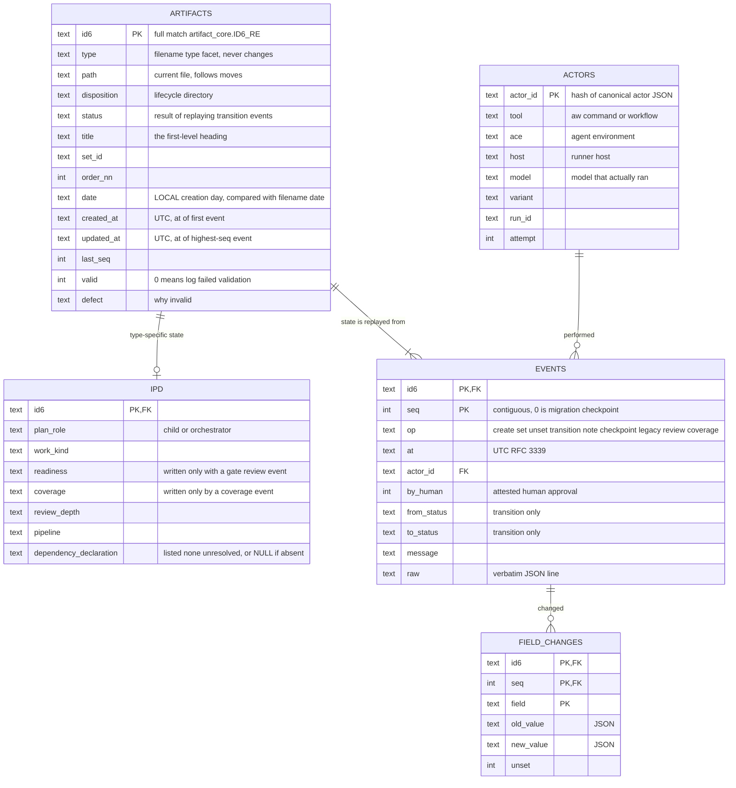
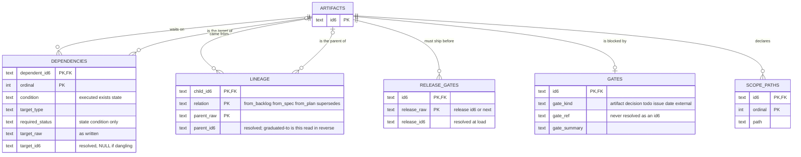
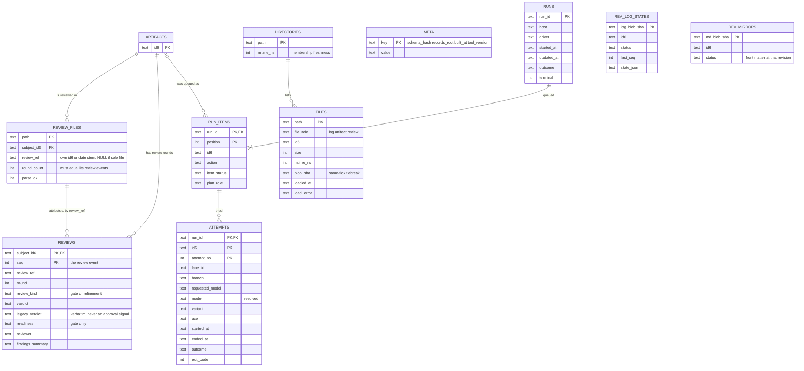
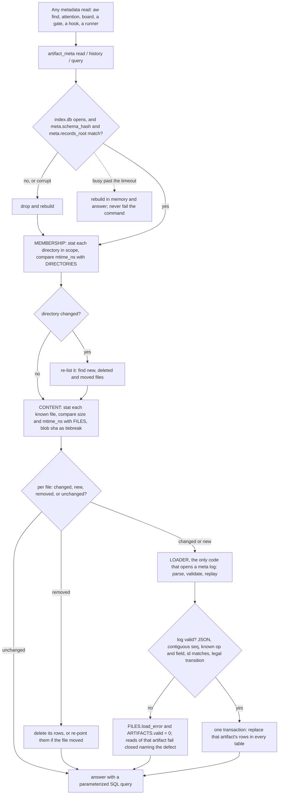
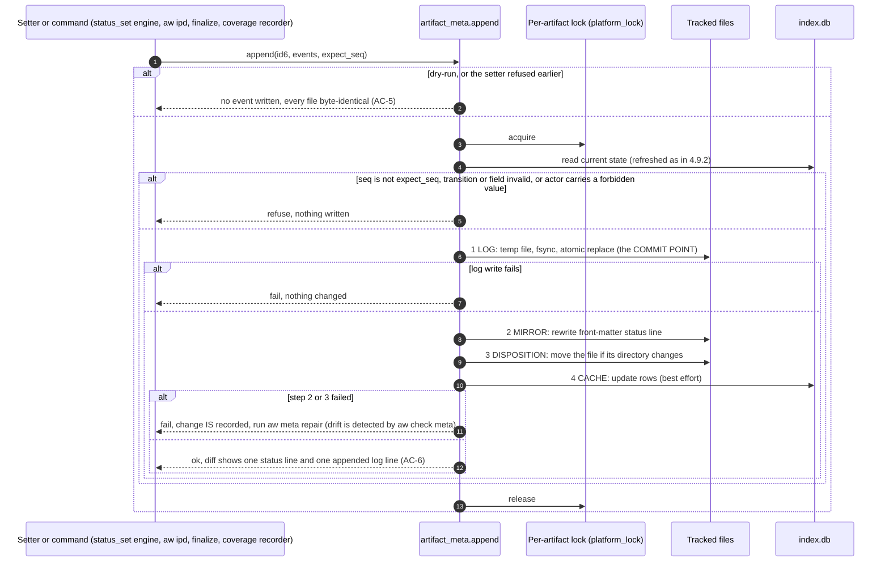
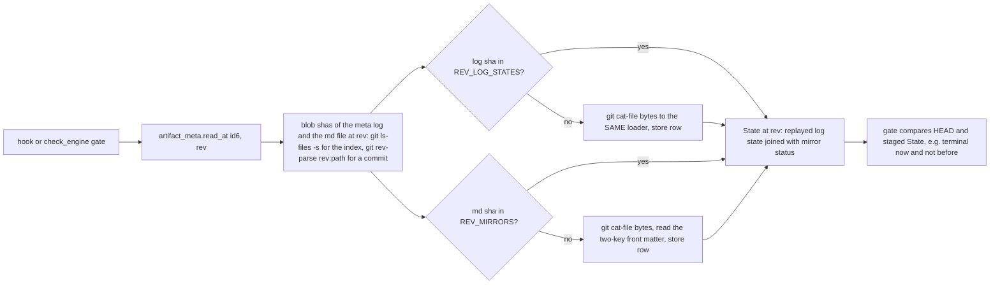
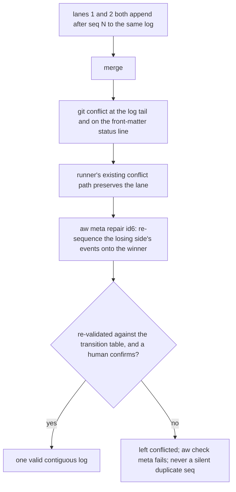
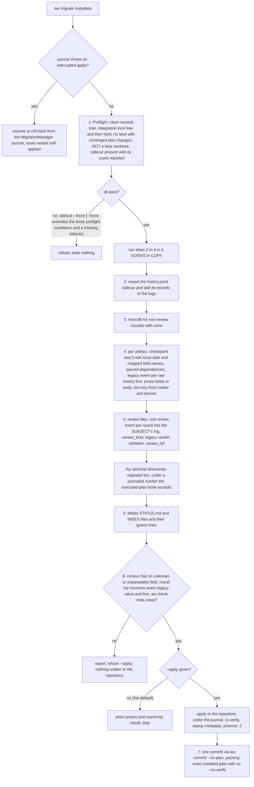
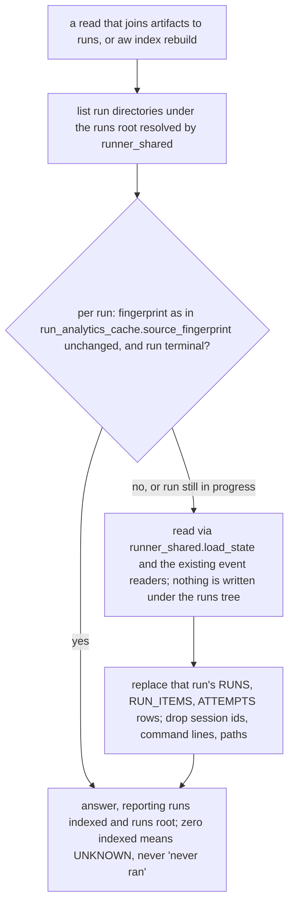

# Spec: Artifact metadata store: id+status front matter, per-artifact event logs, SQLite cache

- Date: 2026-09-25
- Status: reviewed
- Blocks-Release: next
- Id: 4sd62s
- Author: aw specs new
- Scope: Move all aw artifact metadata and history into tracked per-artifact JSONL event logs at .aw/records/meta/<id6>.jsonl; compact front matter (id, status); a gitignored SQLite cache built only from the logs is the sole read path and replaces INDEX.* and STATUS.md; facade-first build, then a hard cutover via aw migrate metadata
- Work-Kind: feature
- Relation to prior work: SUPERSEDES approved spec `2vev8j` (artifact metadata storage), maintainer ruling 2026-10-24 (spec-review round 2, SR-102). Its surviving rules are FOLDED IN here: seq ordering (4.3 -> this spec 4.2), the UTC and reader-clock rule (4.4 as amended 2026-10-13 -> this spec 4.2b), the cache rule (4.6 -> 4.5), and legacy import (4.7 -> 4.2a). Its backward-edge ruling (4.8) already lives in the IPD spec and `ipd_lifecycle._LEGAL_BACKWARD_EDGES`. Its C4, 4.5, C8 and AC-11 are REPLACED, and its OQ-2/OQ-3 are resolved. Section 9 lists the specs this one must stay compatible with.

- Set: metastore
## 0. Terms used in this spec

This section is informative. It defines each term once, and the rest of the spec uses the same term
for the same concept.

| Term | Meaning |
|---|---|
| record | Any tracked Markdown (`.md`) file under `.aw/records/`, except README files. |
| artifact | A record that has a lifecycle status and an `id6` (plans, specs, backlog items, research, releases, prompts). Review records are records but not artifacts (4.1a). Some artifacts do not have an `id6` yet; the migration gives them one (5.2 step 3). |
| corpus | All tracked records in this repository. |
| terminal directory | A lifecycle directory for a final status: `executed/`, `done/`, `superseded/`, `implemented/` or `not-executed/`. |
| Set | A group of related plans that share a Set id in their filenames. The orchestrator plan has order `00`, and the child plans have order `01` and higher. |
| subject | The artifact that a review record reviews. |
| aw-owned field | A metadata field that `aw` commands write and read, as opposed to body prose. |
| `id6` | The stable six-character identifier of an artifact (lowercase letters and digits). |
| plan, IPD | An Implementation Plan Document. The filename type facet is `ipd`. |
| field | One named metadata value of an artifact, for example `status` or `blocks_release`. |
| bullet block | The legacy metadata format: `- Field: value` lines at the top of a record. |
| front matter | The block between two `---` lines at the start of a record. (Some legacy function names, such as `_front_matter_bullets`, use the name for the bullet block.) |
| event | One immutable entry that records one change to an artifact. Its `op` value states the type of change (4.2). |
| event log, log | The tracked file `.aw/records/meta/<id6>.jsonl`, which holds every event of one artifact, one JSON object per line (JSON Lines, JSONL). |
| `seq` | The sequence number of an event in its log: 0, 1, 2, and so on, with no gaps. |
| replay | Calculate the current state of an artifact: start with no values, apply each event in `seq` order, and let each event overwrite the values that it changes. The values that remain after the last event are the current state. Example: events `create status=draft`, `transition draft->to-review`, `set blocks_release=next` replay to `status=to-review, blocks_release=next`. |
| current state | The result of a replay. |
| cache | The gitignored SQLite database `.aw/state/index.db`. It holds a copy of the replayed state and a read-only index of the run records (4.5b). The toolkit can delete and rebuild it at any time. In this spec, "cache" always means this database, never the operating-system file cache. |
| SQL | Structured Query Language, the query language of SQLite. |
| loader | The one component inside `artifact_meta` that fills the cache. After the cutover, it reads the log files. Before the cutover, the legacy loader has this role and reads the bullet blocks and history sections of the `.md` files (4.3). |
| mirror | A copy of a logged value outside the log, kept for people or for the filename grammar, for example the front-matter `status` line. |
| drift | A difference between a mirror and the current state. |
| disposition | The lifecycle directory that holds an artifact, for example `pending/` or `executed/`. |
| registry | The table in `artifact_meta` that lists every allowed field for each artifact type, with its value type. |
| gate | A check that refuses an action, for example a pre-commit hook or an `aw check` rule. Two other terms use the same word: a "gate review" is a review event with `review_kind: gate` (4.1a), and a "blocked-by gate" is the `Gate-Kind`/`Gate-Ref` fields of a blocked item. |
| blob sha | The hash that git uses to identify the content of one file version. |
| setter | An `aw` command that changes metadata, for example `aw specs set`. |
| attestation | A field that records that a step happened, for example `readiness` or `coverage`. |
| worktree, lane | A git worktree is an extra checkout of the same repository. The runner gives each plan it executes its own worktree, which it calls a lane. |
| sidecar | The gitignored file `.aw/records/history.jsonl`, which holds history records that exist only on the maintainer's machine. |
| cutover | The one-time migration run (`aw migrate metadata`, 5.2) that converts the repository from the bullet-block format to the log format. The cutover commit is the one commit that this run makes. |
| facade-first | The build order in section 7: first build the `artifact_meta` interface over the old format, then move every caller onto it, and only then change the storage format. |
| phase A, B, C | The three build phases of section 7. Phase B moves every consumer onto `artifact_meta` while the legacy format is still on disk. |
| interface | The functions that `artifact_meta` provides (4.3). |
| maintainer | The human who owns this repository and makes the decisions recorded here. |
| round, finding (`SR-nnn`) | A spec review round, and a numbered issue that a round found. The review record is `.aw/records/reviews/20260925-4sd62s-01-4sd62s-artifact-metadata-store.review.md`. |
| UTC, RFC 3339 | Coordinated Universal Time, and the standard timestamp text format (`2026-10-25T09:30:00Z`). |
| H1 | A first-level Markdown heading (`# Title`). |

## 1. Problem statement

Today, each Markdown artifact stores its metadata as a hand-editable bullet block. It also has a
`## Workflow history` section, which only grows.

The table below shows measured values. The values were measured at these points:

| Label | Point of measurement | HEAD commit |
|---|---|---|
| (authoring) | Authoring, 2026-09-25 | `83b14a5f` |
| [round 1] | Review round 1, 2026-09-25 | `44df26b3` |
| round 2 | Review round 2, 2026-10-24, about 7,950 commits after the earlier measurements (the original text does not name the reference commit) | `46ab9fdbf` |
| (no label) | Review round 5, 2026-10-24 (full re-measurement) | `e12f81ac1` |
| r6 | Review round 6 (spot check) | `61fce3bfd` |
| r7 | Review round 7 (spot check) | `2edf1f3ac` |

Values without a label are round-5 values. Values in square brackets are round-1 values, shown only
where they differ from round 5. The values
change daily, so the implementing plan must measure them again. The corpus more than doubled between
round 1 and round 5. This growth is the strongest reason to do this work before release 2.0.0.

| Fact | Value |
|---|---|
| Package modules that read or write bullet metadata | 49 of 208 [37 of 174], found with a broad `rg` search for the bullet patterns |
| Independent general-purpose key/value metadata parsers | 11 or more [about 9]: `ipd_schema.parse_metadata_block`, `runner_shared._front_matter_bullets`, the `status_set` `finditer` loop, `plan_readiness._OQ_FIELD_RE`, `backlog.parse_item`, the `specs._read_*` line readers, `research_contract.parse_frontmatter` (YAML), `comms.parse_envelope_header`, `prompts.read_metadata_id6` and `read_metadata_status`, `prompts_index._parse_metadata_comment` (new since round 1), `review_findings._META_RE`, the shared history-block reader in `attention_contract` (backlog `kgv213`), and the per-field public readers `selectors.read_front_matter_id`, `_status` and `_blocks_release`, which 9 modules use. Smaller helpers: `check_engine._metadata_status`, `releases._in_metadata_region`, `attention._frontmatter_block` |
| Copies of the `Id`, `Status` and `Set` regular expressions | 95 regular-expression literals [more than 50]. 86 of them are anchored on `^-`, in 30 files. They use different whitespace patterns (`^- ` 71 times, `^-\s*` 18 times, `^-[ \t]*` 9 times) and different capture rules. One real result, fixed on 2026-09-25 in commit `44df26b3`: `attention._plans_id` showed plan `je74a0` as `je7` on the board |
| Modules that refer to `## Workflow history` | 27 [23]. They use four incompatible orderings (see `2vev8j` section 1) |
| Readers that give different results for the same records | `selectors` and `plans_index` disagree on 24 plans (see the PARITY CONSTRAINT note in `selectors.py`, which is still present) |
| Different field names used before the first `##` heading | 68 [57]. New since round 1: `Coverage`, `Coverage-Fingerprint`, `Coverage-Checked`, `Scope-Exceeded`, `Close-Evidence`, `Attended`, `Findings` (reviews), and, from specs, `Review-Depth` and `Pipeline` (see 4.2c) |
| Tracked `.md` records under `.aw/records/` | 4,382 (r6: 4,383; r7: 4,391) [1,969]: plans 1,696, reviews 1,275, backlog 1,113, research 171, specs 45, prompts 36, walkthroughs 27, other 19. 2,922 [1,411] have a `## Workflow history` section. 1,535 [549] have no `- Id:` bullet, and 1,275 of these are reviews. 39 non-review records have no `id6` in any form. This count excludes 24 READMEs, 4 prompt-library templates and 2 research templates |
| Review records | 1,275 `.review.md` files (r6: 1,276; r7: 1,278) [338]. In 1,257 files, the `id6` in the filename is the same as the `Subject-Id`, by design. In 18 files (r6: 19; r7: 21), it is not. All of these are `specflow` refinement records for spec `18hh1u`, and each refinement iteration adds one. 5 subjects have more than one review file: `18hh1u` has 18 (r6: 19; r7: 21), and `rtvdak`, `e25iy9`, `l4vw9o` and `urv602` have 2 each. Rounds per file: 1,151 files have one round, 109 have two, 12 have three, 2 have four, and 1 has six. 29 files (r6: 30; r7: 32) have a verdict that is not in `plan_readiness.VERDICTS`: 14 (r6: 15; r7: 17) `REVIEWED - MATERIAL CHANGES APPLIED`, 11 `REVIEWED`, 3 `REVIEWED - NO MATERIAL IMPROVEMENTS FOUND IN THIS ITERATION`, and 1 `REVIEWED - CONVERGED WITH REVISIONS` (see 4.1a) |
| Records in terminal directories | 2,828 [1,055]: `executed/` 1,650, `done/` 1,086, `superseded/` 59, `implemented/` 17, `not-executed/` 16 |
| Generated index files | 6 gitignored `INDEX.{json,md}` files [4], for plans, research and prompts (`prompts_index.py` is new since round 1). Also the committed file `plans/STATUS.md`, which has not been updated since 2026-08-17 |
| History sidecar `.aw/records/history.jsonl` (gitignored) | 413 (r7: 414) records for 296 `id6` values [306 records]: backlog 309, specs 82, research 11, plans 8, walkthroughs 2, roadmaps 1 |
| Commits that only repaired index files, before the index files became gitignored | 14 of 328 commits in 14 days (backlog `ila6vl`) |

Problems that result:

- P1 Duplication. Each consumer reads metadata with its own regular expression. So behavior differs
  between consumers, and a fix in one reader does not reach the others.
- P2 Forgeable attestations. `Readiness`, `Approval` and `Status` are text that any editor can
  write. AGENTS.md has a full section that forbids this. Lint rule `IPD-M107` and the hook
  `status_untooled_gate` can only find such an edit after it is made.
- P3 History is not ordered and is partly lost (`2vev8j`, evidence E1 to E4). Some writers add lines
  at the top, some at the bottom, and some replace lines. The only full history for backlog items and
  specs is the gitignored sidecar.
- P4 Context cost. Each time an agent reads an artifact, it also reads about 16 metadata bullets and
  the full history. The task almost never needs the history.
- P5 Query cost. `aw find`, `aw attention` and `aw ipd board` read all records on each call. The
  worst duplicate reads were removed after round 1 (backlog `59t9x5`, Set `findonce`; backlog `8cpbia`,
  plan `jpn6hy`; both closed, the backlog items as `done` and the plan as `executed`). So P5 now comes from the full read itself, and that cost grows with the
  corpus. AC-13 measures this cost. This spec does not state a value for it.

## 2. Evidence and options considered

The maintainer asked for the best solution for cost, maintainability and user experience. The
maintainer also noted that almost no one else uses the toolkit yet, and that no release was made
after 1.2.0. So a change that breaks compatibility costs other users almost nothing.
`CHANGELOG.md` already has an entry `2.0.0 (pending)`.

The number of commits in `v1.3.0-rc.1..HEAD`, as recorded at each point in section 1: 4,050 at
authoring, 4,125 at round 1, 12,133 at round 3, 12,135 at round 4, 12,137 at round 5, 12,139 at
round 6, and 12,144 at round 7. A later recount with `git rev-list --count` can give a slightly
different value for the same commit (for example 4,120 for the authoring commit).

The storage options below were compared against how this repository executes plans: each executed
plan gets its own isolated git worktree, and `runner_shared.integrate_lane_branch` merges the result back.

| Option | Decision | Reason |
|---|---|---|
| O1 SQLite as the tracked authority | Rejected | The file is binary, so each parallel lane that finalizes causes a merge conflict. A diff or review cannot show the changes. It breaks the code that compares HEAD with staged content (see the 4.4 list). A SQLite merge driver works only on the local machine, and `git clone` does not copy it. |
| O2 A gitignored SQLite file as the only store, including history | Rejected | A fresh clone, CI (continuous integration), a second machine or a collaborator gets no metadata. `2vev8j` evidence E4 measured this loss: at that time, 176 of 177 sidecar records existed on only one machine, and at round 2 the sidecar held 408 records that exist nowhere else. Gate `IPD-S405` and the finalize evidence gates would fail on any checkout that has no database. O5 also uses SQLite as the only read path, but O5 never uses it as the store. That is the difference between O5 and O2. |
| O3 History from `git log` and commit trailers, indexed by SQLite | Rejected | Squash merges and rebases remove intermediate transitions. Shallow clones, source distributions and tarballs lose history. A hand edit followed by a raw commit skips an event without any warning. Every writer would have to follow a commit-trailer convention. |
| O4 One state file `<id6>.json` per artifact, with a history array | Rejected | The file stores state and history side by side, so they can disagree. This needs a drift check inside each file, in addition to the front-matter drift check. Each change produces a diff of several lines. |
| O5 One append-only event log `<id6>.jsonl` per artifact as the tracked durable record, and SQLite as the only read path, built only from the logs (4.5) | Chosen | The logs are tracked, so they survive a clone, a squash merge and a tarball. The path depends only on the `id6`, which never changes, so renames and moves never change it. Different artifacts never write the same file (C3). Each change adds one line. The `seq` number sets the order. State cannot contradict history, because the toolkit calculates state from history. Every reader queries SQLite (maintainer decision 2026-10-24, finding SR-101), so no consumer parses a log, and queries use indexes. |

Front-matter options:

| Option | Decision | Reason |
|---|---|---|
| F1 `id` only | Rejected | People could no longer see the status on GitHub, in raw file views or in `.md` diffs. |
| F2 `id` and `status` | Chosen (maintainer, 2026-09-25) | Status is the one field that people look for. The cost is one mirrored field, which a drift check keeps correct. |
| F3 All current fields, as YAML | Rejected | It is not compact, and it brings back P1 and P2. |

## 3. Criteria

Each criterion has a label:
- `[Must]`: a mandatory requirement.
- `[Constraint]`: a mandatory limit on the solution that the maintainer set.
- `[Want]`: a desired result that is not mandatory.

- C1 `[Must]` The per-artifact event log is the only authority for every aw-owned metadata field and
  for all history. No other surface (front matter, filename, SQLite, directory) is an authority.
  Section 4.6 names the surfaces that are deliberate mirrors of the log, and `aw check meta` checks
  each mirror against the log.
- C2 `[Must]` A fresh clone, including a clone made with `--depth 1`, contains all current metadata
  and the full history.
- C3 `[Must]` Two lanes that change DIFFERENT artifacts never write the same tracked file.
- C4 `[Must]` The order of events comes only from `seq`. Line position, dates and commits never set
  the order (from `2vev8j` C1).
- C5 `[Must]` Exactly one read/write interface, `artifact_meta`, handles metadata. No module outside
  it parses front matter or event logs.
- C5a `[Must]` The SQLite cache answers every metadata read, through `artifact_meta`. This applies to
  every command, gate, hook, runner and workflow helper. The loader inside `artifact_meta` is the only
  code that parses a `meta/*.jsonl` log. No other code opens a log, not even to read it (maintainer
  decision 2026-10-24, finding SR-101). The log stays the durable, tracked record, and the log is
  correct when the log and the cache disagree (4.5).
- C6 `[Must]` A refused change or a `--dry-run` change writes no event. If the event write fails, the
  change fails (from `2vev8j` C5).
- C7 `[Must]` A review diff shows each status change: the front-matter `status` line and one added
  event line.
- C8 `[Constraint]` The change adds no runtime dependency. `sqlite3` and `json` are in the Python
  standard library, and `filelock` is already a dependency.
- C9 `[Constraint]` Hard cutover: after the migration, the toolkit reads only ONE format. There are
  no readers for two formats (maintainer, 2026-09-25).
- C10 `[Constraint]` The metadata in filenames (date, Set id, `NN` order, `id6`, slug, type facet)
  does not change (maintainer, 2026-09-25). The filename stays a checked mirror of `set` and `order`.
- C10a `[Must]` During implementation, every commit on `main` reads and writes exactly ONE on-disk
  metadata format. The test suite passes at every such commit:
  - The core tier (bare `python3 -m pytest`, which is the runner's merge gate) passes at every merge.
  - The thorough tier (`make test-all`) passes at the end of each phase of section 7 and at the
    cutover commit.

  Before the cutover commit, that one format is the bullet-block format, and code reaches it only
  through `artifact_meta`. From the cutover commit, it is the log format. This is how the toolkit
  satisfies C9 when the runner merges each plan to `main` as soon as the plan is done (section 7;
  maintainer decision 2026-10-24, finding SR-103).
- C11 `[Want]` An agent reads fewer bytes for each artifact, and `aw find`, `aw attention` and the
  board run faster. AC-13 measures both.

## 3a. Non-goals

- N1 This spec does NOT change the artifact naming grammar or the lifecycle directories (`pending/`,
  `executed/` and so on). Directories still show the disposition.
- N2 This spec does NOT change the status vocabularies or the lifecycle transition tables. (The
  backward-edge decision of `2vev8j` 4.8 is already in the IPD spec and in
  `ipd_lifecycle._LEGAL_BACKWARD_EDGES`.) This spec adds only one vocabulary: the refinement review
  verdicts (4.1a). That vocabulary applies to a new event type and changes no status.
- N3 This spec does NOT move prose. Body sections (execution and validation checklists, open
  questions, execution and validation (E/V) items) stay in Markdown. Only aw-owned metadata fields and history move.
- N4 This spec does NOT change comms envelopes. It does NOT change how the toolkit stores or writes
  run records (`.aw/records/runs/`) and run analytics. The cache indexes run records, read-only (4.5b;
  maintainer decision 2026-10-25, finding SR-701). The cache never writes to them, and they stay
  gitignored and local to one machine.
- N5 This spec does NOT include a period in which both formats are in use (C9).

## 3b. Acceptance criteria

In this table, "pasted" means that the implementer pastes the actual command output or test output
into the plan's validation evidence.

| ID | Covers | Criterion | Evidence that satisfies it |
|---|---|---|---|
| AC-1 | C1, C5 | No module outside `artifact_meta` reads or writes front matter, bullet metadata, `## Workflow history` or `meta/*.jsonl`. | (1) A pasted `rg` search of `agent_workflows/` for the legacy bullet and heading patterns and for `records/meta`. It finds matches ONLY in `artifact_meta.py` and `migrations/m0001_metadata_v2.py`. Body-prose bullets that N3 keeps in Markdown (for example the `Carrier`, `Carrier-Evidence` and `Carrier-Declined` bullets in plan open-question rows) are not counted: the `rg` command excludes them with an explicit pattern that the evidence lists, never silently. (2) A behavioral test that creates a test repository and shows that the result of a metadata command changes only through `artifact_meta`. The test must not read source code (the repository's no-code-pinning rule). |
| AC-1a | C5a | The cache serves every metadata read, and only the loader opens a log. | From the cutover commit: (1) A test builds the cache. It then counts every open of a `meta/*.jsonl` file during `aw find`, `aw attention --format json`, `aw show <id6> --history`, a status setter, `aw check meta` and one pre-commit gate (for example with an `open` audit hook in a subprocess). It asserts that the output does not change and that the loader made every open. (2) A test edits a log without `artifact_meta`, as a `git pull` does, and asserts that the next read shows the edited log. Both pasted. In phase B, the same tests run against the legacy loader and the artifact `.md` files (3c). |
| AC-1b | C10a | `main` uses one format and passes its tests at every commit of the Set. | For each merge of a child plan, the pasted core-tier summary line. For the end of each phase and for the cutover commit, the pasted thorough-tier summary line. For the cutover commit, a pasted check that no migrated record still has a bullet block, and that no `meta/` directory existed before that commit. |
| AC-2 | C2 | A `git clone --depth 1` contains the full state and history. | Clone into a temporary directory. Run `aw show <id6> --history` on a migrated plan that has several events. Paste the output. |
| AC-3 | C3 | Two branches that change the status of different artifacts merge without conflict. | A pasted two-branch merge test. |
| AC-4 | C4 | The order of a replay does not depend on the order of lines in the file. | A test that shuffles the lines of a log and asserts that the `seq`-ordered replay gives the same result. A test that refuses a log with a gap in `seq` or a duplicate `seq`. |
| AC-5 | C6, 4.3 | (1) A refused transition and a dry-run transition leave the log byte-identical. (2) A forced failure of the log write leaves every file unchanged. (3) After a forced failure after the log write (in the mirror step or the move step), the setter reports a failure that names `aw meta repair`. `aw check meta` detects it, and `aw meta repair --apply` restores every file. | Pasted tests for each case, with a forced failure at each of the 4.3 write steps. |
| AC-6 | C7 | The diff of a status transition shows the front-matter `status` line and one added log line. | A pasted `git diff` of a real transition. |
| AC-7 | 4.6 | `aw check meta` compares every mirror (front-matter `status`, filename `set`/`order`/`id`, disposition directory) with the log. | Pasted `aw check meta` output that detects each type of drift in a test repository. Pasted output that shows zero findings on the migrated corpus. |
| AC-8 | 4.5 | The cache is disposable: deleting it changes no command output. | Run `aw find` and `aw attention --format json` with and without `.aw/state/index.db`. Paste the diff, which must be empty. |
| AC-9 | 4.5, C11 | The `INDEX.*` files and `STATUS.md` are deleted, and nothing creates them again. | Pasted `git ls-files` output and file-system check. An `rg` search for `INDEX.json` and `STATUS.md` in `agent_workflows/` finds only the migration's cleanup code. |
| AC-10 | 5 | A second run of the migration changes nothing. The migration keeps a journal, is a dry run by default, and loses no information. | On a copy of this repository: the dry-run report; an apply; a second apply that changes nothing; and an automated round-trip check that finds every legacy field value and every raw legacy history line in the logs. All pasted. |
| AC-11 | C9 | Every metadata-reading command refuses an unmigrated repository with a message that names `aw migrate metadata`. | A pasted test. |
| AC-12 | C8 | The `dependencies` list in `pyproject.toml` does not change. | Pasted. |
| AC-13 | C11 | Before and after values are measured for: the bytes that an agent reads for one plan, and the end-to-end time of `aw find` and `aw attention`, with a warm and with a cold operating-system file cache, as the AGENTS.md end-to-end rule defines them. | The pasted values, measured by the end-to-end rule in AGENTS.md. This spec sets no target value. |
| AC-14 | 4.1a | A review record has no log of its own. Each review round is ONE `op: review` event in the SUBJECT's log. The number of rounds in a review file equals the number of `review` events that the subject's log attributes to that file. | (1) An `rg` search that shows no `meta/*.jsonl` file is created for a review. (2) A test that records a review and asserts that exactly one `review` event is added to the subject's log. (3) `aw check meta` output that detects a round-count mismatch in a test repository. All pasted. |
| AC-14a | 4.1a | Review kinds are typed. A `gate` event accepts only `plan_readiness.VERDICTS`. A `refinement` event accepts only the refinement vocabulary and never has `readiness`. The migration keeps each legacy verdict unchanged. | Pasted tests: (1) a `gate` event with a refinement verdict is refused; (2) a `refinement` event that has `readiness` is refused; (3) any number of `refinement` rounds are added in `seq` order; (4) both setter spellings refuse `->reviewed` for a spec whose log has only `refinement` review events, and `check.spec-review-unattested` reports it, while one `gate` event (migrated or new) satisfies the rule (4.4, finding SR-601); (5) after the migration of a test corpus that contains each DIFFERENT off-vocabulary verdict string found in the corpus at implementation time, every original verdict string can be recovered byte for byte. (At round 5 there were 4 different strings in 29 records; 30 records at round 6 and 32 at round 7.) |
| AC-15 | 4.4 | For a plan, the setter refuses a `readiness` value unless the same append adds an `op: review` event with `review_kind: gate` for that plan, in the same transaction. The same rule applies to the coverage fields (`coverage`, 4.4). | Pasted tests: (1) a `set readiness=go` without a review event is refused; (2) the same write with a gate review event succeeds; (3) the same two cases for `coverage`. |
| AC-16 | 5.2 | Only the migration may rewrite artifacts in terminal directories. The migration makes exactly one commit, and that commit passes every installed gate. | Pasted output that shows: (1) the migration commit passes the executed-plan hook, `backlog_blocking_close_gate` and the pre-push gate `aw attention --check --agent`, without `--no-verify`; (2) after the cutover, the hook still refuses a separate raw edit to an executed plan. |
| AC-17 | C3, 4.7 | Two lanes that change the SAME artifact cause a conflict that the toolkit reports. No merge can produce a log with a duplicate `seq` that `aw check meta` accepts. | A pasted two-branch test on one artifact. It asserts that the merge does not produce a valid log with a duplicate `seq`: either git reports a conflict, or `aw check meta` fails. |
| AC-18 | 4.5 | With a `companion` or `home` records backend, the logs are next to the records that they describe, and the cache still works. | A pasted test with a companion backend that shows `meta/<id6>.jsonl` under the resolved records root, and a working `aw find`. |
| AC-19 | 4.2b | The check compares the creation date in the log on the same clock that wrote the filename date. | A test artifact created at 23:30 local time on a host whose local time is behind UTC: `aw check meta` reports no filename-date drift. `tests/test_date_reader_clock_parity.py` (or the test that replaces it) passes after the date readers are changed to use `artifact_meta`. Both pasted. |
| AC-20 | 4.2c | The registry contains every field that the corpus or an approved spec uses, and the migration drops no field unless the census records the drop as deliberate. | The migration dry-run's field census for this repository, pasted. It lists every different field name used before the first `##` heading, with its destination (log field, body section, or a recorded deliberate drop), and it shows zero `unknown-field` refusals. |
| AC-21 | 4.4a | This spec meets the obligations that executed plans gave to it. | For each row of 4.4a, the pasted evidence that the row names. |
| AC-22 | 5.2 | The cutover refuses to run when the history sidecar is not present. When it runs correctly, it does not lose the sidecar records. | (1) A test that runs the migration preflight in a lane-style worktree that has no sidecar, and asserts a refusal that names the sidecar. (2) The real cutover's preflight line that reports the sidecar record count. Both pasted. |
| AC-23 | 4.5, 4.5a | The cache schema is the schema in 4.5a, and the toolkit generates it from the registry. | Pasted: (1) a test that compares the table set and the columns of each table with 4.5a; (2) a test that adds a field to the registry, with no other change, and shows that the next read rebuilds the cache and has the new column; (3) `EXPLAIN QUERY PLAN` output that shows an index is used for: `aw find` by status and Set, "which artifacts depend on X", and "the latest gate review of X". |
| AC-24 | 4.2, 4.5a | Dependencies, lineage and actors keep their structure through a migration and a replay. | Pasted: (1) a migration test with each form of `Item-Dependencies` (`executed:`, `exists:`, `state:`, `none`, `unresolved`, and no field). It asserts the parsed conditions and the `dependency_declaration`, and that `none` and "no field" stay different. (2) A test in which the writer refuses an event whose `actor` contains a session id, a path or a user name, and the leak sanitizer reports it. (3) `aw graduation` gives the same result in both directions, using only the `lineage` table. |
| AC-25 | 4.5b | The cache indexes run records read-only. The toolkit never presents "no run data" as "never ran". | Pasted: (1) a test that indexes a test runs tree into `runs`, `run_items` and `attempts`, with rows that match the output of the runner's own readers; (2) a byte-for-byte check that indexing changed no file under the runs tree; (3) on a fresh clone, a query for the attempts of an artifact reports `runs_indexed: 0` (unknown) and not an empty success. |
| AC-26 | 4.3 | The next read shows a new, deleted or moved record, with no `aw index rebuild`. | Pasted tests that add a log and an artifact, delete one, and `git mv` one into another disposition directory without `artifact_meta` (as a pull or checkout does). After each change, `aw find` shows the change. |

## 3c. Honest limits

- The size counts in sections 1 and 6 come from one inventory pass. The implementing plan must measure
  them again.
- Two lanes that change the SAME artifact still conflict at the end of its log. This is expected to
  be rare, because each lane owns different plans. The toolkit reports the conflict and does not
  resolve it automatically (4.7).
- Tool-written events make forged attestations HARDER, but not impossible. Anyone with write
  access, a person or an agent, can still add a line by hand. Hooks and `aw check` detect malformed events and events that
  no tool wrote. Neither is an enforcement boundary. (The integration lock has the same limit.)
- The front-matter `status` line is a mirror that can drift after a hand edit. The toolkit detects the
  drift. It does not prevent it.
- The token savings (C11) are an expectation until AC-13 measures them.
- C2 applies to the RECORDS. It does not apply to data that exists only on one machine. `aw attention`
  also shows stranded lanes and run state, which are in the gitignored `.aw/records/runs/` directory and
  in worktrees. A fresh clone has none of this data, before and after this spec. C2 does not mean that a
  clone shows everything that one machine shows.
- The review verdict becomes tool-written (4.1a), but the findings and decisions TABLES stay as text
  in the review file. A person can still change a severity or a decision by hand. Only the existing
  `review_findings` parse rules and gating rules detect this. The log does not.
- The migration rewrites every terminal artifact one time (5.2 step 4a). This one commit is a
  deliberate exception to the rule that no commit changes an executed plan. After it, `git blame` on
  those files shows the migration commit. The logs keep the history. Line-level blame of the old
  bullet blocks is lost.
- "SQLite is the only read path" (C5a) applies to the code of THIS toolkit, and a behavioral test
  checks it. A person or another tool can still read a log with `cat`, and git reads logs during a
  merge. Neither is a metadata read in the sense of C5a. The SQLite file is never the durable record:
  deleting it loses nothing (AC-8), and the tracked log is correct when the two disagree.
- In phase B of the facade-first order (section 7), `artifact_meta` reads the LEGACY format. Until
  the cutover commit, the cache gets its data from bullet blocks, not from logs. So the C5a rule "only
  the loader parses a log" can be tested only from the cutover commit. Before that commit, the
  testable rule is the same rule applied to the artifact `.md` files: only the legacy loader parses
  metadata from them (AC-1, and the phase-B form of AC-1a).
- The cutover depends on data that exists only on one machine. The gitignored history sidecar holds
  the only copy of 413 records, and it exists only in the maintainer's main checkout. So the cutover
  must run there. It must not run in a runner lane worktree, which has no sidecar (AC-22). For this
  reason, a person must attend the cutover, and the runner cannot do it unattended.
- A tooled write is NOT atomic across files (4.3, finding SR-705). The log write is atomic. The
  front-matter update and the directory move come after it. A crash between these steps leaves drift
  that the toolkit can detect and repair deterministically. It never leaves lost or contradictory history. But for a
  short time, a reader can see a `status:` line or a directory that is behind the log.
- The run index (4.5b) is local to one machine and is incomplete by design. It shows only the runs
  whose records exist on this machine. A count of zero means "unknown", not "never ran".
- The writing tool supplies the `actor` object, and nothing verifies it (comms senders have the same
  limit). It records who CLAIMED to act. It does not authenticate the agent or the model.
- C10a depends on the test suite finding each regression. In phase B, a behavior that no test
  exercises can change without anyone noticing. For this reason, each phase-B plan must name the
  behavior that its moved consumers had and the test that checks it (section 7).

## 4. Design

### 4.1 Artifact file shape

```
---
id: abc123
status: approved
---
<!-- aw-managed: metadata lives in .aw/records/meta/<id>.jsonl; use `aw show <id>`; agents read .aw/AGENT_QUICKSTART.md -->
# <Title>
...body...
```

- The front matter uses YAML delimiters (`---`). An artifact has exactly two keys, `id` and
  `status`, in that order. A review record has `subject`, `subject_type` and an optional `ref` (4.1a).
  `artifact_meta` parses the front matter with a strict line grammar, not with a YAML library. This
  avoids a new dependency (C8) and removes ambiguity.
- The banner is ONE HTML comment. The proposed `# START README FIRST` H1 block was rejected for three
  reasons:
  - GitHub shows an H1 as a large heading.
  - It conflicts with the "first H1 is the title" rule in the `ipd_schema` section-order checks.
  - About 80 tokens in each of about 2,000 files is a real cost that repeats on every read.

  GitHub does not show the comment, and agents still read it. `artifact_meta` owns the exact text as
  a template, and a check confirms that the comment is present. For artifacts, the comment
  points to `meta/<id>.jsonl` and `aw show <id>`. For review records (4.1a), the text is:
  `<!-- aw-managed: review metadata lives in .aw/records/meta/<subject>.jsonl; use aw show <subject>; agents read .aw/AGENT_QUICKSTART.md -->`.
- The installer creates `.aw/AGENT_QUICKSTART.md` and `.aw/QUICKSTART.md`. These files do not exist
  today.
- Records have no `## Workflow history` section. `aw show <id6> --history` shows the history.
- Records that are not artifacts (walkthroughs, research reference packages, comms messages)
  get front matter only if they have an id today. The plan decides this for each type. The plan must
  also decide, by name, how to handle:
  - `roadmaps/` (1 record, metadata in bold prose, excluded from attention by decision `uxb0tz`);
  - `prompt-library/` (4 files, no id);
  - research companion directories `<doc-stem>.data/` (backlog `mtdxiu`);
  - READMEs, which are not records and are excluded.

### 4.1a Review records are events in their SUBJECT's log

MAINTAINER DECISION, 2026-09-25, made during spec review (finding SR-001).

THE PROBLEM: the `id6` in a review record's filename is the `id6` of the REVIEWED artifact. This is
a deliberate design, so that the link survives renames (`.aw/records/reviews/README.md`, section
"Naming": "`<id6>` is the REVIEWED ARTIFACT's id6, not a fresh identifier"). At round 1, all 338 review
records used the `id6` of their subject, and none had an id of its own. With the path rule in 4.2, a
review and its subject would therefore use the SAME file `meta/<id6>.jsonl`. The second writer would
damage or refuse the first writer's history. The first version of this spec did not address this, and
its field list in 4.2 named `subject-id/type (reviews)`, which implied that reviews get a log.

THE DECISION: a review has NO log and NO id of its own. Each review ROUND is ONE event in the
SUBJECT's log. A review is metadata about its subject. Also, 4.4 lets only a review event set
`readiness`, so the review must be an event in the subject's log.

RESULTS (points R1 to R4):

R1. A new event type `op: review` (added to the `op` list in 4.2). It has `round` (an integer that
   matches the file's `## Round <n>` heading), `verdict` (one of `plan_readiness.VERDICTS`),
   `reviewer`, and, for a plan, `readiness`. A tool writes the verdict. Today the verdict is a
   hand-editable `- Verdict:` line.
R2. The review FILE keeps its findings and decisions TABLES as readable text (N3). Their shape does
   not change, and `review_findings` still parses them. The file's front matter is `subject: <id6>`
   and `subject_type: <ipd|spec>`, NOT `id:`. So no tool can mistake the file for an artifact with
   its own log.
R3. `aw check meta` (4.6) treats a review file as a DEPENDENT of its subject, not as an orphan. It
   adds one drift rule: the number of rounds in the file must equal the number of `review` events
   in the subject's log.
R4. `review_findings.subject_gating_blocks` still reads the findings of the current round from the
   FILE. Only the verdict and `readiness` move to the log.

REJECTED ALTERNATIVES:
- (a) Reviews get no log, and their fields stay in the file. Rejected because the verdict stays
  forgeable, which is P2, the problem that this spec exists to fix.
- (b) Give each review its own `id6` and link it with a separate field. Rejected because it renames
  all 338 records and reverses the deliberate link-by-subject design, with no benefit that the
  subject's log does not already give.

THIS DECISION CANNOT BE EASILY REVERSED. It sets the review record's front-matter shape and a new
event type in a tracked format that every later review writes. To reverse it later, every review
event must be rewritten.

ROUND-2 AMENDMENT: TYPED REVIEW KINDS (maintainer decision 2026-10-24, finding SR-104). After round
1, the spec-refinement pipeline (spec `18hh1u`, Set `specflow`) started to write review records that
break two assumptions above:
- 18 of these records (at round 3) have their OWN `id6`. Example:
  `20261024-specflow-04-vprs7o-spec-refinement.agy.gemini38flashhigh.review.md`, subject `18hh1u`.
- Their verdicts report whether the refinement CONVERGED (`18hh1u` section 6.3:
  `REVIEWED - MATERIAL CHANGES APPLIED | NO MATERIAL IMPROVEMENTS FOUND`). They do not report approval.

The maintainer requires that this type of multi-round iteration continue to work. Therefore (points
K1 to K6):

K1. Every `op: review` event has `review_kind`, which is `gate` or `refinement`. (The name follows the
   naming rule in 4.5c.)
K2. `/plan-review`, `/spec-review` and `aw ipd recheck-readiness` write `gate` events. The `verdict`
   of a `gate` event is one of `plan_readiness.VERDICTS`. Only a `gate` event can have `readiness`
   (4.4).
K3. An iterative refinement pipeline writes `refinement` events. The `verdict` of a `refinement`
   event comes from a separate closed vocabulary that the registry owns. That vocabulary contains at
   least the two `18hh1u` values. A `refinement` event NEVER has `readiness`. A `refinement` event
   alone never satisfies the transition authority for `->reviewed` (4.4). A subject can have any
   number of refinement rounds. The round number orders the rounds, and `seq` orders all events.
K4. How each event is matched to its review file (`review_ref`):
   - A review record whose filename `id6` differs from its subject keeps its own `id6` as a reference.
     The writer records the reference as `review_ref` in the subject's events and as `ref: <own-id6>` in its
     front matter. (There are 18 such records at round 5, 19 at round 6 and 21 at round 7. All are
     `specflow` refinement records for `18hh1u`.)
   - When several review files use the subject's `id6`, each file uses its date prefix or its
     clustered filename stem (for example `20260930-reqids-02` and `20261007-reqids-02`) as
     `review_ref`, in its front matter (`ref: <stem>`) and in its events. This case applies to the 4
     historical pairs of gate re-reviews for `rtvdak`, `e25iy9`, `l4vw9o` and `urv602`, from
     2026-09-30 and 2026-10-07.
   - A review file that is the only file for its subject, and that uses the subject's `id6`, has no
     `review_ref`.
   - No record is renamed.

   A subject can have SEVERAL review files (5 subjects have more than one at round 5, and `18hh1u`
   has 18). So the round-count rule in 4.6 counts events for each pair of subject and review file. It
   compares each file's rounds with the subject's `review` events that have that file's `review_ref`.
   For a subject that has only one file, it uses the events that have no `review_ref`. It never
   compares one file with all of the subject's events.
K5. The migration keeps every legacy verdict string UNCHANGED in the event field `legacy_verdict`. The
   vocabulary checks apply only to events written after the cutover. So the migration keeps the 29
   off-vocabulary verdicts measured at round 5, and it does not map them to new values (the
   legacy-import rule, 4.2a). These were 14 `REVIEWED - MATERIAL CHANGES APPLIED`, 11 `REVIEWED`, 3
   `REVIEWED - NO MATERIAL IMPROVEMENTS FOUND IN THIS ITERATION`, and 1
   `REVIEWED - CONVERGED WITH REVISIONS`. The migration sets `review_kind` from the writer, where the record shows the writer: the `specflow`
   refinement files are `refinement`, and all other files are `gate`. No readiness check and no
   approval check uses an event that has `legacy_verdict`.

   K5a. A file's `- Verdict:` line is ONE verdict for the whole file, but a file can have several rounds
   (124 files had two or more rounds at round 3). So the migration puts the file's verdict, and the
   file's one `Reviewer` value and one `Reviewed-At` value, on the event of the LAST round only. The
   events of earlier rounds have `legacy_verdict: null` and the observed round number. A verdict for
   each round would be invented data (4.2a).
K6. The other bullet-block fields of a review record become fields OF THE REVIEW EVENT: `Reviewer`
   becomes `reviewer`, `Reviewed-At` becomes `at`, and the `Findings` summary bullet becomes
   `findings_summary`. (`/plan-review` started to write the `Findings` bullet on 2026-10-12. 431
   records have it.) `Findings` is a summary of the file's findings table, so a check compares the
   event value with the table and does not trust it.

Coordination: spec `18hh1u` is at `draft`. Whichever of the two specs is implemented second must
agree with this section. The registry owns the refinement verdict vocabulary. The text of neither
spec owns it.

### 4.2 Event log: `.aw/records/meta/<id6>.jsonl`

- The log files are tracked. They are in one flat directory. (This resolves `2vev8j` OQ-3. About
  3,100 logs at round 2 is not a problem for git or for file systems. Splitting the directory later is
  a change that can be reversed.)
- Every interface call and every path calculation validates `<id6>` with a FULL match against
  `artifact_core.ID6_RE` (`\A[0-9a-z]{6}\Z`). This prevents directory traversal. A `^...$` pattern
  with `re.match` is NOT sufficient, because `$` also matches before a final newline.
- Each line is one JSON object, in UTF-8, with sorted keys, no trailing whitespace, and a line feed
  (LF) at the end.
- Event schema, version 1:
  - `v`: the schema version (integer).
  - `seq`: the sequence number (integer), with no gaps, for each artifact. `0` is the migration
    checkpoint of a migrated artifact. `1` is the creation event of an artifact created after the
    cutover (from `2vev8j` 4.3).
  - `at`: an RFC 3339 timestamp in UTC. It is used for display, and for age and staleness comparisons on the UTC
    clock (4.2b). It never sets the order (from
    `2vev8j` 4.4).
  - `actor`: an OBJECT, not a string (round 8, finding SR-702). Keys:
    - `tool`: the `aw` command or workflow that wrote the event, for example `aw specs set` or
      `/spec-review`. Always present.
    - `ace`: the agent environment, for example `opencode` or `antigravity`.
    - `host`: the runner host id, for example `oc` or `agy`.
    - `model`: the model that ACTUALLY ran (the resolved model id).
    - `variant`: the effort level or variant.
    - `run_id` and `attempt` (integer): the run and the attempt that wrote the event.

    Every key except `tool` is written only when the writer knows its value. A key with no value is
    left out; it is never written as `null`. The writer must refuse these values in a tracked log:
    session ids (the leak sanitizer's `session-id` rule, the `ses_` pattern in `leak_sanitizer.py`),
    command lines, file-system paths, user names and host names. These values stay in the
    gitignored run records. The REQUESTED model belongs to the run attempt (4.5b), not to the event.
    The actor is an object now because the log is tracked, and its schema cannot be reversed after
    the corpus is migrated. The cache, in contrast, can be rebuilt at any time. So a query must be
    able to answer "which model changed what in which run" without parsing free text (P1).
  - `op`: the event type. One of `create`, `set`, `unset`, `transition`, `note`, `checkpoint`,
    `legacy`, `review` (4.1a) and `coverage` (4.4).
  - `fields`: for `create`, `set` and `checkpoint`, an object that maps each field to its new value.
    For `unset`, a list of field names.
  - `from` and `to`: for `transition` (a status change). The writer validates them against the
    lifecycle table of the artifact's TYPE. Not every type has a table. At round 2:
    - specs use `attention_contract.SPEC_TRANSITIONS`;
    - backlog items use `attention_contract.BACKLOG_TRANSITIONS` (added after round 1, backlog `cc2m29`);
    - plans use the `ipd_lifecycle` ranks and `ipd_lifecycle._LEGAL_BACKWARD_EDGES`;
    - research, prompts and releases have no table, and only the target VALUE is validated.

    A type with no table validates only the value, as today. This spec does not add tables (N2). The
    implementation uses the tables that exist at implementation time, not this list.
  - `by_human`: a boolean. It is present only on events that a setter records with `--by-human`.
  - `message`: optional free text.
  - `legacy`: for `op: legacy`, the original line unchanged, the observed day, the original position
    in the file, and `ordering_confidence` (`known`, `inferred-from-git` or `unknown`), per 4.2a.
  - For `op: review` (4.1a): `round` (integer), `verdict` (string), `review_kind` (`gate` or `refinement`),
    `reviewer` (string), and the optional strings `review_ref`, `findings_summary`, `legacy_verdict`
    and `readiness` (plans only).
  - For `op: coverage` (4.4): `coverage`, `coverage_fingerprint` and `coverage_checked` (strings).
- FIELD NAMES in the log are lowercase snake_case and follow the naming rule in 4.5c. The migration
  renames the legacy field `Kind` (the plan role: `child`, `orchestrator` and so on) to `plan_role`
  (maintainer decision 2026-10-25, finding SR-703). This rename cannot be reversed, because every
  migrated log and every later writer uses the new name. The other legacy names map one to one: for
  example `Work-Kind` becomes `work_kind`, `Gate-Kind` becomes `gate_kind`, and `Blocks-Release`
  becomes `blocks_release`. The same Set updates the `aw` options and the documents that name `Kind`
  (5.4).
- The log stores `item_dependencies` PARSED, not as the raw bullet text:
  - `dependency_declaration` is `listed`, `none` or `unresolved`. If the field is not present, the
    artifact declared nothing.
  - An ordered list of conditions. Each condition is
    `{condition, target_type, required_status, target_id6, raw}`, and `condition` is `executed`,
    `exists` or `state`.

  The three forms in use today make a closed grammar. Measured at round 8: `executed:<id6>` 464
  times, `exists:<type>:<id6>` 5 times, and `state:<type>:<status>:<id6>` 5 times. `none` is a
  POSITIVE statement, and `ipd_dependency_statement_gate` treats it differently from a missing
  field. So the store must always keep `none` and "no field" separate.
- The current state is the replay of the events in `seq` order (section 0). The log holds EVERY
  aw-owned field (4.2c). Review records have no log (4.1a). The registry in `artifact_meta` lists the
  exact fields for each type, and the writer and the loader refuse unknown fields.
- Prose fields (`Summary`, `Scope`, `Concern`, `Motivation`, `Relation to prior work`) move into BODY
  sections during the migration. They do not go into the log (N3). `title` stays the H1 heading. Today,
  every write path refuses unsafe descriptive values in these fields (specs and releases `uz05bl`,
  research `deftzy`, backlog Summary `dtg7dz`, research checker `xnogdl`). These refusals MUST stay.
  They move with the field to the body-section writer. They also apply to every string value that
  `artifact_meta` writes into a log or into the two-key front matter.

### 4.2a Legacy import without invented precision (taken from `2vev8j` 4.7)

The migration keeps each legacy history line unchanged, as a `legacy` event. The event has the
observed day, the line's original position in the file, and an `ordering_confidence` value (`known`,
`inferred-from-git` or `unknown`). The validated chain of events starts at the `seq` 0 checkpoint,
which accepts the migrated state as correct. The loader does NOT validate transitions across the
unordered legacy events before the checkpoint. Some legacy history went back and forth across several
days, and no reader can order it. With this rule, that history no longer causes false failures, and
the migration does not invent an order. The same rule applies to every other legacy value that has no
exact match in the new vocabulary, for example the off-vocabulary review verdicts in 4.1a. Keep the
value unchanged, mark it as legacy, and do not map it.

### 4.2b One clock for each stored value (taken from `2vev8j` 4.4, as amended 2026-10-13)

- Every writer records the event `at` in UTC. Local time is used only for display. Use the shared UTC
  helper in `artifact_core` (Set `5ivkdh`). Do not write a new helper.
- A READER MUST USE THE CLOCK THAT WROTE THE STORED VALUE. Code that compares a stored date with
  "today" (for age, staleness, retention or cleanup) calculates "today" on the SAME clock that wrote
  the value:
  - A UTC value (the event `at`) is compared with "today" in UTC.
  - A LOCAL value (the filename date prefix, and the workflow-artifacts `RUN_ID`, which
    `DECISIONS.md` D55 defines as local) is compared with "today" in local time.

  Readers do NOT use UTC by default. Reason, from a measurement: plan `840y6i` finding F-01 found ten
  artifacts whose staleness result changed with the reader's time zone.
- RESULT FOR THIS SPEC (finding SR-105). Today, `- Date:` and research `created` are written on the
  LOCAL clock, next to the filename date, which has the same day. When these values move into the log,
  they must not become UTC values. Otherwise, a 4.6 rule "filename date must equal the day of
  `create.at`" would report drift for every artifact created in the evening. So the log stores the
  creation day in a separate LOCAL-clock field, `date` (on `create` and `checkpoint` events). The
  drift rule compares the filename date with `date`, never with `at`. Every reader of `- Date:` changes
  to read that field, and keeps its clock. These readers are: `plans_archive._age_days`,
  `research_archive._age_days`, the dependency-schema and carrier grandfathering in `check_engine`
  (`_DATE_LINE_RE`), the citation plan-date rule in `ipd_lint`, `plans_refs`, `artifact_rename`, and
  `config.applies_to_artifact_date`. Every per-repository cutover in the `cutovers` list of
  `.aw/config/project.json` (8 entries at round 2) uses `config.applies_to_artifact_date` to exempt
  older artifacts by date.
- `tests/test_date_reader_clock_parity.py` (or the test that replaces it) checks this rule (AC-19).

### 4.2c Field registry obligations (round 2, finding SR-106)

For each field that the corpus uses, the registry (OQ-1) must contain the field or record a
deliberate disposition for it. The dispositions are: log field, body section, review-event field, or
a drop with a reason. The migration's field census checks this (AC-20).

The first version of this spec listed these fields: type, set, order, kind, priority, work-kind,
blocks-release, readiness, approval, from-backlog, from-spec, graduated-to, item-dependencies,
gate-kind, gate-ref, gate-summary and version. Round 2 found these additional fields, which the
registry must also include:

| Field | Used by | Source | Required disposition |
|---|---|---|---|
| `coverage`, `coverage-fingerprint`, `coverage-checked` | orchestrator plans (34) | spec `25kzda` 2.5e, `coverage_record.py` | Attestation. Only an `op: coverage` event writes these fields (4.4). |
| `review-depth` | plans | approved spec `k3yx72` (its section 12 maps itself onto this spec) | A field that the gate `review` event sets, per `k3yx72` section 12. |
| `pipeline` (`standard` or `quick`) | plans | reviewed spec `4iyd78` | A field with a closed set of values. The writer refuses any other value. |
| `scope-exceeded` | plans (40) | finalize, `ipd_lifecycle` | A field that the finalize event writes. |
| `attended` | plans (2) | runner | Field. |
| `close-evidence` | backlog (55) | backlog setter | A field that the `done` transition writes. |
| `release-exempt-kind`, `release-exempt-ref` | backlog | `backlog/README.md` (`ghna7l`) | Fields. |
| `scope-paths`, `item-dependencies`, `from-plan`, `supersedes`, `canonical`, `target-id` | several types | existing | Fields. |
| `reviewer`, `reviewed-at`, `findings`, `verdict` | review records | `review_findings.render_review`, `/plan-review` | Review-event fields (4.1a point K6). |

Specs that are still at `draft` add more fields. Spec `18hh1u` adds `Prior-Id`, `Slot`, `ACE`,
`Requested-Model`, `Resolved-Model`, `Variant`, `Iteration`, `Contributors`, `Matrix-Ref` and
`Supersedes`. Spec `yfz5u9` adds research YAML keys. This spec does NOT add these fields to the
registry now. Whichever spec is implemented second must agree with the other (section 9).

### 4.3 The single interface: `agent_workflows/artifact_meta.py`

- Functions: `read(id6) -> State`, `history(id6) -> list[Event]`, `query(...)` (for queries across
  all records, used by find, attention and the board), `append(id6, events, *, expect_seq)`,
  `create(...)`, `resolve(path|id6)`, and `read_at(id6, rev)` for a staged or committed revision
  (4.4).
- THE CACHE ANSWERS EVERY READ (C5a). Before each public read function answers, it brings the cache
  up to date for the data that it will return. Then it answers with a SQL query. Neither of the two
  checks below is sufficient alone, so the function does both (round 8, finding SR-704):
  1. MEMBERSHIP. For each directory in scope (`meta/`, and every record-type and disposition
     directory), compare the directory's `mtime_ns` with its row in the `directories` table (4.5a).
     If it changed, list the directory again. This is the only way to find a file that is NEW,
     DELETED or MOVED: a `stat` of the known files cannot find a new file.
  2. CONTENT. For each known file, compare `(size, mtime_ns)` with its row in the `files` table.
     Use the git blob sha as the tiebreak for two edits in the same clock tick. (Backlog `8mkt5l`
     measured two file changes with the same `mtime_ns`. The plan decides when the tiebreak runs,
     and AC-13 measures its cost.)
     This finds an edit inside a file, which does not change the directory's mtime.

  The function gives each changed or new file to the LOADER. The loader is the ONLY code that opens
  and parses a `meta/*.jsonl` log. It validates the log, replays it, and writes the rows. The loader
  can be several functions, but they make one internal component of `artifact_meta`, with one entry
  point. No other code, inside or outside `artifact_meta`, opens a log. The `aw meta repair` command
  and the migration also READ through the loader. They WRITE through the same atomic write path as
  `append`.
- COST OF THE FRESHNESS CHECK. For a query across all records in this repository, the starting
  point is one `stat` call for each file in scope (about 7,500 logs and artifacts) and one for each
  directory. A cheaper method is acceptable ONLY if it can never return a row that is older than its
  file:
  - Directory mtimes alone do NOT meet this condition, because an edit inside a file does not change
    the directory's mtime. The toolkit uses directory mtimes only to find new, deleted and moved files.
    It never uses them in place of the per-file check.
  - `HEAD` plus the index mtime does NOT meet this condition, because it does not detect unstaged
    edits.

  AC-13 measures the end-to-end cost of the method that the plan builds. This spec does not state
  that the cost is acceptable.
- WRITES. Every write (`append`, `create`, `aw meta repair` and the migration) takes a lock on the
  artifact (`platform_lock`, the repository's single wrapper for
  `filelock`) and checks `expect_seq` against the log's current `seq` (optimistic concurrency). Then,
  while it holds the lock, it does these steps IN THIS ORDER. (Round 8, finding SR-705. This replaces
  an earlier statement that the log and the mirror "change together or not at all". The toolkit
  cannot replace three separate files in one atomic step.)
  1. LOG. Write the whole log to a temporary file, call `fsync`, and replace the log in one atomic
     step (logs are small). This step is the COMMIT POINT. If it fails, nothing changed, and the write
     fails (C6).
  2. FRONT-MATTER MIRROR. Rewrite the `status` line, with the same atomic-replace method.
  3. DISPOSITION. If the new status belongs in a different lifecycle directory, move the artifact
     file.
  4. CACHE. Update the rows. If this fails, the write still succeeds, and the next read loads the log
     again.

  After step 1 succeeds, the change has happened, because the log is the authority. If a crash or a failure stops steps 2 or 3,
  only DERIVED copies are wrong. `aw check meta` already detects this drift (4.6, the
  front-matter `status` and disposition rows), and `aw meta repair` restores the copies DETERMINISTICALLY from the log
  with no human decision. The setter reports this partial result as a failure that names the repair
  command. It never reports it as a success.
- THE LOG IS CORRECT WHEN THE LOG AND THE CACHE DISAGREE. A gitignored cache cannot be the durable
  record (option O2). Git delivers changes from a pull, a merge, a checkout or another worktree as
  edits to logs. So the freshness check, not a fallback that reads the log outside the cache, is
  what makes C5a safe.
- LOADER VALIDATION. The loader refuses a log that has one of these problems:
  - malformed JSON;
  - a gap in `seq`, or a duplicate `seq`;
  - an unknown `op` or an unknown field;
  - an id that differs from the artifact's id;
  - a status transition that is not in the lifecycle table.

  The loader does not cache a refused log as valid. A read of that artifact fails, and the error
  names the problem.
- BEFORE THE CUTOVER (section 7, phase B), a legacy loader serves the same interface. It parses
  today's bullet block and history section into the same rows. So every caller already reads from the
  cache through `artifact_meta` before the format changes. At the cutover commit, that loader moves,
  without further change, into `migrations/m0001_metadata_v2.py` (5.2).
- Delete every parser listed in section 1 (11 or more, plus the smaller helpers) and the 95
  regular-expression literals, and change their callers to use `artifact_meta`. With one reader, the
  disagreement between `selectors` and `plans_index` on 24 records cannot occur. The plan must record
  which behavior each consumer of the two disagreeing readers loses.

### 4.4 Consumers that change behavior (not only a port)

- Gate `IPD-S405`, and every gate that reads history, calls `artifact_meta.history`. None reads
  Markdown.
- `attention_contract.last_history_at` becomes the `at` of the event with the highest `seq`. (At
  round 2: `attention_contract.newest_history_record` already fixed the file-order defect that
  `2vev8j` evidence E3 described. So this is now a port, not a bug fix.)
- READS OF A STAGED OR COMMITTED REVISION ALSO USE THE CACHE (C5a). A gate that compares a staged or
  committed revision calls `artifact_meta.read_at(id6, rev)`. The function:
  1. finds the git blob sha of `meta/<id6>.jsonl` and of the artifact `.md` file at that revision
     (`git ls-files -s` for the index, `git rev-parse <rev>:<path>` for a commit);
  2. looks up each blob sha in the cache tables that use blob shas as keys (4.5a: `rev_log_states` and
     `rev_mirrors`);
  3. for a blob sha that is not in the cache, reads the content with `git cat-file` and gives it to the
     SAME loader.

  Gates never parse git content themselves. The returned `State` contains the replayed log state and
  the front-matter `status` at that revision. Gate rules change as follows:
  - "The status changed with no matching history line" becomes "the front-matter `status` differs
    from the replayed state" (drift), or "the log has an event that no tool wrote" (untooled).
  - "An executed transition" becomes "the staged status is terminal and the HEAD status is not".
- LIST OF CODE THAT READS HEAD, STAGED OR BRANCH CONTENT. This list was measured again at round 2
  (finding SR-107). It is a MINIMUM. The implementing plan must search again for `git show`,
  `--cached`, `cat-file`, `ls-files -s` and `<ref>:<path>`, and record what happens to each consumer.
  - **Readers of git content that must change to use `read_at`:**
    - `check_engine._status_meta` and `_blob_text`, and their callers `check_status_untooled`,
      `check_status_untooled_range`, `check_staged_illegal_backlog_transition`,
      `_lane_carrier_is_executed`, `_staged_backlog_done_items` and `check_release_gate_consistency`.
    - `agent_workflows/hooks/executed_transition_gate.py`.
    - `agent_workflows/hooks/ipd_dependency_statement_gate.py`.
    - `agent_workflows/hooks/status_untooled_gate.py`, which calls `check_engine`.
    - `agent_workflows/hooks/backlog_blocking_close_gate.py` (missing from the round-1 list).
    - `status_set._prepare_status_change`, which reads the HEAD status.
    - `plan_readiness.review_staleness_index`, which reads plan content at review commits.
    - In `runner_shared`: `backlog_item_paths_for_commit`, `check_review_lane_artifacts`,
      `read_merge_stage`, `classify_conflict_set_for_rederivation` and `integrate_lane_branch`.
    - `ipd_lifecycle._release_own_plan_edit_before_landing`.
  - **Not metadata readers:**
    - `leak_sanitizer.scan_working_tree_counted` reads tracked files to find leaks. This is not a
      metadata read. It must scan `meta/*.jsonl` as ordinary text, because each log contains an
      `actor` object and is a new place where leaks can occur.
    - `artifact_audit.FinalizeEvidenceIndex` reads commit SUBJECT lines, not file content. So it is
      NOT a content reader. The round-1 list included it in error.
    - Code that reads only lists of paths (`work_cmd`, `cli`, `git_commit_helper`, `commit_lock`,
      `clean_delta`) does not change.

  The hooks are in `agent_workflows/hooks/`, not in a top-level `hooks/` directory as round 1 stated.
- `runner_shared._body_change_is_history_insert_only`, and similar finalize scope logic, treat
  `meta/<id6>.jsonl` of the plan that is being finalized as a path that the plan owns.
- `IPD-M107` (an unattested Readiness) is replaced by this rule: `readiness` can be written only in
  the same append as an `op: review` event with `review_kind: gate` for the same subject (4.1a). Otherwise the
  setter refuses (AC-15).
  - `IPD-M113` (Readiness REQUIRED at `reviewed` and `approved`, plan `fhinri`) and the auto-approve
    refusal of a missing readiness (plan `l56tyz`) change to read the replayed state. Their meaning
    does not change.
  - `plan-review` and `spec-review` are agent workflows, not `aw` commands. Their instructions change
    from "write `- Readiness:` into the plan" (`plan-review.md`, "Write the structured `Readiness`
    field") to "run a tooled command that records the review and appends the event". The implementing
    plan names that command.
  - `aw ipd recheck-readiness` (`readiness_recheck.py`, which today replaces the field with a
    regular expression) also appends a gate `review` event. It no longer edits a field.
- THE `->reviewed` ATTESTATION FOR SPECS USES THE LOG AND BECOMES STRICTER (round 7, finding SR-601).
  Today, ONE predicate, `review_findings.review_attestation_missing`, enforces
  `attention_contract.TRANSITION_AUTHORITY["->reviewed"]` (`review_record: True`). Both spec setters
  (`specs._review_attestation_refusal` and the positional path in `status_set`) and
  `check_engine.check_spec_review_attestation` (`check.spec-review-unattested`) call it.
  - Today it accepts ANY record that names the subject, declares `Subject-Type: spec`, and parses. It
    does not read the verdict. So each of the 21 `specflow` refinement records for `18hh1u` would
    satisfy it today.
  - Under this spec, it stays one function, and all three callers still use it. It passes only when
    the subject's replayed state has at least one `review` event with `review_kind: gate`, and the review file
    of that event parses. It refuses a subject that has only `refinement` events.
  - Migrated gate events count, whatever their `legacy_verdict` (4.1a point K5 sets `review_kind` during the
    migration). So the cutover does not invalidate a spec that is already at `reviewed`. The check
    still applies only to specs whose current status is `reviewed`, as today.
  - This consumer implements 4.1a point K3. It is a deliberate behavior change, and the plan that
    changes the predicate must state this.
- THE COVERAGE RECORD IS ALSO AN ATTESTATION (round 2, finding SR-106). Spec `25kzda` 2.5e (added
  2026-10-06) records the orchestrator coverage verdict as the bullets `- Coverage:`,
  `- Coverage-Fingerprint:` and `- Coverage-Checked:`, a required history line (`IPD-M112`), and a
  `## Coverage findings` body section. `coverage_record.py` writes all of them. Under this spec:
  - Only an `op: coverage` event writes the three fields.
  - The `IPD-M112` rule "attested in workflow history" becomes "the last event that wrote these fields
    is a `coverage` event".
  - The `## Coverage findings` section stays as body text (N3).
  - The record stays outside `frozen_region_digest`, as `25kzda` requires.
- The 4.6 orphan rule ("an artifact with no log is an error") replaces backlog `v5m5y8` (refuse a
  backlog item whose history block is empty). The new rule is stricter.
- The code that walks `.aw/records/` (`selectors`, `artifact_refs`, `check_engine`, `ipd_lint`,
  `specs`, `releases`, `artifact_core.iter_scan_files`) excludes `records/meta/` through ONE shared
  exclusion list. At round 2, `artifact_core` has no such list. The nearest one is
  `layout.TRAVERSAL_EXCLUSIONS`, which only `selectors` uses. `_SKIP_NAMES` is defined three times, in
  `check_engine`, `selectors` and `artifact_refs`. The plan chooses where the list lives and deletes
  the copies. (`attention_contract`, which the round-1 list included, walks no directories.)

### 4.4a Obligations from executed plans (round 2, finding SR-108)

The executed plans in this table did not carry these items, because this spec owns them. Those
plans gave this reason: "A spec is not an accepted carrier type". So this table is the only record
of these obligations, and AC-21 checks it.

| From plan | Obligation of this spec | Evidence required |
|---|---|---|
| `me227c` (researchsel) | Research readers use `artifact_meta`. | Covered by AC-1. |
| `wja06w` (faov03) | After the `aw find` rewrite, `tests/test_find_filters.py` still passes. | A pasted run of that test module. |
| `zyj8io` (selquiet) | An `aw find` selector that matches nothing still exits with code 2. | The pasted exit code. |
| `pw2ln3` (gradtravers) | `graduated-to`, `from-backlog` and `from-spec` come from one store, so `aw graduation` gives the same result in both directions. | A test with a link written in each direction. |
| `fhinri` (rdyreq) | `IPD-M107` is replaced by the event rule (4.4). | Covered by AC-15. |
| `l56tyz` (rdyclosed) | Auto-approve still refuses a missing readiness. | A pasted test. |
| `63zo2f` (setdisp) | Its row `Carrier: 4sd62s` is closed when the setters change to use `artifact_meta` (4.8). | A reference to the closing evidence. |
| backlog `6tjye0` (done; closed because this spec makes it unnecessary) | Every artifact that has no `id6` gets one (5.2 step 3). | Covered by the census in AC-20. |

### 4.5 SQLite cache: `.aw/state/index.db`

- The cache file is gitignored (by the existing `/state/` rule in `.aw/.gitignore`). It uses the
  standard-library `sqlite3` module in WAL (write-ahead logging) mode.
- The toolkit finds the cache location through the project-context resolver
  (`project_context.resolve_project_context`, as `runner_shared.state_root` finds run state). It does
  NOT assume `<repo>/.aw/`. A repository whose `records_backend` is `companion` or `home` keeps its
  records, and so its `meta/*.jsonl` logs, OUTSIDE the repository. The logs are always under the
  RESOLVED records root, next to the records that they describe (AC-18).
- WHERE THE CACHE IS FOR EACH WORKTREE (measured at round 6, finding SR-501). For the `repository`
  backend, `resolve_project_context` called inside a runner lane worktree returns that worktree's OWN
  `.aw/state`. So each lane has its own `index.db`, which starts empty. Lanes do NOT share a cache.
  This spec does NOT move the `repository`-backend cache to `--git-common-dir` to share it. The first
  build in each lane is a real cost. AC-13 measures it, and this spec does not assume that it is
  small.
- ONE CACHE FOR EACH RESOLVED RECORDS ROOT, AND NO WORKTREE COLUMN (round 8, finding SR-706. This
  replaces the worktree key added in round 5.) One cache file describes exactly one records root:
  - For the `repository` backend, that root is inside each worktree. So each worktree already has its
    own cache file, and a worktree column would have the same value in every row.
  - For `companion` and `home`, every worktree of the repository uses the SAME records files. So rows
    for each worktree would be identical copies of the same data.

  In both cases, the key is `id6` alone. The `meta` table records the resolved records root. If the
  recorded root differs from the root that the toolkit resolves now, the toolkit deletes and rebuilds
  the cache. This gives the protection that the worktree key was meant to give. Pruning by worktree
  (round 5) is deleted. Lane teardown deletes a per-worktree cache together with its worktree.
- ROLE. The cache is the ONLY READ PATH for metadata (C5a). It is never the durable record. Only the
  `artifact_meta` loader fills it (4.3). Every SQL query in `artifact_meta` MUST use parameter
  bindings (`?`). `artifact_meta` MUST NEVER build a SQL query with string formatting.
- Tables: see 4.5a. Updates are incremental (4.3). The toolkit lists a directory again only when its
  mtime changes. It reads a log or an artifact again only when its size or `mtime_ns` changes, or when
  the blob sha differs. (The blob sha is the tiebreak for two edits in the same clock tick, a
  problem measured in backlog `8mkt5l`.)
  When a file is removed or moved (for example by a lifecycle transition), the toolkit deletes or
  updates its rows. The `rev_*` tables use git blob shas as keys. A blob sha always identifies the
  same content, so these rows never become out of date and need no freshness check.
- THE SCHEMA VERSION IS A HASH OF THE REGISTRY (round 8, finding SR-707). The toolkit GENERATES the
  per-type tables from the field registry (4.2c, OQ-1). So `meta.schema_hash` is a hash of the
  registry and the cache layout version. Any registry change (a field is added, renamed, or gets a new
  type) causes a rebuild on the next read. No person has to remember to change a version number.
- FAILURES. If the cache cannot be opened or is damaged, the toolkit deletes and rebuilds it. A
  command must never fail because the cache is missing or damaged (AC-8). SQLite's own locking (in WAL
  mode) and a busy timeout make concurrent processes wait for each other (for example parallel lanes,
  or a hook that runs during a command). If the cache stays busy after the timeout, the command builds
  the data in memory and answers. It does not fail.
- Similar code in this repository: `run_analytics_cache.py` is already a disposable, rebuildable cache
  of the runs tree that uses fingerprints (the model for 4.5b). `run_ledger_store.py` is an
  append-only JSONL store that uses `platform_lock`.
- The cache REPLACES:
  - `plans/INDEX.{json,md}`, `research/INDEX.{json,md}` and `prompts/INDEX.{json,md}` (the last added
    after round 1, `prompts_index.py`);
  - `plans/STATUS.md`;
  - `artifact_audit._INDEX_CACHE`;
  - the full reads of all records in `aw find`, `aw attention` and `aw ipd board`.

  `aw index <type>` becomes `aw index rebuild`. `aw index plans`, `aw index research` and
  `aw index prompts` stay as aliases of `aw index rebuild`, for backward compatibility, and print an
  information message. The `--check` drift checks for INDEX files are deleted, together with
  `check.stale-index-*`, which `plans_index`, `research_index` and `prompts_index` report today. The
  INDEX ignore lines that are written directly in `placement_switch.py` are also deleted.
- The `aw find` rewrite must keep these behaviors (from executed plans, 4.4a):
  `tests/test_find_filters.py` passes, and a selector that matches nothing still exits with code 2.

### 4.5a Cache schema (round 8, findings SR-706 to SR-709; design pass directed by the maintainer, 2026-10-25)

DESIGN RULES. Each rule decides a case that the first version of this spec left open.

1. ONE TYPED COLUMN FOR EACH FIELD. NO TABLE OF NAME/VALUE ROWS. The usual reasons for a general
   name/value table (an "entity-attribute-value" design) do not apply here. The registry is closed (4.2: unknown fields are refused). The
   cache is disposable, so a schema change costs one rebuild and no data migration. A name/value
   table would still have its costs: every value is text, a query on two fields must first rebuild a
   row from several rows, and indexes are weak. So each field is a typed column in the table of its
   artifact type. A field that can hold several values gets its own CHILD TABLE. It is never stored
   as one string with separators.
2. EACH RELATIONSHIP TABLE HAS A NAME THAT STATES ITS MEANING. Relationships with different meanings
   are in different tables (`dependencies`, `lineage`, `release_gates`, `gates`). There is no general
   `links` table.
3. EACH REFERENCE STORES ITS RAW TEXT AND ITS RESOLVED TARGET. A reference is a pair of columns:
   `<x>_raw` (the text as written) and `<x>_id6` (the `id6` that the text resolves to, or NULL if it
   resolves to nothing). Reference columns have NO foreign-key constraints. A reference that resolves
   to nothing is a FINDING for `aw check` (`check.from-backlog-dangling` and the similar rules become
   queries). It is not a reason for the cache to refuse rows.
4. HISTORY IS EVENTS. CURRENT STATE COMES FROM THE EVENTS. The `events` table is the cached log.
   Every other artifact table holds the replayed state of `events`, stored as rows so that queries
   are fast. Status changes are `events` rows with `op = 'transition'`. Field changes are
   `field_changes` rows with the old value and the new value.
5. TIMESTAMPS FOLLOW 4.2b. Columns whose names end in `_at` hold UTC RFC 3339 text. Columns named
   `date` hold the LOCAL-clock creation day (`YYYY-MM-DD`). No column holds both kinds of value.

TABLES. "PK" means primary key. The columns shown are the minimum. Each per-type table also has one
column for each registry field of that type, generated from the registry.

| Table | Columns | Purpose |
|---|---|---|
| `meta` | `key` PK, `value` | Holds `schema_hash`, `records_root`, `built_at` and `tool_version`. A mismatch in `schema_hash` or `records_root` causes a rebuild. |
| `directories` | `path` PK, `mtime_ns` | Shows whether a directory changed (4.3 check 1). |
| `files` | `path` PK, `file_role` (`log`, `artifact` or `review`), `id6`, `size`, `mtime_ns`, `blob_sha`, `loaded_at`, `load_error` | Shows whether a file changed (4.3 check 2). For a log that failed validation, `load_error` holds the reason. |
| `artifacts` | `id6` PK, `type`, `path`, `disposition`, `status`, `title`, `set_id`, `order_nn`, `date`, `created_at`, `updated_at`, `last_seq`, `valid`, `defect` | One row for each artifact, with the columns that all types share and that most queries filter on. `updated_at` is the `at` of the event with the highest `seq` (`attention_contract.last_history_at`). A row with `valid = 0` is never returned as state, and `defect` states why. |
| `ipd`, `spec`, `backlog`, `research`, `release`, `prompt`, and so on | `id6` PK and FK (foreign key) to `artifacts`, and the registry fields of that type. Examples: `ipd` has `plan_role`, `work_kind`, `readiness`, `coverage`, `coverage_fingerprint`, `coverage_checked`, `review_depth`, `pipeline`, `scope_exceeded`, `attended` and `dependency_declaration`. `backlog` has `priority`, `work_kind`, `close_evidence`, `release_exempt_kind` and `release_exempt_ref`. | The current state that is specific to one type. Each table name is the filename type facet (4.5c). |
| `scope_paths` | (`id6`, `ordinal`) PK, `path` | The values of the multi-value field `scope-paths`. |
| `dependencies` | (`dependent_id6`, `ordinal`) PK, `condition` (`executed`, `exists` or `state`), `target_type`, `required_status`, `target_raw`, `target_id6` | The parsed `Item-Dependencies` (4.2). An index on `target_id6` answers "which artifacts wait for X" with one lookup. |
| `lineage` | (`child_id6`, `relation`, `parent_raw`) PK, `parent_id6` | `relation` is `from_backlog`, `from_spec`, `from_plan` or `supersedes`. The table does NOT store `graduated-to`. A query reads this table in the reverse direction instead. So `aw graduation` always gives the same result in both directions (obligation `pw2ln3`). |
| `release_gates` | (`id6`, `release_raw`) PK, `release_id6` | `Blocks-Release`. `release_raw` keeps `next` as written. `release_id6` holds the release that `release_raw` resolved to when the loader read the log. |
| `gates` | `id6` PK, `gate_kind`, `gate_ref`, `gate_summary` | The typed blocked-by gate of a blocked item. `gate_ref` can name an issue, a date or an external item, so the toolkit never resolves it as an `id6`. |
| `actors` | `actor_id` PK (a hash of the actor object in canonical JSON), `tool`, `ace`, `host`, `model`, `variant`, `run_id`, `attempt` | Who did the action (4.2). The same actor gets the same key after every rebuild. |
| `events` | (`id6`, `seq`) PK, `op`, `at`, `actor_id` FK, `by_human`, `from_status`, `to_status`, `message`, `raw` | The cached log, one row for each line. `raw` holds the JSON line unchanged, so the cache loses nothing from the log. The status history is the rows with `op = 'transition'`. |
| `field_changes` | (`id6`, `seq`, `field`) PK, `old_value`, `new_value`, `unset` | The change history of each field, which the loader writes during the replay. For example: who changed `blocks_release`, from which value, and when. Values are JSON text, so one table holds every field type. |
| `review_files` | `path` PK, `subject_id6`, `review_ref`, `round_count`, `parse_ok` | One row for each review record file, for the round-count rule in 4.6. |
| `reviews` | (`subject_id6`, `seq`) PK, `review_ref`, `round`, `review_kind` (`gate` or `refinement`), `verdict`, `legacy_verdict`, `readiness`, `findings_summary`, `reviewer` | The `op = 'review'` events, with one typed column for each value (4.1a). "The latest gate review of X" is one indexed query. The findings themselves stay as text in the review file (N3). |
| `rev_log_states` | `log_blob_sha` PK, `id6`, `status`, `last_seq`, `state_json` | The replayed state of a log AT ONE REVISION, for `read_at` (4.4). |
| `rev_mirrors` | `md_blob_sha` PK, `id6`, `status` | The front-matter `status` AT ONE REVISION. `read_at` joins this table with `rev_log_states`. One hash cannot be the key for both, because the state at a revision depends on two files. |

Minimum indexes: `artifacts(status)`, `artifacts(type, status)`, `artifacts(set_id, order_nn)`,
`dependencies(target_id6)`, `lineage(parent_id6)`, `release_gates(release_id6)`,
`events(id6, op)`, `reviews(subject_id6, review_kind, seq)` and `attempts(id6)` (4.5b).

Rejected alternatives:
- a general `fields(id6, name, value)` table (rule 1);
- one `links` table (rule 2);
- foreign-key constraints on references (rule 3);
- caching the review findings (they stay as text that `review_findings` parses (N3), and reading them
  again is fast);
- a `worktree` column (finding SR-706).

### 4.5b The cache indexes run records and never writes them (maintainer decision 2026-10-25, finding SR-701)

The cache also indexes the gitignored runs tree (`.aw/records/runs/`, found through `runner_shared`).
Measured at round 8: 597 run directories, about 34,000 run events, and a list of attempts for each
item in each `state.json`. With this index, a query can join an artifact to the runs that acted on it.

- The cache READS RUN DATA WITH THE RUNNER'S OWN READERS (`runner_shared.load_state`, and the event
  readers that `run_analytics_cache` already uses). It never uses a new parser, because a second
  parser of run state would bring back P1. Freshness uses the fingerprint rule that
  `run_analytics_cache.source_fingerprint` already defines. The cache reads an unfinished run again at every
  refresh, because an unfinished run can still change.
- READ-ONLY. Indexing writes nothing under the runs tree (AC-25). The storage, format and retention
  of run records do not change (N4).
- Tables:
  - `runs(run_id PK, host, driver, started_at, updated_at, outcome, terminal)`
  - `run_items(run_id, position, id6, action, item_status, plan_role, PK(run_id, position))`
  - `attempts(run_id, id6, attempt_no, lane_id, branch, requested_model, model, variant, ace,
    started_at, ended_at, outcome, exit_code, PK(run_id, id6, attempt_no))`

  The cache does NOT copy session ids, command lines or paths. The cache is gitignored, but people
  often paste `aw find --format json` output.
- LIMIT, SHOWN IN THE OUTPUT. Run data exists only on the machine that ran it. A fresh clone has
  none. The cache of a lane worktree does not see the runs of the main checkout. So the toolkit must
  never present "no attempts" as "never run". Every answer that uses these tables states how many runs
  the cache indexed and from which runs root. Zero means UNKNOWN (AC-25).
- The `actor.run_id` and `actor.attempt` values of an event (4.2) connect events to runs. A tracked
  event can name the run that wrote it. The join works on every machine where that run's records
  exist.

### 4.5c Naming rule: `type`, `kind`, `role`, `status`, `disposition`, `op`

Today the corpus uses these words for different things. Measured: `Kind` is the plan role on 1,596
plans, `Work-Kind` is the nature of the work, `Gate-Kind` is what blocks an item, and
`Subject-Type: ipd|spec` is the class of artifact. From the cutover, logs, cache columns, interface
fields and JSON output use this rule:

| Word | Meaning | Can it change? | Examples |
|---|---|---|---|
| `type` | The CLASS of a record. It decides which schema and which table apply. Each record has exactly one type, and the values are the filename type facets. | Never | `ipd`, `spec`, `backlog`, `review` |
| `<thing>_kind` | A variant WITHIN a type that changes behavior. The name always states what it classifies. A column or field named only `kind` is not permitted, because one record can have several kinds. | Rarely | `work_kind`, `review_kind`, `gate_kind`, `release_exempt_kind` |
| `<thing>_role` | The position of a record in a structure of related records. | Rarely | `plan_role` (`child`, `orchestrator`), `file_role` |
| `status` | The position in the lifecycle. Only a `transition` event changes it. | Yes | `approved`, `executed` |
| `disposition` | The lifecycle DIRECTORY for a status (N1). | When the status changes | `pending`, `executed` |
| `op` | What an event did. Events never change. | No | `set`, `transition`, `review` |
| `relation`, `condition` | The meaning of one row in a relationship table. | No | `from_spec`, `executed` |

Exceptions: names that are a published contract of another part of the toolkit keep their current
form. These are the filename grammar (C10) and `Subject-Type` inside review FILES, which
`review_findings` parses (N3).

### 4.6 Mirrors and drift (`aw check meta`)

The log is the authority. The values below are deliberate mirrors. `aw check meta` checks each one,
and `aw meta repair --apply` can repair each one.

| Mirror | Why it exists | Drift rule |
|---|---|---|
| Front-matter `status` | People can see the status (F2). | Must equal the replayed status. |
| Front-matter `id` | Connects the file to its log. | Must equal the filename `id6` and the log's identity. |
| Filename Set id, `NN`, `id6` and date | C10 | Must equal the replayed `set`, `order` and `id`. The date must equal the LOCAL-clock creation `date` field, never the UTC `at` (4.2b). |
| Research filename facets (order, model, kind) | C10 | Must equal the replayed fields. This replaces today's mirror checks in the research index (`okw4ke`, and the rename-time rewrite `ax8eg1`). |
| Disposition directory | N1 | Must agree with the replayed status, by the rules of the artifact's type. |
| Orphans | (none stated) | A log with no artifact, or an artifact with no log, is an error. A review file is a DEPENDENT of its subject, never an orphan (4.1a). |
| Review rounds | 4.1a | The number of `## Round <n>` headings in a review file must equal the number of `review` events in the subject's log that belong to that file (4.1a point K4). |

### 4.7 Concurrency and merges

- Different artifacts: the files are different, so merges have no conflict (C3).
- The same artifact on two branches: both branches add events after the same `seq`. Git reports a
  conflict at the end of the log (AC-17). Both branches also rewrite the front-matter `status` line, so
  that line also conflicts.
  - Do NOT use `merge=union` to resolve it, because it would create duplicate `seq` values without
    any warning.
  - The runner's existing conflict handling keeps the lane.
  - `aw meta repair <id6>` can renumber the events of the losing branch so that they come after the
    events of the winning branch. It validates the result against the transition table again, and a person
    must confirm it.

### 4.8 Tooled writes only

- Every metadata change goes through one of these: `aw set`, `aw specs set`, `aw backlog set`,
  `aw ipd ...`, `aw group`, `aw rename`, finalize, retirement, and the coverage recorder. These already
  exist, and they change to use `artifact_meta`. After round 1, approved spec `wy9aru` made `status_set`
  the single setter engine. So this change happens once, inside that engine. The cutover retires the
  `history.jsonl` sidecar writer, which `wy9aru` 4.3 keeps for backlog items and specs (5.2 step 2).
  This agrees with `wy9aru` 3a, which leaves storage to this spec.
- ADD `--history` and `--format json` to the existing `aw show` command. (Today, `aw show <action_ref>`
  prints the full content of a record and has no `--history` option.) Add `aw meta repair` and
  `aw check meta`. Do not create a second `show` command.
- The toolkit extends the optional hooks. A hook refuses a staged change to `meta/*.jsonl` unless the
  change only adds valid events at the end of the log.

### 4.9 Diagrams (informative)

These diagrams show 4.1a, 4.3, 4.4, 4.5, 4.5a, 4.5b, 4.7, 5.2 and section 7. They are INFORMATIVE.
The text sections are the requirements. If a diagram and its section disagree, the section is correct
and the diagram has the defect. The diagrams add no requirement.

#### 4.9.1 SQLite cache entities (`.aw/state/index.db`, 4.5a, 4.5b)

The toolkit calculates every row from other files, so deleting the cache file loses nothing (AC-8).
The tracked logs under `meta/` are the durable record of artifact metadata. The runs tree is the
durable record of runs.

How to read these diagrams:
- Each box is a table (an entity). Each line in a box is a column (an attribute). A column line shows
  the data type, the name, and a short note. `PK` marks part of the primary key. `FK` marks a column
  that refers to a row of another table.
- A line between two boxes shows a relationship. The symbols at each end show how many rows can be
  on that side:
  - `||` means exactly one;
  - `o|` means zero or one;
  - `|{` means one or more;
  - `o{` means zero or more.
  - The left end of a line shows the same symbols mirrored: `|o` means zero or one.
- Reference columns have NO foreign-key constraint (4.5a rule 3). A relationship line shows what a
  reference RESOLVES to. A reference that resolves to nothing is an `aw check` finding.
- The `IPD` box is an example of a per-type table. The `spec`, `backlog` and other per-type tables
  have the same shape, with the columns that the registry generates for that type.

Diagram 1. Artifact state and history:



Diagram 2. Relationships between artifacts. Each table has a name that states the meaning of its rows (4.5a rule 2):



Diagram 3. Reviews, runs, freshness checks and revisions:



`META`, `DIRECTORIES`, `FILES` and the two `REV_*` tables are for internal use. They record how up
to date the cache is, and what a file contained at a git revision. They hold no metadata of their
own.

#### 4.9.2 A metadata read (4.3, 4.5; C5a)



Before the cutover (phase B), the LOADER box is the legacy loader. It reads the bullet blocks and
the `## Workflow history` sections of the artifact `.md` files. Nothing else in the diagram changes
(4.3, 3c).

#### 4.9.3 A tooled metadata write (4.3, 4.8; C6, C7)



#### 4.9.4 A gate reading a staged or committed revision (4.4 `read_at`)



#### 4.9.5 Same artifact changed on two branches (4.7)



#### 4.9.6 Cutover migration `m0001` (5.2)



#### 4.9.7 Facade-first build order (section 7; C10a)

```mermaid
flowchart LR
    subgraph A["Phase A, additive, legacy format on disk"]
        A1["1: artifact_meta, registry, cache, legacy loader; supersede 2vev8j"] --> A2["2: aw show --history, aw index rebuild"] --> A3["3: migration framework and m0001, run on a COPY only"]
    end
    subgraph B["Phase B, one green merge per plan, legacy format on disk"]
        B4["4: writers via artifact_meta"] --> B5["5: readers via artifact_meta and read_at"] --> B6["6: fixtures on one shared builder"] --> B7["7: delete INDEX, STATUS and legacy parsers; AC-1 test"]
    end
    subgraph C["Phase C, ONE attended commit in the sidecar-holding checkout"]
        C8["8: docs, managed block, templates"] --- C9["9: loader and writer switch to logs, legacy loader into m0001, migrate, stamp; measure AC-13"]
    end
    A3 --> B4
    B7 --> C8
```



#### 4.9.8 Indexing run records (4.5b)



## 5. Installer and migration

### 5.1 Numbered migration chain (new)

- Today the toolkit has no numbered migration chain. (Commit `19313eed` deleted the migration test
  suites, and they were added again on 2026-10-16 and 2026-10-17. The four `migration_*` and
  `compat_migration` modules migrate workflow bodies and command shims, not records, and they are not
  a chain.)
- `.aw/config/project.json` already has `schema_version: 2` for its CONFIGURATION schema. So the new
  stamp must use a different key.
- Add `agent_workflows/migrations/`, with ordered, numbered migrations, and a `metadata_schema` stamp
  in `.aw/config/project.json`.
- `aw install` runs pending migrations after it installs the bundle. Without `--apply` or `-y`, it
  only reports what it would do (a dry run). `aw migrate metadata` runs this migration directly.
- `aw migrate` does NOT exist today. The existing `aw migrate-layout` is a separate top-level command,
  with the actions `inventory`, `plan`, `apply`, `status`, `resume`, `rollback`, `cleanup` and
  `wizard`. Plan step 3 decides whether `migrate-layout` becomes `aw migrate layout`, next to
  `aw migrate metadata`, so that the command-line interface does not have two spellings for
  migrations. (See the command-line inventory, research `ffi66q`, status `todo`, which is an input to
  the naming review.)
- Use the `layout_migration.MigrationManager` components (transaction journal, writer lock, rollback).
  Do not write new ones.

### 5.2 Migration 0001 `metadata-v2` (hard cutover, one commit)

0. DRY RUN IS THE DEFAULT. Without `--apply`, the migration does steps 1 to 6 in a scratch copy. It
   prints the field census (AC-20) and the round-trip result, and it writes nothing to the
   repository. If the census finds an `unknown-field` or a value that it cannot parse, the migration
   refuses `--apply`. If an `--apply` is interrupted, the migration continues it or rolls it back from
   the `MigrationManager` journal (5.1). It never starts again from a partly applied state.
1. PREFLIGHT. The migration refuses to continue if one of these conditions is true. It reports the
   condition that failed.
   - The `.aw/records/` tree has uncommitted changes.
   - A live run holds the integration lock.
   - A lane worktree has plan changes that are not merged. The migration lists each such worktree.

   `--force` overrides each of these three conditions (maintainer decision 2026-10-25, OQ-12). The
   migration still reports every condition that `--force` overrode. The consequences of each
   override:
   - Uncommitted changes in `.aw/records/`: the migration rewrites those files, so the uncommitted
     edits are mixed into the migration commit or lost.
   - A live run holds the integration lock: the migration cannot acquire the lock, so it runs and
     commits without holding it, and it can race a driver that publishes to `main`.
   - A lane has unmerged plan changes: when that lane merges later, git reports a conflict on each
     file that the migration also rewrote, and a person must resolve it.

   The migration runs in the checkout that holds the history sidecar. When no live run holds the
   integration lock, the migration acquires it and holds it while it runs. It refuses to run in a
   lane worktree (3c, AC-22). So a person must attend the
   migration. The runner cannot run it unattended.
2. SIDECAR FIRST. Export the gitignored `.aw/records/history.jsonl` sidecar and add its records to
   the logs before any other step. At round 5, it held the only copy of 413 records for 296 `id6`
   values (backlog 309, specs 82, research 11, plans 8, walkthroughs 2, roadmaps 1). It exists only on
   the machine that runs the migration. A migration on a machine WITHOUT that sidecar loses those
   records. So the preflight must report whether the sidecar exists and how many records it holds.
   It must refuse, unless `--force` is given, when a sidecar is expected but not present. After this
   step, the migration retires the sidecar writer (4.8) and deletes the sidecar's `.gitignore` line.
3. NEW IDS. Give an `id6` to each non-review record that has none in any form (the same population
   as the "39 non-review records" count in section 1). At round 5 there were 39
   such records, not counting 24 READMEs, 4 prompt-library templates and 2 research templates. These
   include 14 legacy specs in `implemented/` and `superseded/`, 8 walkthroughs, 7 comms messages, 3
   companion data files (`s1..s3.md`), and `plans/STATUS.md`, which step 5 deletes instead. Review
   records are EXCLUDED (4.1a). `aw rename ... --to-id6` handles ONLY legacy timestamp names
   (`YYYYMMDD-HHMM-NN-<slug>`). For records with names in other forms, the plan must name a method
   that gives them an `id6`. It must not assume that the existing command handles them.
4. CONVERSION. For each artifact:
   - Parse it with the legacy loader (the phase-B `artifact_meta` legacy loader, moved into the
     migration, 4.3).
   - Write a `checkpoint` event (`seq` 0) that holds every field, including the LOCAL creation
     `date` (4.2b). Use the field names of 4.2 and 4.5c (`Kind` becomes `plan_role`). Parse
     `Item-Dependencies` into structured conditions. A value that cannot be parsed is a census
     refusal. The migration never stores it as an unparsed string.
   - Write a `legacy` event for each raw history line (4.2a). The migration can add
     `inferred-from-git` ordering from `git log -p`.
   - Move prose fields into body sections.
   - Write the new two-key front matter and the banner.
   - Delete the bullet block and the `## Workflow history` section.

   For a review record, write one `review` event for each round into the SUBJECT's log instead. Each
   event has `review_kind`, the legacy verdict unchanged, and the record's own `id6` as `review_ref`
   when the record has one (4.1a).

   4a. TERMINAL ARTIFACTS ARE ALSO MIGRATED, AS A NAMED ONE-TIME EXCEPTION. MAINTAINER DECISION,
   2026-09-25, during spec review (finding SR-002).
   - The repository forbids new commits to an executed plan (AGENTS.md: "Do NOT add commits to a plan
     already in `.aw/records/plans/executed/`", the wording on 2026-09-25; the current AGENTS.md
     states the rule as "Never change what a plan already in `.aw/records/plans/executed/` RECORDS").
     The `ipd-executed-gate` pre-commit hook enforces the
     terminal-state part of this rule. The hook is in `agent_workflows/hooks/executed_transition_gate.py`.
   - C9 (one format, no readers for two formats) does not permit terminal artifacts to stay in the old
     format. So this migration commit is the one deliberate exception. It rewrites every artifact in
     `executed/`, `superseded/`, `not-executed/`, `implemented/` and `done/` (2,828 files at round 2,
     1,055 at round 1), and it does not change their meaning.
   - The same commit must also pass `backlog_blocking_close_gate` and the pre-push gate
     `aw attention --check --agent`, which fails closed (refuses the push) on metadata drift (AC-16).
   - The hook must accept the migration commit because of a positive marker that the migration writes
     in its journal (the same type of evidence that finalize leaves). The hook must NOT accept it
     because of `--no-verify`. After the cutover, the hook must still refuse every other edit to a
     terminal artifact (AC-16).
   - The cutover commit amends the AGENTS.md rule to name this exception.
   - Rejected alternative: keep terminal artifacts in the old format. Rejected because it breaks C9
     and keeps two formats in the tree permanently.
5. CLEANUP. Delete `plans/STATUS.md`. Remove the INDEX ignore lines (plans, research, prompts) from
   the `.aw/.gitignore` template and from `placement_switch.py`. Delete the INDEX files from disk.
6. VERIFICATION. Run the automated round-trip check: every legacy field value (under its new name)
   and every raw history line must be recoverable from the logs. Confirm that `aw check meta` reports
   no findings. Then write the stamp `metadata_schema: 2`.
7. COMMIT. Commit with `aw commit --no-plan` and the migration's own list of paths.

After the cutover, the legacy readers exist ONLY in `migrations/m0001_metadata_v2.py`, and they do
not change. A later change deletes them when no supported version needs to migrate from 1.x (C9).

### 5.3 Every other command refuses an unmigrated repository

Every command that reads metadata checks `metadata_schema`. If the value is less than 2, the command
exits with a nonzero code and the message "run `aw migrate metadata`" (AC-11).

### 5.4 Managed block, templates and documents

- Rewrite these to describe commands instead of field syntax:
  - the managed block in `engine.py` (the AGENTS.md text about attestations, `Status` fields,
    `- From-Backlog:`, `- Blocks-Release:`, and, added after round 1, the `- Coverage:` field syntax);
  - the repository-local AGENTS.md text below the managed block (`- Work-Kind:`,
    `- Release-Exempt-Kind:` and `-Ref:`, `- From-Spec:`, and the field syntax of the
    close-legitimacy rule);
  - 25 workflow files (the largest changes are in `plan-review.md`, `assess/templates/ipd.md`,
    `assess/templates/orchestrator-ipd.md`, `templates/plans-README.md`, `spec-review.md` and
    `plan-review-long/03-resolve-and-finalize.md`);
  - 5 records READMEs, `docs/artifact-lifecycles.md`, the `ipd_schema.py` section schema, and the
    ipd-spec reference documents.

  (Found at round 2: `aw set` has no `--priority` option; only `aw backlog set` has one. Where a
  document needs a command that does not exist yet, the plan adds the command or names the
  type-specific command. A document must not describe a command that does not exist.)
- The YAML front matter of research records (`research_contract`) changes to the same two-key format.
- The cutover commit updates every `aw` option, help text and document that names the legacy `Kind`
  field (the plan role) to `plan_role` (4.2, finding SR-703). From the cutover, JSON output keys follow
  4.5c.

## 6. Size of the change and cost

Round-2 values, with round-1 values in square brackets. Measure them again when you write the plan.

| Area | Size | Work |
|---|---|---|
| Package modules that touch metadata | 49 of 208 [35] | Change them to use `artifact_meta`. Delete their own parsers. |
| Modules that parse history | 27 [about 13] | Replace the parsing with `history()`. |
| Code that reads metadata from filenames | about 20 places | No change (C10). The about 8 places that do not use `artifact_naming` should change to use it when the plan touches them. |
| Code that reads git content | about 15 content readers (4.4 list) [6] | Change them to use `read_at` (4.4). |
| Tests | 680 test files; 268 of them have 2,607 matches for legacy strings [51 of 80; about 740] | Rewrite the test data with ONE shared record builder in phase B. Then the cutover changes the builder, not 268 files. |
| Documents and workflows | 44 documents that are not records, and 44 specs, mention the format | Rewrite the current documents. Leave historical specs unchanged as history. |
| Corpus | 4,374 tracked records [about 1,990] | One scripted migration commit. |
| Deleted | 6 INDEX files, `STATUS.md`, the drift checks in `plans_index`, `research_index` and `prompts_index`, and 11 or more parsers | |

Benefits:
- one parser instead of 11 or more;
- no INDEX drift and no INDEX merge conflicts;
- tools write the attestations (readiness, review verdict, coverage);
- an explicit order, and a history that a clone contains;
- smaller reads of each artifact;
- indexed queries for every reader.

Costs:
- People can no longer see metadata other than `status` in the `.md` file. `aw show` shows it.
- A large refactor, mostly in `runner_shared.py` (52,534 lines at round 2), `check_engine.py`
  (10,905), `status_set.py` (4,571) and `attention.py` (5,066).
- A one-time migration of the full corpus, which has risk. The dry run, the round-trip check, the
  journal and one commit that can be reverted reduce this risk.

## 7. Suggested plan breakdown (for the IPD Set)

FACADE-FIRST ORDER (maintainer decision 2026-10-24, finding SR-103). This order replaces the round-1
order. In the round-1 order, steps 4 to 6 had to "land together on one branch". But the runner merges
each plan to `main` as soon as the plan is done, so no such branch exists. This order changes HOW the
work is sequenced. It does not change WHAT this spec decides. C9 is true at every commit (C10a),
because the disk has exactly one format until the cutover commit, and no caller ever has two readers.

PHASE A: build the single interface on today's format. Phase A is additive: it adds the new code and moves no caller to it.
1. The `artifact_meta` interface; the event schema (structured actor and parsed dependencies, 4.2);
   the field registry (OQ-1, 4.2c); the cache schema generated from the registry (4.5a, 4.5c); the run
   index (4.5b); the SQLite cache and the loader contract (4.3, 4.5); and the LEGACY loader, which
   fills the cache from bullet blocks and history sections. Tests. No callers yet.
2. `aw show --history`, `aw show --format json` and `aw index rebuild`, served through the interface.
3. The migration chain framework and `m0001_metadata_v2`, with the dry run, the census (AC-20) and
   the round-trip check. Run it only on a COPY of this repository.

PHASE B: move every consumer to the interface, still on today's format. Each plan has one merge, and
the tests pass after each merge.

4. Writers. Change them to write through `artifact_meta`, which still writes bullets and history
   lines in phase B. First the `status_set` engine (`wy9aru`), then `specs`, `backlog`, `releases`,
   `ipd_authoring`, `artifact_rename`, `plans_refs`, `plan_readiness` and `readiness_recheck`,
   `set_records`, `coverage_record`, finalize and retirement.
5. Readers, a few modules in each plan: `selectors`, `check_engine`, the `attention` modules,
   `ipd_lint`, `runner_shared`, the runners, the `plans`, `research` and `prompts` modules,
   `artifact_audit`, `review_findings`, the hooks, and every reader of HEAD or staged content in 4.4,
   through `read_at`.
6. Test data. Move it to ONE shared record builder that writes through `artifact_meta`.
7. Delete the INDEX and STATUS code and every legacy parser outside `artifact_meta`. Add the AC-1
   test.

Each phase-B plan must name the behavior that its moved consumers had and the test that checks it.
Where two old readers disagreed, the plan must state which behavior it keeps (4.3).

PHASE C: change the storage and migrate the corpus, in one commit.
8. Documents, the managed block, templates and quickstarts, written for the commands after the
   cutover. They are part of the cutover commit and are not merged before it. Documents that describe
   log-based commands and `aw show` instead of field syntax would be wrong on a `main` that still uses
   the legacy format, and C10a forbids that.
9. One commit: change the `artifact_meta` loader and writer to use logs, move the legacy loader into
   `m0001`, run the migration on this repository, and write the `metadata_schema` stamp. Measure
   AC-13. A person attends this step, in the checkout that holds the sidecar (5.2 step 1), because a
   runner lane worktree has no sidecar. The code for this step is prepared and verified on a COPY in
   phase A, step 3.

The first plan of phase A also SUPERSEDES `2vev8j` (OQ-4), so that the records are consistent before
any code changes.

AN APPROVED SPEC WRITTEN AFTER ROUND 1 CAN BE IMPLEMENTED DURING THE SET (section 9). If an
implementing plan of `k3yx72` or `4iyd78` adds a metadata field in phase B, it adds the field through
the `artifact_meta` registry, because by then `artifact_meta` owns every field.

The maintainer stops other work in the repository while this Set runs (2026-10-24). So phase B has
no risk of merge conflicts with other work. Phase B exists so that each step can be checked. It is not
for concurrency.

## 8. Open questions

- OQ-1 `[Non-blocking]` What is the exact field registry for each type? This applies especially to
  prompts (whose id is in an HTML comment today) and research (YAML today). 4.1a settles reviews. Owner:
  plan step 1, which decides it.
- OQ-2 `[Non-blocking]` Which record types have front matter at all (walkthroughs, comms, research
  reference packages)? Owner: plan step 1, which decides it.
- OQ-3 `[Non-blocking]` Does `aw install` run migrations automatically after a confirmation, or does
  it only report them and require `aw migrate metadata`? Recommendation: report them, and require the
  explicit command. Owner: the maintainer.
- OQ-4 `[RESOLVED 2026-10-24 by the maintainer]` `2vev8j` is SUPERSEDED, and its remaining rules are
  in this spec (4.2, 4.2a, 4.2b, 4.5; finding SR-102). The first plan of the implementing Set changes
  `2vev8j` to `superseded`, with a reference to this spec. It changes the 16 code and test files that
  refer to `2vev8j` so that they refer to this spec. It also moves the release-gate handoff of backlog
  `ms06pi` to this spec. (`ms06pi` graduated to `2vev8j`, which has `Blocks-Release: next`.) That plan
  must list `2vev8j` in its `Scope-Paths`.
- OQ-5 `[RESOLVED 2026-09-25 by the maintainer]` How do review records map to a per-`id6` log? See
  4.1a.
- OQ-6 `[RESOLVED 2026-09-25 by the maintainer]` Does the migration rewrite terminal-directory
  artifacts, despite the rule against edits? See 5.2 step 4a.
- OQ-7 `[RESOLVED 2026-10-24 by the maintainer]` Does SQLite or do the logs answer reads? SQLite is
  the only read path, and the logs fill it (C5a, 4.3, 4.5; finding SR-101).
- OQ-8 `[RESOLVED 2026-10-24 by the maintainer]` Build order: facade-first (section 7; finding
  SR-103).
- OQ-9 `[RESOLVED 2026-10-24 by the maintainer]` Iterative (refinement) reviews: typed review kinds,
  with legacy verdicts kept unchanged (the round-2 amendment in 4.1a; finding SR-104).
- OQ-10 `[RESOLVED 2026-10-25 by the maintainer]` Does the cache index run records? Yes, read-only
  (4.5b; finding SR-701).
- OQ-11 `[RESOLVED 2026-10-25 by the maintainer]` Does the migration rename `Kind` to `plan_role` in
  the logs? Yes. This cannot be reversed (4.2; finding SR-703).
- OQ-12 `[RESOLVED 2026-10-25 by the maintainer]` Which preflight conditions in 5.2 step 1 can
  `--force` override? Earlier wording was ambiguous. This spec stated that `--force` overrides only
  the unmerged-lane condition (and, in step 2, a missing sidecar). Owner: the maintainer. It did not
  block approval, because this was the stricter and safer reading. RESOLVED 2026-10-25 by the user
  via /askme: `--force` overrides all three preflight conditions (uncommitted changes in
  `.aw/records/`, a live run holding the integration lock, and a lane with unmerged plan changes).
  5.2 step 1 now states this and the consequence of each override. No reason was given.

## 9. Compatibility with specs written after round 1

| Spec | Status at round 5 | Relation |
|---|---|---|
| `2vev8j` artifact metadata storage | approved | This spec SUPERSEDES it (OQ-4). |
| `k3yx72` plan-review redesign | approved, gates 2.0.0 | Its section 12 maps itself onto this spec: `review-depth` becomes a field that the gate `review` event sets, each invocation writes one `review` event with a verdict, and its structural check compares replayed state. Whichever spec is implemented second must agree with the other. Its plans must state which format they target. |
| `4iyd78` quick pipeline | reviewed, gates 2.0.0 | Adds the `pipeline` field (4.2c). Its section 6.1 row "Plan `## Workflow history`: Kept" means that the AUDIT TRAIL is kept. Under this spec, the log holds that trail. If `4iyd78` is implemented first, its history writes go through `status_set` and are migrated like all others. |
| `wy9aru` canonical set dispatch | approved | Its setter engine is where the writers change to use `artifact_meta` (4.8). The cutover retires the sidecar that it keeps, as its section 3a leaves to this spec. |
| `25kzda` runner (2.5e coverage record) | approved | The coverage record becomes an `op: coverage` attestation (4.4). |
| `18hh1u` spec and research synthesis | draft | Refinement reviews are typed (4.1a). Its new fields are not added to the registry now (4.2c). Its review records already exist on disk (18 at round 5), and the migration converts them under 4.1a, whatever the status of `18hh1u` is. |
| `yfz5u9` multi-participant synthesis | draft | Whichever spec is implemented second must make the research YAML keys and the `.<ace>.` filename facet of `yfz5u9` agree with the two-key front matter and C10. Its own `events.jsonl` is a RUN log (N4), not artifact metadata. The two are different by design and must stay different. |
| `89xjll` requirement IDs | implemented | No conflict. It exempts the C, P and F ids of this spec. |
| `tg80ht` spec-to-plan bridge | open (backlog) | Connects approved specs to runner dispatch and to IPD Set authoring. It automates the graduation of this spec into the implementing IPD Set and does not change the metadata schema. |

## Workflow history

- 2026-10-25 note (aw specs): OQ-12 resolved by the maintainer via /askme: `--force` overrides all three 5.2 step 1 preflight conditions; step 1 and diagram 4.9.6 updated to state this and the consequence of each override; no reason was given
- 2026-10-25 note (aw specs): proofread pass 3 (opencode/its_direct/pt3-claude-opus-5.5-1m-us) at maintainer request, against the pre-proofread text and the technical-artifact writing requirements: AC-1 fragment repaired (body-prose exclusion "never silently" restored); round-2 commit-count reference made explicit; P5 closure states (backlog done, plan executed); 3c inventory limit covers sections 1 and 6; K4 example sentence de-duplicated; 5.2 step 4a quotes both the 2026-09-25 and the current AGENTS.md wording of the executed-plan rule; "lifecycle record" replaced by the section 0 terms (artifact; non-review record in step 3 and diagram 4.9.6); no requirement, decision, identifier or measured value changed
- 2026-10-25 note (aw specs): proofread pass 2 (opencode/its_direct/pt3-claude-opus-5.5-1m-us) at maintainer request: full section-by-section comparison against the pre-proofread text (commit ad4e1cd98) and against the technical-artifact writing requirements; restored lost qualifiers (deterministic repair, crash case, isolated worktree, key/value parsers, round-1 bracket rule, cold-lane cost); reverted meaning drift (commit-count column, AC-13 cold OS cache, AC-17/AC-20 wording, P4, 5.2 --force scope, all writes lock, release_id6, hooks pure-append, yfz5u9 row, phase A additive); labelled 4.1a lists R1-R4 and K1-K6; one term per concept (artifact, blob sha, interface, mirror, review_kind); new section 0 terms; new OQ-12 (--force scope, non-blocking); diagram columns plan_role/branch/loaded_at added
- 2026-10-25 note (aw specs): proofread (opencode/its_direct/pt3-claude-opus-5.5-1m-us) at maintainer request, to ASD-STE100 Part 1 writing rules (no Part 2 dictionary): body rewritten for short active sentences and one term per concept; new section 0 defines terms (replay replaces fold); measurement labels tabulated in section 1; OQ-10/OQ-11 record the round-8 maintainer decisions; review_kind used for the review event key per 4.5c; owners added to open OQ-1..OQ-3; no requirement, decision, identifier or measured value changed; front matter and history untouched
- 2026-10-25 note (aw specs): /spec-review round 8 (opencode/its_direct/pt3-claude-opus-5.5-1m-us): APPROVE WITH REVISIONS APPLIED; SR-701..SR-709 FIXED (maintainer decisions D-20 index runs read-only, D-21 Kind->plan_role); new 4.5a cache schema, 4.5b run index, 4.5c naming rule; 4.3 ordered write and two-check staleness; AC-23..AC-26; diagrams redrawn; no Readiness written
- 2026-10-25 note (aw specs): diagrams: added informative section 4.9 (SQLite entity diagram; read, write, read_at, same-artifact merge, cutover migration and build-order flows) at maintainer request; no requirement changed; all 7 mermaid blocks render with mermaid-cli
- 2026-10-25 note (aw specs): /spec-review round 7 (opencode/its_direct/pt3-claude-opus-5.5-1m-us): APPROVE WITH REVISIONS APPLIED; SR-601 (refinement-only reviews must not satisfy ->reviewed; named the consumer and AC), SR-602 (counts) FIXED; no maintainer question needed; no Readiness written
- 2026-10-25 reviewed (aw set): /spec-review round 7: APPROVE WITH REVISIONS APPLIED; SR-601, SR-602 FIXED

- 2026-10-25 note (aw specs): /spec-review round 6 (opencode/its_direct/pt3-claude-opus-5.5-1m-us): APPROVE WITH REVISIONS APPLIED; SR-501..SR-504 all FIXED (SR-501 per-worktree cache placement measured, SR-502 nonexistent cleanup_lane_worktree, SR-503 full-match ID6_RE); no maintainer question needed; no Readiness written
- 2026-10-25 note (aw specs): /spec-review round 5 (antigravity/gemini-3.8-flash): APPROVE WITH REVISIONS APPLIED; SR-401..SR-407 all FIXED (SR-401 show-toplevel worktree keying, SR-402 read_at dual resolution, SR-403 worktree cache pruning, SR-404 review front matter ref key, SR-405 aw index aliases); no maintainer question needed; no Readiness written
- 2026-10-25 note (aw specs): /spec-review round 4 (antigravity/gemini-3.8-flash): APPROVE WITH REVISIONS APPLIED; SR-301..SR-308 all FIXED (SR-301 multi-review attribution via date/stem review_ref, SR-302 AC-14 alignment, SR-303 review banner template); no maintainer question needed; no Readiness written
- 2026-10-25 note (aw specs): /spec-review round 3 (opencode/its_direct/pt3-claude-opus-5.5-1m-us): APPROVE WITH REVISIONS APPLIED; SR-201..SR-208 all FIXED (SR-201 attended cutover in the sidecar-holding checkout, SR-202 per-file review verdict and round attribution); no maintainer question needed; no Readiness written
- 2026-10-25 note (aw specs): /spec-review round 2 (opencode/its_direct/pt3-claude-opus-5.5-1m-us): APPROVE WITH REVISIONS APPLIED; SR-101..SR-114 all FIXED (SR-101 SQLite sole read path, SR-102 supersede 2vev8j, SR-103 facade-first, SR-104 typed review kinds, by maintainer decision 2026-10-24); no Readiness written
- 2026-09-26 same-status (aw set): Maintainer 2026-09-25: implementing this spec blocks the 2.0.0 release

- 2026-09-25 note (aw specs): /spec-review (opencode/its_direct/pt3-claude-opus-5.5-1m-us): APPROVE WITH REVISIONS APPLIED; SR-001..SR-013 FIXED; SR-001 (reviews logged in subject's log, new 4.1a) and SR-002 (terminal artifacts migrated as a named exception, 5.2 step 4a) decided by the maintainer; no Readiness written
- 2026-09-25 reviewed (aw set): /spec-review: APPROVE WITH REVISIONS APPLIED; SR-001..SR-013 all FIXED (SR-001, SR-002 by maintainer decision)

- 2026-09-25 to-review (aw specs): Authored from maintainer design discussion 2026-09-25
- 2026-09-25 created (aw specs): Move all aw artifact metadata and history into tracked per-artifact JSONL event logs at .aw/records/meta/<id6>.jsonl; compact front matter (id, status); gitignored SQLite index replaces INDEX.* and STATUS.md; hard cutover via aw migrate metadata
