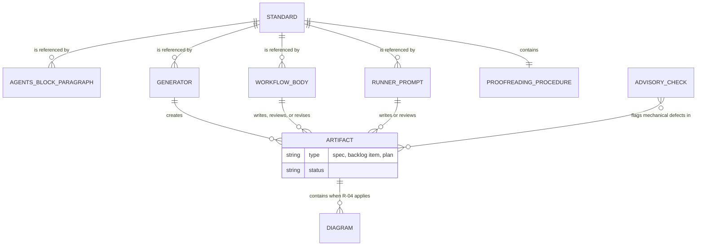
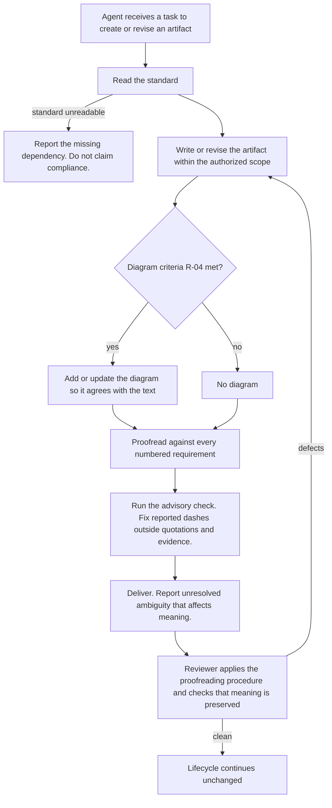
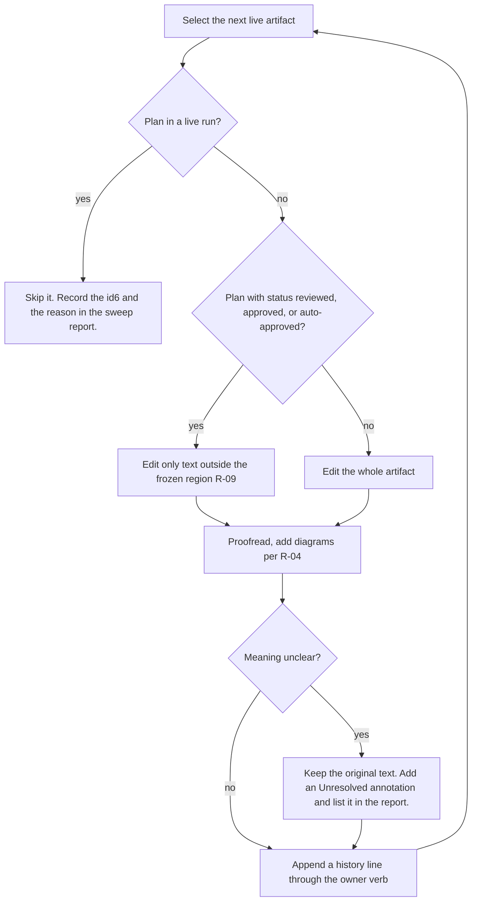

# Spec: Technical artifact writing standard for specs, backlog items, and plans

- Date: 2026-10-25
- Status: to-review
- Id: ecmw83
- Author: opencode its_direct/pt3-claude-opus-5.5-1m-us
- From-Backlog: qph7c5
- Work-Kind: feature
- Priority: high
- Set: writestd
- Scope: Ship one writing standard (including diagram rules) and apply it whenever a spec, backlog item, or plan is written, proofread, reviewed, or revised; sweep live artifacts once.
- Constrained-by: `.aw/records/specs/approved/20261017-revsteps-01-k3yx72-plan-review-redesign.spec.md` (`k3yx72`, `approved`). Its proofreading step uses prompt `wcisgc`, and its non-goal N5 excludes "a writing standard applied while drafting". This spec supplies that standard and amends N5 (Section 7, Order 06).

## Workflow history
- 2026-10-26 to-review (aw specs): authored review-ready from backlog qph7c5

- 2026-10-26 created (aw specs): Ship one writing standard (including diagram rules) and apply it whenever a spec, backlog item, or plan is written, proofread, reviewed, or revised; sweep live artifacts once.

## 0. What this spec authorizes

This spec is a design contract. It authorizes no code change by itself. The plan Set `writestd` implements it. Each plan in that Set executes only after a human approves it.

## 1. Problem

Agents write three kinds of tracked work artifact in this toolkit:

- a **spec** (specification) under `.aw/records/specs/`, which states required behavior;
- a **backlog item** under `.aw/records/backlog/`, which records committed or candidate work;
- a **plan** (IPD, Implementation Plan Document) under `.aw/records/plans/`, which lists the steps to do the work. A **plan Set** is an orchestrator plan plus its child plans.

No single standard says how to write these artifacts. Writing rules are spread across four places:

| Place | What it says |
| --- | --- |
| `GUIDING_PRINCIPLES.md` P13 | The dash rule applies only to user-facing text. Internal artifacts still require clarity and plain language. |
| `CONTRIBUTING.md`, "Authoring conventions" | The same dash scope. |
| `.aw/system/workflows/assess/references/prose-style.md` | Prose rules for the `assess-prose` lens. It exempts internal artifacts from the dash rule. |
| `AGENTS.md`, `aw:reporting` section (`reporting_contract.contract_text`) | Communication rules for messages and documents. |

Three gaps follow:

1. No rule tells an author when to draw an entity diagram or a flow diagram. Some specs contain Mermaid diagrams (for example `4sd62s`, `18hh1u`). Most specs and plans contain none, including specs that describe several related records or a multi-step lifecycle.
2. Proofreading instructions exist only for review. Prompt `wcisgc` (`.aw/records/prompts/reusable/20261017-revsteps-01-wcisgc-technical-artifact-proofreading.prompt.md`) is applied at review time by spec `k3yx72`. Nothing applies the same rules when an author drafts or revises an artifact.
3. Target repositories receive no writing standard. The installer copies only `.aw/system/workflows/` (`engine.collect_source_members`). `wcisgc` lives under `.aw/records/`, and `GUIDING_PRINCIPLES.md` and `docs/` are not shipped.

The maintainer supplied a draft standard on 2026-10-25. Backlog item `qph7c5` records the request and the maintainer's decisions.

## 2. Goals and non-goals

### 2.1 Goals

- G1. One shipped standard governs how specs, backlog items, plans, and plan Sets are written, proofread, reviewed, and revised.
- G2. Every surface that tells an agent to create, review, or revise one of these artifacts directs the agent to the standard.
- G3. Artifacts contain an entity diagram or a flow diagram when the standard's diagram criteria (R-04) apply.
- G4. Every live artifact is proofread against the standard once, without changing its meaning, status, or approval.

### 2.2 Non-goals

- N1. User-facing prose (READMEs, CHANGELOG, docs, UI and CLI text). The existing rules in `prose-style.md` and the execution contract continue to govern it.
- N2. Other record types (research, walkthroughs, prompts, reviews, run records). A later spec may extend the standard to them.
- N3. Terminal artifacts: plans under `executed/`, `superseded/`, or `not-executed/`; specs that are `implemented` or `superseded`; backlog items that are `done`. The execution contract forbids rewriting what an executed plan records.
- N4. Automated judgement of clarity, completeness, or diagram need. Automated checks cover only mechanical defects (R-07).
- N5. Enforcing the ASD-STE100 controlled dictionary.

## 3. Maintainer decisions (2026-10-25, in session)

| ID | Decision |
| --- | --- |
| MD-1 | The standard ships to every managed repository. |
| MD-2 | The standard's dash rule applies to specs, plans, and backlog items. It covers em dashes and en dashes. This replaces the exemption in P13 and in the `AGENTS.md` execution contract for these three artifact types. |
| MD-3 | The standard applies to new work, and a one-time sweep proofreads every live artifact. |
| MD-4 | The sweep includes approved artifacts. They keep their status. The sweep skips any plan that a live run is executing or has queued. |
| MD-5 | The sweep includes parked backlog items and parked specs. |
| MD-6 | Delivery is this spec plus a review-ready plan Set. |

## 4. Entities and relationships

| Entity | Meaning | Location |
| --- | --- | --- |
| Standard | The single authoritative writing standard. | `.aw/system/workflows/standards/technical-artifact-writing.md` (R-01) |
| Proofreading procedure | The review-time procedure, adopted from `wcisgc`. | A section of the standard (R-03) |
| AGENTS block paragraph | The managed `AGENTS.md` paragraph that points to the standard. | `engine.agents_pointer_prose` (R-05) |
| Workflow body | A shipped workflow that writes or reviews an artifact, for example `spec`, `spec-review`, `plan-review`. | `.aw/system/workflows/<name>/` (R-06) |
| Generator | A verb that creates an artifact skeleton: `aw ipd scaffold`, `aw specs new`, `aw backlog new`. | `ipd_authoring`, `specs`, `backlog` modules (R-06) |
| Runner prompt | A prompt the runner sends to an agent to author or review an artifact. | `runner_shared.build_review_prompt`, `build_spec_production_prompt`, `build_backlog_production_prompt`, and the plan production prompt (R-06) |
| Advisory check | A mechanical check that reports a defect and never changes an exit status. | `aw ipd lint`, `aw specs check`, `aw backlog check` (R-07) |
| Diagram | A Mermaid entity or flow diagram inside an artifact. | The artifact body (R-04) |

## 5. Flows

### 5.1 Writing, proofreading, reviewing, and revising an artifact

### 5.2 One-time sweep of a live artifact

## 6. Requirements

This table is the canonical declaration of this spec's requirements.

| ID | Requirement | Section |
| --- | --- | --- |
| R-01 | The standard must exist at `.aw/system/workflows/standards/technical-artifact-writing.md`. `aw install` must copy it into a target repository at the same relative path. The filename must not carry a date. | 1, 4 |
| R-02 | The standard must contain the scope statement, the eleven numbered language requirements of the maintainer's draft (wording preserved except where R-04 and MD-2 change it), the concision paragraph, and the statement that automated checks do not establish clarity. Requirement 11 must say "Do not use em dashes or en dashes." | 3, 4 |
| R-03 | The standard must contain a proofreading procedure section that carries the substance of prompt `wcisgc` sections 1 to 7. After this, `wcisgc` must be a pointer to that section, so one source holds the procedure. | 1, 4 |
| R-04 | The standard must contain a twelfth numbered requirement on diagrams. It must say: (a) add a Mermaid `erDiagram` or class diagram when an artifact introduces or changes three or more related entities, records, files, or components; (b) add a Mermaid `flowchart` or `stateDiagram-v2` when an artifact describes a process of three or more steps with a branch, a loop, or a status lifecycle; (c) do not add a diagram for a single entity or a linear process of fewer than three steps; (d) the text is normative, and a diagram that disagrees with the text is a defect that the author corrects; (e) a diagram must name entities and steps with the same terms as the text. | 2.1 G3, 4, 5 |
| R-05 | The `AGENTS.md` managed block must contain a "Technical artifact writing" paragraph with the substance of the draft's "Required agent instruction", pointing to the path in R-01. The execution contract's dash clause must state that the dash rule also applies to specs, plans, and backlog items. `GUIDING_PRINCIPLES.md` P13, `CONTRIBUTING.md`, `prose-style.md`, `verify-execution/intent-audit.md`, and `GEMINI.md` must state the same scope. | 3 MD-2 |
| R-06 | Each of these surfaces must direct the agent to the standard before it writes, reviews, or revises a spec, backlog item, or plan: the `spec`, `spec-review`, `plan-review` (its step files once `3bwrfx` executes), `plan-review-long`, and `ipd-lifecycle` workflow bodies; the `advise` `spec-editor` persona; the `assess` IPD templates; the skeletons written by `aw ipd scaffold`, `aw specs new`, and `aw backlog new`; and the runner's authoring and review prompts. | 2.1 G2, 4 |
| R-07 | `aw ipd lint`, `aw specs check`, and `aw backlog check` (and `aw check` through them) must report an em dash (U+2014) or en dash (U+2013) in authored prose as an advisory of severity `info`. The advisory must never change a disposition or an exit status. It must ignore fenced code, indented code, block quotes, inline code spans, and front-matter values. Retired code `IPD-D701` must not be reused. | 3 MD-2 |
| R-08 | A one-time sweep must proofread every live artifact against the standard and add diagrams per R-04. Live means: specs in `draft`, `to-review`, `reviewed`, `approved`, `implementing`, `deferred`, `parked`; backlog items in `open`, `blocked`, `graduated`, `parked`; plans in `pending/` and `reusable/`. The sweep must not change any status, approval, `Readiness`, `Blocks-Release`, identity, or provenance field. Each swept artifact must get one history line through its owner verb (`aw specs note`, `aw backlog note`, or a plan `## Workflow history` line) that says it was proofread per the standard and that its meaning is unchanged. | 3 MD-3 to MD-5 |
| R-09 | For a plan whose status is `reviewed`, `approved`, or `auto-approved`, the sweep must not change `- Scope-Paths:` or any E-item or V-item action block. These are the inputs of `ipd_lifecycle.frozen_region_digest`, and changing them marks the review stale (`plan_readiness.review_staleness_index`, reason `substantive-edit`). The sweep lists each defect it left in that region in its report. | 5.2 |
| R-10 | The sweep must skip any plan that `aw runners --once --json` reports as the current item of a live run, or that is in the queue of a live run, at the moment the sweep reaches it. It lists each skipped plan and the reason in its report. | 3 MD-4 |
| R-11 | When the sweep cannot establish the meaning of a passage, it must keep the original text and add an adjacent `Unresolved` annotation, as the proofreading procedure requires. It must not guess. | 5.2 |

## 7. Acceptance criteria

| ID | Criterion | Requirements |
| --- | --- | --- |
| AC-01 | A test installs the toolkit into a temporary repository and finds `.aw/system/workflows/standards/technical-artifact-writing.md` with the same bytes as the source. | R-01 |
| AC-02 | The standard contains numbered requirements 1 to 12, a proofreading procedure section, and no em or en dash outside code. `wcisgc` points to the standard. | R-02 to R-04 |
| AC-03 | `python3 -m tools.regen_agents_block --check` reports no drift, and the regenerated `AGENTS.md` contains the "Technical artifact writing" paragraph and the widened dash clause. | R-05 |
| AC-04 | A plan created by `aw ipd scaffold`, a spec created by `aw specs new`, and a backlog item created by `aw backlog new` each name the standard's path. Each still passes its own lint or check. | R-06 |
| AC-05 | A test lints a plan, a spec, and a backlog item that each contain an em dash and an en dash in prose and in a fenced block. It observes one `info` advisory per prose dash, none for the fenced dashes, and an unchanged exit status. | R-07 |
| AC-06 | After the sweep, `aw ipd lint`, `aw specs check`, and `aw backlog check` report no dash advisory on any swept artifact, except inside quotations and recorded evidence. Each swept artifact carries the history line of R-08. `aw check all` reports no new error. | R-08 |
| AC-07 | For every swept plan in `reviewed`, `approved`, or `auto-approved`, `aw ipd lint` reports no new `review may be stale` advisory caused by the sweep commit. | R-09 |
| AC-08 | The sweep report lists every skipped plan with its reason, and every `Unresolved` annotation it added. | R-10, R-11 |

## 8. Constraints and dependencies

- The `plan-review` body is being split into step files by approved plan `3bwrfx` (Set `revsteps`). Order 06 of this Set edits those step files, so it depends on `executed:3bwrfx`. No other Order edits `plan-review/`.
- Changing the managed block requires `python3 -m tools.regen_agents_block`. Otherwise `tests/test_agents_section_records.py` fails.
- Order 03 amends spec `ipd-structure-and-linting` (`.aw/records/specs/implemented/20260802-1904-01-ipd-structure-and-linting.spec.md`) Section 10 item 17. Order 06 amends spec `k3yx72` non-goal N5 and its proofreading-instructions row. Each Order declares those paths in `- Scope-Paths:`.

## 9. Risks

- The sweep is large (roughly 13,000 lines of live specs and 76 KB of live backlog). A proofreading pass can change meaning by accident. R-08, R-11, and review of each sweep plan's diff limit this risk; they do not remove it.
- Plans in Set `revsteps` are executing now. R-10 skips them while they run. A plan that finishes before the sweep reaches it moves to `executed/` and is out of scope (N3).

## 10. Open questions

None blocking. The maintainer decided every question listed in Section 3.
