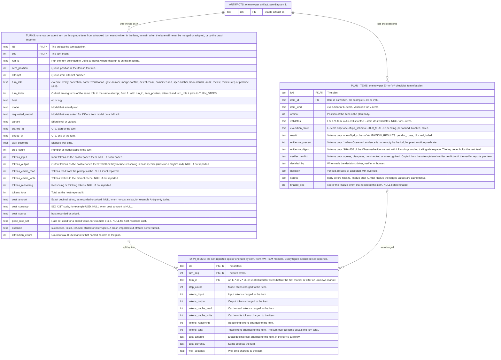
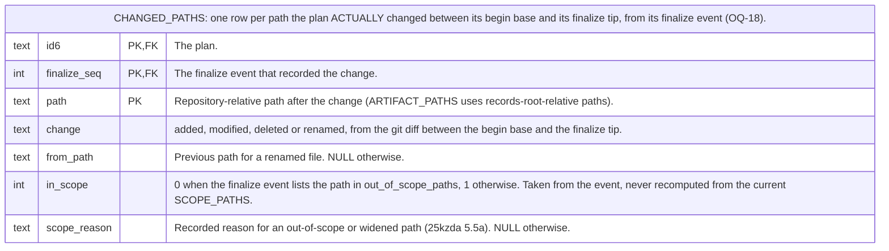

# Spec: Execution record: finalize and turn events, per-item cost and currencies

- Date: 2026-11-01
- Status: to-review
- Id: 37am1y
- Author: aw specs new
- Scope: Tracked finalize and turn events recording what plan execution changed, how V-items were verified, and tokens, time and cost per turn and per item; split from 4sd62s
- From-Spec: 4sd62s

## 0. Purpose and relation to 4sd62s

This spec was split from spec `4sd62s` (artifact metadata store) on 2026-11-01, on the
maintainer's ruling to freeze that spec's scope. It owns the tracked execution record: the
`finalize` and `turn` event payloads, `AW-ITEM` per-item attribution, money amounts and
currencies, the cache tables `changed_paths`, `plan_items`, `turns` and `turn_items`, and their
acceptance criteria. It depends on `4sd62s` (the event log, the `append` key, the registry and
the cache) and adds its op payloads through that registry. Direction: this spec depends on
`4sd62s`; `4sd62s` does not depend on this spec. It does not gate release 2.0.0.

Review state: the moved text below was reviewed in `4sd62s` rounds 15 to 18; it still needs its
own review as a standalone spec.

## Moved text (verbatim from spec 4sd62s at split, 2026-11-01)

Section and requirement references below (for example 4.2, 4.5a, C1, AC-5) refer to spec
`4sd62s` unless stated otherwise. A later revision of this spec rewrites them as its own.

  - For `op: finalize` (round 15, maintainer decision OQ-18): written once per successful plan
    finalize (`aw ipd finalize`) of ANY plan (an artifact of type `ipd`), orchestrators included,
    and only in the append that contains the `transition` to `executed` (maintainer decision
    OQ-29). An orchestrator's checklist holds its orchestration items, so `items` and
    `changed_paths` are still meaningful. The ONE path to `executed` without a `finalize` event is
    runner rollup retirement (`ipd_lifecycle.retire_orchestrator`, spec `77tr3o`), which has no
    begin receipt, makes no code edits, and runs no E/V checkpoint or verifier: it writes the
    `transition` to `executed` (with `path` and any `unset` of `approval`) and leaves `scope_result`
    NULL, `changed_paths` empty and `plan_items` with `source: body`. A plan is an ORCHESTRATOR when
    its `plan_role` is `orchestrator`, or when it has no `plan_role` and its `order` is 0 (the rule
    `retire_orchestrator` applies; 102 plans have no `plan_role` at r18). `op: finalize` is written
    where finalize runs: in the lane worktree for a
    runner execution (the lane's log then reaches `main` through integration), or in the
    checkout for a hand-run `aw ipd finalize`. Fields:
    - `changed_paths`: the sorted list of repository-relative paths that changed between the plan's
      begin-receipt base commit and the finalize tip (the lane or checkout `HEAD` before the
      lifecycle commit), each `{path, change}` with `change` one of `added`, `modified`, `deleted`
      or `renamed` (a rename also carries `from_path`). Finalize computes it from git, never from
      the agent's report. The plan's own `.md` file and `meta/<id6>.jsonl` are excluded.
      Integration never rewrites the event: a difference that appears only at merge time is
      reported by the integration gate, not recorded here.
    - `scope_result`: `within`, `widened` (an accepted additive widening, 25kzda 5.5a) or
      `exceeded`. `out_of_scope_paths` and `widened_paths` are lists of `{path, reason}` with the
      reason that 25kzda 5.5a requires today (prose-safety checked). This replaces the legacy
      `Scope-Exceeded` bullet. Replay sets the `scope_result` field from this event; a generic
      `set` or `unset` of `scope_result` is refused.
    - `items`: one object per E-* and V-* item of the plan, in body order: `item_id` (for example
      `E-03`), `item_kind` (`execution` or `validation`), `validates` (for a V-item, the E-item ids
      it validates), and `execution_state` (E-items, one of `ipd_schema.EXEC_STATES`: `pending`,
      `performed`, `blocked`, `failed`) or `result` (V-items, one of
      `ipd_schema.VALIDATION_RESULTS`: `pending`, `pass`, `blocked`, `failed`) exactly as the body
      states at finalize. For each V-item a `verification` object:
      `evidence_present` (boolean, by the same predicate `ipd_lint --phase pre-transition` uses
      for a non-empty `Observed evidence`, so skeleton text does not count),
      `evidence_digest` (SHA-256 of the `Observed evidence` text normalized to LF line endings with
      trailing whitespace removed from each line, so a later edit is detectable without copying the
      text into the log),
      `verifier_verdict` (`agrees`, `disagrees`, `not-checked` or `unrecognized`),
      `decided_by` (`driver`, `verifier` or `human`) and `decision` (`verified`, `refused` or
      `accepted-with-override`). Today's verifier returns ONE verdict per attempt (`VERIFIED`,
      `BLOCKED` or `CORRECTION_REQUIRED` in `*-verification.json`). Until the verifier reports per
      item, finalize copies that attempt verdict to every V-item (`VERIFIED` is `agrees`,
      `BLOCKED` and `CORRECTION_REQUIRED` are `disagrees`, no verifier turn is `not-checked`). A
      hand-run finalize records `not-checked` and `decided_by: human`. The implementing plan
      states whether the verifier output changes to per-item verdicts (section 7).
      The E/V TEXT stays in the plan body (N3); the log records only these structured facts.
    - `turns`: the `seq` numbers of the `turn` events of this plan that the lane's log already
      holds when finalize runs (see TURN EVENTS below).
  - For `op: turn` (round 15, maintainer decision OQ-20): one event per agent turn that acted on a
    queue item, appended when the turn ends, whether it succeeded or not. A turn that a crash or an
    interruption cut off is recorded by the crash import (TURN EVENTS below) with
    `outcome: interrupted`. The event goes to the log of the queue item's `id6`: for a production
    turn, that is the backlog item or spec being graduated; an artifact the turn produced gets no
    turn event. Fields:
    - `turn_role`: one of `execute`, `verify`, `correction` (a fix-it turn), `carrier-verification`,
      `gate-answer`, `merge-conflict`, `defect-reask`, `combined-red`, `spec-anchor`,
      `hook-refusal`, `audit`, `review`, `review-step` and `produce`. Each value is derived from the
      session file's `log_suffix` (`attempt-N-<suffix>.jsonl`, written by `runner_shared`) and the
      queue item's action. An unsuffixed session is `execute`, `review` (a single-turn review) or `produce` according to
      the item's action, except that an unsuffixed session of an attempt that carries
      `turn_correction` (`runner_shared.turn_correction_packet`, a fix-it attempt, often on a lane
      adopted by `try_adopt_fix_it_lane`) is `correction`; in a multi-step review (`k3yx72`), `runner_shared` writes Prompt 1 to `attempt-N.jsonl` and copies it to `attempt-N-review-step-01-<label>.jsonl`, and the driver, crash importer and `turn_steps` indexer treat that pair as one `review-step` turn rather than double-counting Prompt 1. `review-orchestrator-correction-N` and `set-correction-N` map to `correction`, and `review-step-NN-<label>` (including `-reask` retries and S6 re-review passes `p02+`) maps to `review-step`; in all cases `turn_index` is the 1-based dispatch ordinal among turns of that `turn_role` in the attempt, never the per-pass prompt number `NN` (which repeats on `-reask`, S6 pass 2+, and session restart). The registry maps every suffix; a new suffix is added there.
    - `turn_index`: the 1-based dispatch ordinal of this turn among turns of the same `turn_role` in the same `(run_id, item_position, attempt)`,
      so multiple `correction` or `review-step` turns of one attempt stay distinct.
    - `run_id` (the run), `item_position` (the queue position) and `attempt` (the queue-item attempt
      number): together with `turn_role` and `turn_index` these are the key that joins the turn to
      its detailed per-step rows (`turn_steps`, 4.5b) where that run's records exist.
    - `host`, `model` (the model that ran), `requested_model`, `variant`, `started_at` and
      `ended_at` (UTC), `wall_seconds`, `step_count`.
    - `tokens` `{input, output, cache_read, cache_write, reasoning, total}` (integers). A component
      that the host did not report is omitted, never written as 0. Mapping from today's records: an
      attempt's single `cache` count and Antigravity's `cache_read_tokens` become `cache_read`;
      OpenCode's `cache.read` and `cache.write` map one to one; Antigravity's `thinking_tokens`
      become `reasoning`. Whether `output` includes reasoning is host-specific; the event records
      the host's values unchanged and `docs/run-analytics.md` states the per-host rule.
    - `cost` (see AMOUNTS below), omitted when the host recorded none, with `cost_source` and, for a
      priced value, `price_rate_set`.
    - `outcome`: one of `succeeded`, `failed`, `refused`, `stalled`, `interrupted`.
    - `items`, `attribution`, `attribution_errors` (PER-ITEM ATTRIBUTION below).
  - TURN EVENTS: WHERE THEY ARE WRITTEN (round 16, maintainer decision OQ-23). The driver writes
    each turn event into the LANE worktree's copy of the plan's log as the turn ends, so finalize
    and integration carry it to `main`; the driver commits it on the lane branch with the lane's
    other changes. While an unmerged lane remains adoptable by the next attempt (`runner_shared.try_adopt_fix_it_lane` or the `6kwd2e` answer-resume path (the attempt field `answer_resume` with the item flag `resume_with_answers` and `runner_shared.resolve_prior_lane`)), its turn events stay on that lane branch so the adopting attempt appends after them without a `seq` collision and integration carries all turns to `main` together. When an attempt ends WITHOUT merging and its lane will NOT be merged or adopted (a terminal unmerged attempt, a lane displaced before cutting a fresh attempt-scoped lane from `main`, an abandoned or discarded lane, or a non-merging `aw <host> audit` run), the driver appends that lane's turn events in the main checkout instead, under
    the integration lock, and commits them with `aw commit --no-plan`. This avoids a same-artifact
    conflict (4.7) on the normal and adopted-lane paths and loses no turn. CRASH IMPORT: after a driver crash, `aw
    <host> run resume` and a separate `aw runs import-turns <run-id>` (the plan names the final
    spelling) read the run's local records, find every ended or cut-off turn of that run, and
    append each one that no log yet holds. A turn is identified by
    `(run_id, item_position, attempt, turn_role, turn_index)`; the importer skips a turn whose
    identity is already in the target log, so it imports each turn exactly once and a resumed run
    never duplicates one.
    ONE COPY. An attempt's turn events live in exactly one active copy of the log. Once the driver writes an unmerged lane's turn events to the main checkout, that lane is never merged or adopted, and committed turn events are never removed from a lane log. The
    importer writes to the lane copy when the attempt's lane still exists and can still be merged or adopted,
    otherwise to the main checkout, and checks the turn identity against both copies. A displaced
    lane's turn events are committed on `main` BEFORE the driver cuts a fresh lane from `main`, so the
    fresh lane's log already holds them. For a review parked on the shared review sweep lane, the
    driver commits the turn events on the lane before it creates the `aw/parked/<run_id>/<id6>`
    branch and resets the lane (`runner_shared`, review parking); the parked branch is then the
    active copy, and the importer checks it. The driver and the importer take the dispatch order for
    `turn_index` from the run's own durable records (the attempt's ordered session list in
    `state.json`, or `events.jsonl`; the plan names which), never from file names or timestamps.
    AFTER FINALIZE. A turn that runs after finalize (for example `merge-conflict` during
    integration, or `audit` on an already-executed plan) is appended to the plan's log after the `finalize` event and is not listed in its
    `turns`. The `meta/*.jsonl` append-only hook and `executed_transition_gate` accept a staged change to an executed plan's log that only
    appends valid post-finalize events (5.2 step 4a, AC-16).
  - PER-ITEM ATTRIBUTION (OQ-20). The turn prompt tells the agent to write `AW-ITEM: <id>` on its
    own line whenever it starts work on an E-* or V-* item. The driver charges every model step
    that follows the marker to that item, until the next marker or the end of the turn. Steps
    before the first marker are charged to `unattributed`. The `turn` event's `items` list holds
    `{item_id, step_count, tokens, cost, wall_seconds}` per item, plus one `unattributed` entry, and
    the event carries `attribution: self-reported`. A turn of an artifact that has no checklist
    (a spec or backlog production turn) has one `unattributed` entry. The marker must not collide
    with other final-line markers such as `AW-REVIEW: AGAIN|DONE` and `AW-TIER:` (spec `k3yx72`):
    the driver reads `AW-ITEM` lines anywhere in the turn and those markers only on the last line.
    The driver computes each item entry from the session steps and puts any difference between the
    step sums and the host-recorded turn totals into the `unattributed` entry, so the item entries
    always sum to the turn totals. A marker naming an id that is not an item of the plan is charged to `unattributed` and
    counted in `attribution_errors`. No output may present a per-item figure as exact: every
    per-item figure is labelled self-reported.
  - AMOUNTS AND CURRENCIES (OQ-20). Every money value is an object `{amount, currency}`: `amount`
    is an exact decimal STRING (never a binary float), `currency` an ISO 4217 code. A host value
    recorded as a JSON number (today's `attempt.cost`, for example `2.8295`) is converted with the
    shortest round-trip representation (Python `repr`) and never rounded. It stores the
    value exactly as the host recorded it or as `run_analytics_pricing` produced it; when the host
    records a bare number, the currency is `USD` (today's convention) and `cost_source` is
    `host-recorded`; a value computed from the price table has `cost_source: priced` and
    `price_rate_set` naming the rate set. A value is NEVER converted when stored. A display may
    convert to one or more currencies configured in `.aw/config/` (the plan names the key);
    exchange rates come from that configuration only, never from a network call (C8: only the migration's description generation uses the network); a converted
    figure names the exchange rate, its source and its date, and is labelled converted. Totals across currencies are
    never summed without a stated conversion.

| `changed_paths` | (`id6`, `finalize_seq`, `path`) PK, `change`, `from_path`, `in_scope`, `scope_reason` | What executing a plan ACTUALLY changed, from its `finalize` event (OQ-18). `path` is repository-relative (unlike `artifact_paths.path`, which is records-root-relative; a query that joins the two converts through the resolved records root). `in_scope` is 0 when the path is in the event's `out_of_scope_paths`, and 1 otherwise; it is NOT recomputed from the current `scope_paths`, which may have changed since. `scope_reason` is the recorded reason for an out-of-scope or widened path. An index on `path` answers "which plans touched file X". |

| `plan_items` | (`id6`, `item_id`) PK, `item_kind`, `ordinal`, `validates`, `execution_state`, `result`, `evidence_present`, `evidence_digest`, `verifier_verdict`, `decided_by`, `decision`, `source`, `finalize_seq` | One row per E-* or V-* item (OQ-18). Before finalize, the loader fills it from the plan BODY (`source: body`). After finalize, the tracked `finalize` event is authoritative (`source: finalize`), and a body whose evidence digest no longer matches is reported by `aw check meta` as `evidence-changed-after-finalize`. |

| `turns` | (`id6`, `seq`) PK, `run_id`, `item_position`, `attempt`, `turn_role`, `turn_index`, `host`, `model`, `requested_model`, `variant`, `started_at`, `ended_at`, `wall_seconds`, `step_count`, `tokens_input`, `tokens_output`, `tokens_cache_read`, `tokens_cache_write`, `tokens_reasoning`, `tokens_total`, `cost_amount`, `cost_currency`, `cost_source`, `price_rate_set`, `outcome`, `attribution_errors` | One row per tracked `turn` event (OQ-20). Survives a clone. Token columns are NULL, never 0, when the host did not report them. (`run_id`, `item_position`, `attempt`, `turn_role`, `turn_index`) is unique and joins to `turn_steps` (4.5b). |

| `turn_items` | (`id6`, `turn_seq`, `item_id`) PK, `step_count`, `tokens_input`, `tokens_output`, `tokens_cache_read`, `tokens_cache_write`, `tokens_reasoning`, `tokens_total`, `cost_amount`, `cost_currency`, `wall_seconds` | The self-reported per-item split of one turn (OQ-20). `item_id` is an E-* or V-* id or `unattributed`. Answers "what does a typical V-* check cost" and "tokens and time per E-* item"; every figure is labelled self-reported. |

Diagram 3. Execution record: E-* and V-* items, verification, turns, tokens and cost (OQ-18, OQ-20). The rows come from TRACKED events, so they survive a clone, except PLAN_ITEMS rows with source body, which come from the plan body before finalize:

Diagram 2 excerpt:

| AC-35 | 4.2, 4.3, 4.5a (OQ-18, OQ-29) | Finalize records what the plan actually changed and how each V-item was verified, and the record survives a clone. | Pasted tests: (1) finalizing a test plan appends one `finalize` event, with the same `append` as its `transition` to `executed`, whose `changed_paths` equals the git diff from the begin-receipt base to the finalize tip excluding the plan file and its log (not the agent's report), with the correct `scope_result` and `out_of_scope_paths` with reasons; a `finalize` on a non-plan or outside that append is refused by the writer and by replay; (2) `items` has one entry per E-* and V-* item, and each V-item entry has a `verification` object with `evidence_present`, `evidence_digest`, `verifier_verdict`, `decided_by` and `decision`; an attempt verdict `VERIFIED` maps to `agrees` on every V-item, and a hand-run finalize records `not-checked` and `decided_by: human`; (3) on a `git clone --depth 1`, a command (the plan names it, for example an `aw find` filter) answers "which plans changed file X" and "which V-items were refused" from `changed_paths` and `plan_items`; (4) editing a V-item's `Observed evidence` after finalize makes `aw check meta` report `evidence-changed-after-finalize`; (5) the log contains no evidence text. (6) a hand `aw ipd finalize` of an orchestrator writes a `finalize` event; `ipd_lifecycle.retire_orchestrator` appends a `transition` to `executed` with `path` and no `finalize`; a plan with no `plan_role` and `order` 0 is treated as an orchestrator, and a non-orchestrator `transition` to `executed` without `finalize` is refused. |

| AC-37 | 4.2, 4.5a, 4.5b (OQ-20) | Tokens, time and cost are recorded per turn (tracked), per step (cache) and per item (self-reported), with exact amounts and currencies. | Pasted tests: (1) each turn role in 4.2 appends one `turn` event with the token components the host reported, omitted ones absent (not 0), and two correction turns of one attempt get distinct `turn_index` values; a lane turn reaches `main` through integration, a turn of an attempt whose lane will not be merged or adopted is committed in the main checkout, a turn of an adoptable unmerged lane stays on the lane and after adoption and integration reaches `main` exactly once, a parked review's turns survive the sweep-lane reset, and after a simulated driver crash the importer adds each missing turn exactly once, including after a second run of the importer and after `resume`; (2) amounts are decimal strings with an ISO 4217 code, a bare host number is stored as `USD` with `cost_source: host-recorded`, and a priced value names its rate set; (3) a session fixture with `AW-ITEM` markers yields `turn_items` whose sums equal the turn totals, with pre-marker steps in `unattributed` and an unknown id counted in `attribution_errors`; (4) `aw runs analyze` output for a fixture run is unchanged when it reads through `artifact_meta`; (5) a display converted to EUR names the rate, source and date, and labels the figure converted; mixed-currency totals are refused without a conversion; (6) a query answers "median tokens and cost per V-item" and labels it self-reported; (7) a pilot run reports the share of steps that were `unattributed`. |

### OQ-18: Record what executing a plan actually did (round 15)

- Status: resolved
- Owner: maintainer
- Blocking: yes
- Question: How are the files a plan actually changed, its E-* and V-* items, each V-item's evidence, and the agreed verification decision recorded?
- Evidence: `scope_paths` held only declared paths. Actual changed files exist only in the gitignored `outcomes/*.json` (`files_changed`); only `scope_exceeded` was kept. E/V items and evidence are body prose (N3); the verifier's verdict (`verify_verdict_state`, `verify_has_evidence`) exists only in local run state.
- Recommendation: Tracked and indexed.
- Closes when: The maintainer decides, and 4.2, 4.4, 4.5a, the diagrams and an acceptance criterion use the chosen rule.
- Resolution or deferral rationale: RESOLVED 2026-10-26 by the user via /askme: tracked and indexed. Finalize appends one tracked event to the plan's log holding the changed paths (from the merged diff, repository-relative), the scope-check result, and for each V-item the verification decision (required evidence present, verifier agrees or disagrees, who decided, and a digest of the evidence text). E/V text stays in the body (N3). The loader indexes the E/V items and the changed paths into cache tables. No reason was given. CORRECTION 2026-10-26 (round 16, internal-consistency review): "merged diff" is not available when finalize runs in a lane, so 4.2 defines `changed_paths` as the diff from the plan's begin-receipt base to the finalize tip; the decision itself is unchanged.

### OQ-20: Token, cost and time granularity, and currencies (round 15)

- Status: resolved
- Owner: maintainer
- Blocking: yes
- Question: At what granularity are tokens, cost and time recorded, which part is tracked, and how are currencies stored?
- Evidence: run state splits tokens and cost by turn (execute, verify) per attempt (tokens on 3,291 of 3,752 recorded attempts, cost on 2,220); host session logs record each model step (OpenCode: tokens and cost; Antigravity: tokens and duration, no cost); one execute attempt had 2,164 steps; no step names the E-item or V-item it served; hosts record cost as a bare number, treated as USD by `run_analytics_pricing`.
- Recommendation: Track per-turn totals, cache per-step rows, add a self-reported item marker; store amounts as recorded with a currency code and convert only on display.
- Closes when: The maintainer decides, and 4.2, 4.5a, 4.5b, the diagrams and acceptance criteria use the chosen rule.
- Resolution or deferral rationale: RESOLVED 2026-10-26 by the user via /askme: (a) every amount is stored as an exact decimal string with its ISO 4217 currency code, exactly as recorded or as the price table produced it; it is never converted at storage time; displays may convert to configured currencies with a dated, named exchange rate and label the result as converted. (b) Per-turn totals are TRACKED; per-model-step rows are CACHE ONLY, indexed from local session logs; agents emit `AW-ITEM: <E-nn|V-nn>` when they change item, the runner charges following steps to that item, steps before the first marker are `unattributed`, and per-item totals are tracked with `attribution: self-reported`. The maintainer required this to support `aw runs analyze` and questions such as "how expensive is it to validate a typical V-* entry?" and "how many tokens and how much time are models spending per E-* item". This amends non-goal N4 for totals only.

### OQ-23: Where `turn` events are written (round 16)

- Status: resolved
- Owner: maintainer
- Blocking: yes
- Question: Which copy of the log receives `turn` events, given lane isolation?
- Evidence: round 15 said both that the driver appends at turn end and that finalize appends them; a driver append in the main checkout while the lane appends `finalize` would conflict on every run (4.7) and dirty `.aw/records/`.
- Recommendation: Lane; main only if the attempt does not merge.
- Closes when: 4.2, 4.9.3 and an acceptance criterion use the chosen rule.
- Resolution or deferral rationale: RESOLVED 2026-10-26 by the user via /askme: the driver writes `turn` events into the LANE's copy of the log as each turn ends, so finalize and integration carry them to `main`; when an attempt ends without merging, the driver appends that attempt's turn events in the main checkout under the integration lock and commits them with `aw commit --no-plan`. ADDITION by the maintainer: a mechanism must import turn data after a runner crash; it imports each turn exactly once and handles resumes. No further reason was given.

### OQ-29: What a hand `aw ipd finalize` of an orchestrator writes (round 18)

- Status: resolved
- Owner: maintainer
- Blocking: yes
- Question: After the cutover, does `aw ipd finalize` write a `finalize` event for an orchestrator plan?
- Evidence: round 17 allowed `finalize` only on `plan_role: child`; of 97 executed orchestrators, 65 were retired by the runner (`ipd_lifecycle.retire_orchestrator`) and about 14 were hand-finalized; 102 plans carry no `Kind`, so "child only" excluded them; `retire_orchestrator` treats a plan as an orchestrator when its role is `orchestrator`, or its role is absent and its order is 0.
- Recommendation: Write a finalize event for every finalized plan.
- Closes when: 4.2, 4.3, AC-35 and section 9 use the rule.
- Resolution or deferral rationale: RESOLVED 2026-10-31 by the user via /askme: `aw ipd finalize` writes a `finalize` event for every plan it finalizes, orchestrators included; only runner rollup retirement writes a `transition` to `executed` without one. "Orchestrator" uses the `retire_orchestrator` rule. No reason was given.

## Moved text, second pass (terms, limits, notes and rows that belong to the execution record)

| crash importer | The command (`aw runs import-turns`; the plan fixes the name) that appends missing `turn` events from local run records after a driver crash (4.2 TURN EVENTS). |

| adoptable lane | An unmerged lane that a later attempt can take over (`runner_shared.try_adopt_fix_it_lane`, answer-resume) (4.2 TURN EVENTS). |

| turn, turn event | One agent session that acted on a queue item (an execute, verify, correction, review or production session), and the tracked `op: turn` event that records its tokens, time and cost (4.2, OQ-20, OQ-23). |

| `AW-ITEM` marker | A line `AW-ITEM: <E-nn or V-nn>` that an agent writes when it starts work on a checklist item. The driver charges the following model steps to that item. Steps before the first marker are `unattributed`. Per-item figures are SELF-REPORTED (4.2, 3c). |

| amount | A money value stored as `{amount, currency}`: an exact decimal string and an ISO 4217 code, never converted when stored (4.2). |

- TRACKED LOG GROWTH. Each executed plan's log gains one `turn` event per agent turn (with its
  `items` list) and one `finalize` event (with its `changed_paths` and `items` lists). The current
  runs tree holds about 3,750 attempts and about 1,040 verify sessions, so logs are larger than the
  "logs are small" assumption of 4.3 step 1 made at round 8. AC-13 measures the bytes that an agent
  reads for one plan and the write cost; the plan re-measures typical log sizes.

- PER-ITEM COST IS SELF-REPORTED (OQ-20). The split of a turn's tokens, cost and time by E-* or V-*
  item depends on the agent writing `AW-ITEM` markers. An agent can forget, mislabel or interleave
  items, and work done before the first marker is `unattributed`. The split is therefore an
  estimate. The turn TOTALS are host-recorded and are not affected. How reliably agents emit the
  marker is unmeasured until a pilot runs; the implementing plan measures the `unattributed` share.
- COST IS ONLY AS GOOD AS THE HOST'S RECORD. Antigravity records no cost today, so its turns have
  tokens but no `cost_amount`. A priced value depends on the price table in force (`price_rate_set`).
  No stored amount is converted; a converted display is only as accurate as its stated rate.
- THE FINALIZE RECORD SUMMARIZES, IT DOES NOT AUTHENTICATE. `changed_paths` comes from the git diff
  between the plan's begin-receipt base commit and the finalize tip (4.2, SR-911), so it is reliable. The V-item `decision` and `verifier_verdict` record what the driver and
  verifier concluded; the `evidence_digest` proves only that the evidence text has not changed
  since finalize, not that it is true (25kzda 6.1 states the same limit).

Actor rule for `turn` events (moved from 4sd62s 4.2 actor):
For a `turn` event, `actor.tool` is the driver (`oc_runipd` or
    `agy_runipd`) or the crash importer, and `actor.model` is absent: the model that ran the turn is the payload key
    `model`, because the driver, not the model, writes the event.

4.6 mirror row (moved):
| Finalized E/V items | 4.2 `finalize` (OQ-18) | After a plan's `finalize` event, each body E-* and V-* item must still exist, and each V-item's normalized `Observed evidence` must match the logged `evidence_digest`. A mismatch is `evidence-changed-after-finalize`. The body is never rewritten from the log. |

Documentation obligations (moved from 4sd62s 5.4):
  - the runner prompt templates for execute, verify and correction turns (the `AW-ITEM: <id>`
    instruction, 4.2), the managed block text that explains `AW-ITEM` and that per-item figures
    are self-reported, `docs/run-analytics.md` (per-host token mapping, currencies, per-item
    figures), the help of `aw runs analyze`, and the help of every command that gains `--summary`;

Size row (moved from 4sd62s 6):
| New tracked events and tables | `finalize` and `turn` events; `artifact_paths`, `changed_paths`, `plan_items`, `turns`, `turn_items` | New writers in finalize and both drivers, a crash importer, a prompt change (`AW-ITEM`), and per-op payload schemas (4.2). |

Build-order notes (moved from 4sd62s section 7):
Phase A step 1 also defines the round-15 and round-16 additions: the `short_description`,
`path`, `append`, `finalize` and `turn` event schemas (4.2), their cache tables (4.5a), and the full
run index (4.5b). The run index can be built and tested in phase A, because it reads only the runs
tree; `aw runs analyze` moves onto it in phase B step 5.

WHAT CAN AND CANNOT RUN BEFORE THE CUTOVER (C10a). The legacy bullet-block format has no place for
an `append` key, a `finalize` event, a `turn` event or a path history. So in phase B the legacy
loader projects only what the old format holds: `plan_items` from the plan body, `scope_result`
from a `Scope-Exceeded` bullet, and the current path; it fills no `turns`, `turn_items`,
`changed_paths` or earlier `artifact_paths` rows. The writers of `finalize` events, `turn`
events, path-bearing events and the `AW-ITEM` attribution start at the cutover commit (step 9) or in
a plan after it. The plan that adds `AW-ITEM` names the prompt files it edits, states whether the
verifier output changes to per-item verdicts (4.2 `finalize`), and measures the `unattributed` share
on a pilot run (3c). The description journal and the generation prompt are built and trialled in
phase A step 3, on the copy of the repository.

Compatibility row excerpt (moved from 4sd62s 9, 25kzda):
The `finalize` event replaces the `Scope-Exceeded` bullet and keeps the 5.5a widening reasons; finalize copies the attempt-level verifier verdict to each V-item until the verifier reports per item; the drivers write `turn` events (4.2 TURN EVENTS); the run-state fields it records are indexed read-only (4.5b). |

## Workflow history
- 2026-11-01 to-review (aw set): Split from 4sd62s (2026-11-01) on maintainer ruling; contains text reviewed in 4sd62s rounds 8-18; needs its own standalone review

- 2026-11-01 created (aw specs): Tracked finalize and turn events recording what plan execution changed, how V-items were verified, and tokens, time and cost per turn and per item; split from 4sd62s
