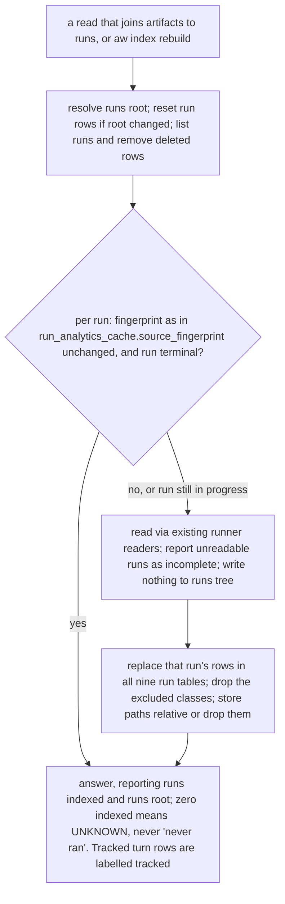

# Spec: Run index: read-only cache of local run records

- Date: 2026-11-01
- Status: to-review
- Id: bfuzs6
- Author: aw specs new
- Scope: Read-only SQLite index of the structured data in the local runs tree; split from 4sd62s
- From-Spec: 4sd62s

## 0. Purpose and relation to 4sd62s

This spec was split from spec `4sd62s` (artifact metadata store) on 2026-11-01, on the
maintainer's ruling to freeze that spec's scope. It owns the read-only SQLite index of the
structured data in the local runs tree (`.aw/records/runs/`): the nine run tables, their
freshness and exclusion rules, and their acceptance criteria. It uses the cache of `4sd62s`
(`.aw/state/index.db`, the `meta` keys `runs_root` and `run_reader_version`). Direction: this
spec depends on `4sd62s`. It does not gate release 2.0.0. The `turn_steps` table is shared with
spec `37am1y`, which defines the `turn` identity it joins on.

Review state: the moved text below was reviewed in `4sd62s` rounds 8 to 18; it still needs its
own review as a standalone spec.

## Moved text (verbatim from spec 4sd62s at split, 2026-11-01)

Section and requirement references below (for example 4.2, 4.5a, C1, AC-5) refer to spec
`4sd62s` unless stated otherwise. A later revision of this spec rewrites them as its own.

### 4.5b The cache indexes run records and never writes them (maintainer decision 2026-10-25, finding SR-701)

The cache also indexes the gitignored runs tree (`.aw/records/runs/`, found through `runner_shared`).
With this index, a query can join an artifact to the runs that acted on it. (The current size of the
runs tree is in the SCOPE bullet below.)

- The cache READS RUN DATA WITH THE RUNNER'S OWN READERS (`runner_shared.load_state`, and the event
  readers that `run_analytics_cache` already uses). It never uses a new parser, because a second
  parser of run state would bring back P1. Freshness uses the fingerprint rule that
  `run_analytics_cache.source_fingerprint` already defines. The cache reads an unfinished run again at every
  refresh, because an unfinished run can still change. Refresh includes membership: remove rows
  for deleted runs and report unreadable or malformed runs as incomplete data. Store the resolved
  runs root and its reader/fingerprint version in cache metadata. A root change discards the old
  run projection before reading the new root, even if run ids coincide. One cache indexes one
  runs root at a time; this does not add a multi-machine run store.
- READ-ONLY. Indexing writes nothing under the runs tree (AC-25). The storage, format and retention
  of run records do not change (N4). The tracked `turn` and `finalize` events (4.2) are written by
  the driver and finalize, not by the cache; the cache only reads them, like every other log.
- SCOPE: ALL STRUCTURED RUN DATA (round 15, maintainer decision OQ-21). Measured 2026-10-26: 596
  run directories, about 2.3 GB: session logs 1.9 GB, `manifest.json` 225 MB, `state.json` 58 MB,
  `events.jsonl` 31 MB (96 distinct event types; median 15 and at most 34 per run), prompts 25 MB,
  telemetry 9 MB, outcomes 8 MB, lane collections 6 MB, lane reports 6 MB. The cache indexes every
  STRUCTURED field of `state.json` (the run, each queue item, and every attempt field: about 60 per
  attempt, about 150 distinct keys across all attempts), every `events.jsonl`
  event, the item outcome and verification outcome files, lane collections, questions and answers,
  telemetry, and per-step usage from session logs. It does NOT store text bodies: prompts, session
  message text, tool input and output, command lines (`argv`) and markdown reports. For each such
  file it stores the path relative to the run directory and a content digest only, so `aw runs`
  can open the file. The runner's own readers define each field; where a reader exposes a field
  this table list does not name, the `extra_json` column of that table keeps it, so no structured
  field is dropped. Every run table has an `extra_json` column. EXCLUDED CLASSES: a field in one of
  these classes is never copied, whether into a column or into `extra_json` or `payload_json`:
  session ids (`session_id`, `verify_session_id`), command lines (`argv`), text bodies (prompt
  text, for example `carrier_verification_prompt` and `defect_reask_prompt`), user names and host
  names. A field that holds an absolute path (for example `repo`, `worktree`, `log`, `prompt`,
  `verify_log`, `lane_plan_path`, `driver.path`) is stored relative to the runs root or the
  repository, or dropped when it lies outside both.
- Tables (the columns shown are the minimum; see diagram 4 in 4.9.1 for every column, its meaning and
  its source key). Source-key renames follow 4.5c: `kind` becomes `plan_role`, `setid` `set_id`,
  `order` `order_nn`, `worktree_lane_id` `lane_id`, `prompt_sha256` `prompt_digest`.
  - `runs(run_id PK, host, driver, driver_sha256, schema_version, created_at, updated_at, terminal,
    selectors_json, options_json, run_order, driver_restarts, git_commit, aw_version, git_dirty,
    manifest_sha256, runbook_sha256, host_capabilities_json, extra_json)`. `state.json` has no
    top-level host or outcome: `driver` is `driver.id` (`oc_runipd` or `agy_runipd`), `host` is
    derived from it (`oc` or `agy`), `terminal` is `run_analytics_cache.run_is_terminal`, and
    `git_commit`, `aw_version` and `git_dirty` come from the `git` object, which only newer runs
    record. A run's overall result is derived from its items, not stored.
  - `run_items(run_id, position, id6, artifact_type, action, initial_status, item_status, plan_role,
    set_id, order_nn, from_backlog, needs_input, run_state_status, dependencies_json, extra_json,
    PK(run_id, position))`
  - `attempts(run_id, item_position, id6, attempt_no, action, lane_id, worktree_branch, worktree_base,
    worktree_disposition, starting_head, ending_head, starting_status, ending_status, model,
    model_source, host_posture, prompt_digest, started_at, ended_at, exit_code, disposition,
    finalized, integrated, integration_signal, integration_detail, corrections_made,
    corroboration_verdict, verify_model, verify_exit_code, verify_has_evidence,
    verify_verdict_state, verify_verdict_recognized, verification_status, questions_verdict,
    tests_run_json, extra_json, PK(run_id, item_position, attempt_no))`. Today's attempt records
    have no `ace`, `variant`, `requested_model` or `outcome` key; those values belong to the `turn`
    events (4.2) and appear here only when a future runner records them (in `extra_json` until then).
  - `run_events(run_id, ordinal, at, event, id6, position, payload_json, PK(run_id, ordinal))`:
    every line of `events.jsonl`. `payload_json` is the event without the excluded classes above.
  - `run_outcomes(run_id, item_position, attempt_no, outcome_role, disposition, summary_digest,
    files_changed_json, tests_json, commits_json, starting_head, ending_head, pushed, verdict,
    corrections_made, extra_json, PK(run_id, item_position, attempt_no, outcome_role))`: the item
    outcome (`outcome_role: execute`, file `NN-<id6>.json`) and verification outcome
    (`outcome_role: verify`, file `NN-<id6>-verification.json`). The files carry no attempt number
    and a later attempt overwrites them, so `attempt_no` is the item's last attempt at index time;
    earlier attempts' outcome files are not recoverable.
  - `run_questions(run_id, question_id, item_position, id6, oq_id, action, created_at, answered_at,
    status, gates_verdict, fingerprint, artifact_hash, extra_json, PK(run_id, question_id))`: the
    question files (`questions/<qid>.json`) and answer files (`answers/<qid>.json`) of
    `question_inbox`. `status` is one of `question_inbox.VALID_QUESTION_STATUSES` (`open`,
    `answered`, `stale`); `answered_at` comes from the answer file. Question and answer TEXT and the
    question's `artifact_path` (stored relative) are not copied as text.
  - `run_telemetry(run_id, execution_id, event_kind, phase, item_position, attempt_no, at,
    duration_seconds, cpu_seconds, rss_bytes, load_1m, memory_available_bytes, probe_error_count,
    extra_json, PK(run_id, execution_id, event_kind))`. `phase` is `execute` or `validate`.
  - `turn_steps(run_id, item_position, attempt_no, turn_role, turn_index, step_index, at,
    step_type, tool_name, duration_seconds, tokens_input, tokens_output, tokens_cache_read,
    tokens_cache_write, tokens_reasoning, tokens_total, cost_amount, cost_currency, item_id,
    extra_json, PK(run_id, item_position, attempt_no, turn_role, turn_index, step_index))`: one row
    per model step from the host session log (OQ-20). `turn_role` and `turn_index` match the
    tracked `turn` event (4.2). `item_id` is the E-* or V-* id that the `AW-ITEM` marker attributed
    the step to, or `unattributed`. Tool input and output are not copied.
  - `run_files(run_id, rel_path, file_role, size, content_digest, PK(run_id, rel_path))`: every
    text file the cache deliberately does not copy (prompts, session logs, reports), with its path
    relative to the run directory, so a command can find and open it.
  - Lane collection files (`collections/NN-<id6>-attempt-N.json`) are stored in the owning
    `attempts` row's `extra_json` under the key `collection`, with `lane_root` and
    `lane_submission_root` stored relative or dropped.

  `item_position` references `run_items.position` within the same run. Attempt numbering belongs
  to a queue item, as `runner_shared` defines it, not to an artifact. Two positions can name the
  same `id6`; both may have attempt 1. Keep `id6` for artifact queries, but enforce that it agrees
  with the owning queue item. An actor run/attempt reference is only a partial join key when it
  does not identify a queue item. Return all matches and report ambiguity; never select one by
  row order or invent an item position in a migrated event.

  The cache never copies the excluded classes listed in the SCOPE bullet. The cache is gitignored,
  but people often paste `aw find --format json` output.
  `aw runs analyze` reads these tables through `artifact_meta` instead of its own parsers, which
  removes its second reader of run state (P1); `run_analytics_cache` entries become derivable from
  the cache, and the implementing plan decides whether that module is deleted or kept as a view.
- LIMIT, SHOWN IN THE OUTPUT. Run data exists only on the machine that ran it. A fresh clone has
  none. The cache of a lane worktree does not see the runs of the main checkout. So the toolkit must
  never present "no attempts" as "never run". Every answer that uses the run tables states how many
  runs the cache indexed and from which runs root. Zero means UNKNOWN (AC-25). Answers from the
  TRACKED `turns`, `turn_items`, `changed_paths` and `plan_items` tables are labelled as tracked:
  they exist on every clone, but they cover only turns written after the cutover.
- The `actor.run_id` and `actor.attempt` values of an event (4.2) connect events to runs. A tracked
  event can name the run that wrote it. The join is available where the run records exist. Missing run data and ambiguous item
  matches are explicit; neither proves that an event was not produced by that run.

Diagram (run tables), moved from 4sd62s 4.9.1 diagram 4:

```mermaid
erDiagram
    ARTIFACTS["ARTIFACTS: one row per artifact, see spec 4sd62s 4.9.1 diagram 1."] {
        text id6 PK "Stable artifact id."
    }
    RUNS["RUNS: one row per run directory under the runs root. Read-only index of state.json."] {
        text run_id PK "Run directory name, for example run-20261025T224352Z-3331747."
        text host "oc or agy, derived from driver."
        text driver "driver.id in state.json: oc_runipd or agy_runipd. NULL for older runs that did not record it."
        text driver_sha256 "driver.sha256: digest of the driver code that ran. driver.path is absolute and is not copied."
        int schema_version "state.json schema version."
        text created_at "UTC time the run was created."
        text updated_at "UTC time state.json was last written."
        int terminal "1 when run_analytics_cache.run_is_terminal says the run can no longer change. Not stored in state.json."
        text selectors_json "The selectors the run was started with."
        text options_json "The run options (flags), with no command line."
        text run_order "Ordering mode of the queue."
        int driver_restarts "How many times the driver restarted."
        text git_commit "git.commit: commit the run started from. Only newer runs record the git object."
        text aw_version "git.aw_version: toolkit version that ran."
        int git_dirty "git.dirty: 1 when the checkout had uncommitted changes."
        text manifest_sha256 "Digest of manifest.json."
        text runbook_sha256 "Digest of the frozen runbook."
        text host_capabilities_json "Host capability probe results for the run."
        text extra_json "Every other structured field, without the excluded classes of 4.5b."
    }
    RUN_ITEMS["RUN_ITEMS: one row per item in a run's queue."] {
        text run_id PK, FK "The run."
        int position PK "Queue position. Two positions can name the same artifact."
        text id6 "The artifact queued. Reference, no constraint."
        text artifact_type "ipd, spec or backlog."
        text action "execute, review, plan, orchestrate or skip, as the queue records it."
        text initial_status "Artifact status when queued."
        text item_status "Item status in the run, for example queued, executed, reviewed, dependency-blocked, blocked, fail-gate, interrupted, fail-merge or failed-safely."
        text plan_role "child or orchestrator (source key kind)."
        text set_id "Set of the artifact (source key setid)."
        int order_nn "Order in the Set (source key order)."
        text from_backlog "Backlog id6 the item graduated from, if any."
        int needs_input "1 when the item waits for a human answer."
        text run_state_status "Status the runner's run-state check derived for the item."
        text dependencies_json "Dependency conditions as the runner evaluated them."
        text extra_json "Every other structured queue-item field."
    }
    ATTEMPTS["ATTEMPTS: one row per attempt at one queue item."] {
        text run_id PK, FK "The run."
        int item_position PK, FK "Owning queue item."
        int attempt_no PK "Attempt number within the queue item, from 1."
        text id6 "Must agree with the owning queue item."
        text action "Action of this attempt."
        text lane_id "Isolated worktree lane id (source key worktree_lane_id)."
        text worktree_branch "Lane branch name."
        text worktree_base "Commit the lane worktree was created from."
        text worktree_disposition "How the lane was set up: created, attempt-scoped or adopted. NULL for a non-isolated attempt."
        text starting_head "Commit the attempt started from."
        text ending_head "Commit the attempt ended at."
        text starting_status "Artifact status at start."
        text ending_status "Artifact status at end."
        text model "Model the attempt recorded."
        text model_source "Where the model choice came from: options, or NULL when not recorded."
        text host_posture "Permission posture applied to the host for this attempt (7ckptx R4.1)."
        text prompt_digest "SHA-256 of the prompt (source key prompt_sha256). The prompt text is not copied."
        text started_at "UTC start."
        text ended_at "UTC end."
        int exit_code "Agent process exit code."
        text disposition "Attempt disposition, for example executed, reviewed, blocked, substantially-complete, fail-gate, fail-verify, partial or interrupted."
        text finalized "Whether and how finalize completed, as recorded."
        text integrated "Integration result text as recorded, for example a merge description. NULL when not integrated."
        text integration_signal "What decided integration: verifier, driver-run-suite, suite-failed or verifier-declined."
        text integration_detail "Why integration succeeded or was refused."
        int corrections_made "Corrections the verifier made."
        text corroboration_verdict "Whether the driver's own evidence corroborated the agent's claim."
        text verify_model "Model of the verifier turn."
        int verify_exit_code "Verifier process exit code."
        int verify_has_evidence "1 when the verifier cited evidence."
        text verify_verdict_state "Verifier verdict as recognized by the driver: verified, fail-verify, blocked or correction_required."
        int verify_verdict_recognized "1 when the verifier's verdict line matched a known verdict."
        text verification_status "Overall verification result: verified, unverified, blocked or pass."
        text questions_verdict "Result of checking the attempt's emergent questions (6kwd2e)."
        text tests_run_json "Test commands the attempt ran."
        text extra_json "Every other structured attempt field."
    }
    TURN_STEPS["TURN_STEPS: one row per model step of one turn, from the host session log. Local only (OQ-20)."] {
        text run_id PK, FK "The run."
        int item_position PK, FK "The queue item."
        int attempt_no PK, FK "The attempt."
        text turn_role PK "Same vocabulary as TURNS.turn_role (4.2)."
        int turn_index PK "Same as TURNS.turn_index."
        int step_index PK "Step number within the session, from the host."
        text at "UTC time of the step."
        text step_type "Host step type, for example tool or agent_response."
        text tool_name "Tool the step called, for example bash. Tool input and output are not copied."
        real duration_seconds "Step duration as the host reported it."
        int tokens_input "Input tokens of the step."
        int tokens_output "Output tokens of the step."
        int tokens_cache_read "Cache-read tokens of the step."
        int tokens_cache_write "Cache-write tokens of the step."
        int tokens_reasoning "Reasoning tokens of the step."
        int tokens_total "Total tokens of the step."
        text cost_amount "Exact decimal cost of the step, when the host recorded one."
        text cost_currency "ISO 4217 code of that cost."
        text item_id "E-* or V-* id from the most recent AW-ITEM marker, or unattributed."
        text extra_json "Other structured step fields, without tool input or output."
    }
    RUN_EVENTS["RUN_EVENTS: one row per line of a run's events.jsonl (96 event types seen)."] {
        text run_id PK, FK "The run."
        int ordinal PK "Line number in events.jsonl."
        text at "UTC time of the event."
        text event "Event name, for example worktree-allocated or ipd-finalized."
        text id6 "Artifact the event concerns, if any."
        int position "Queue position the event concerns, if any."
        text payload_json "The event without the excluded classes of 4.5b (session ids, argv, text bodies; paths made relative)."
    }
    RUN_OUTCOMES["RUN_OUTCOMES: one row per item outcome or verification outcome file."] {
        text run_id PK, FK "The run."
        int item_position PK, FK "The queue item."
        int attempt_no PK, FK "The item's last attempt at index time: outcome files carry no attempt number and are overwritten."
        text outcome_role PK "execute for NN-id6.json, verify for NN-id6-verification.json."
        text disposition "Disposition the agent reported."
        text summary_digest "Digest of the summary text, which is not copied."
        text files_changed_json "Files the AGENT reported changing. The tracked finalize event records the git diff from begin base to finalize tip instead."
        text tests_json "Tests the agent reported."
        text commits_json "Commits the agent reported."
        text starting_head "Commit the agent reported starting from."
        text ending_head "Commit the agent reported ending at."
        int pushed "1 when the agent reported a push. The runner forbids pushes, so 1 is a defect signal."
        text verdict "Verify role: VERIFIED, BLOCKED or CORRECTION_REQUIRED."
        int corrections_made "Corrections reported."
        text extra_json "Other structured outcome fields."
    }
    RUN_QUESTIONS["RUN_QUESTIONS: one row per question a run asked the maintainer, from questions/qid.json and answers/qid.json (question_inbox)."] {
        text run_id PK, FK "The run."
        text question_id PK "Question id."
        int item_position "Queue item that asked."
        text id6 "Artifact the question concerns (source key artifact_id6)."
        text oq_id "Open-question id in the artifact, when the question comes from one."
        text action "Action the item was performing."
        text created_at "UTC time the question was created."
        text answered_at "UTC time of the answer file. NULL while open."
        text status "open, answered or stale (question_inbox.VALID_QUESTION_STATUSES)."
        text gates_verdict "Gate result recorded with the question."
        text fingerprint "Fingerprint used to deduplicate the question."
        text artifact_hash "Digest of the artifact when the question was asked."
        text extra_json "Other structured fields. Question text, answer text and the artifact path as text are not copied."
    }
    RUN_TELEMETRY["RUN_TELEMETRY: one row per start or end telemetry record of one execution phase."] {
        text run_id PK, FK "The run."
        text execution_id PK "Execution id from the telemetry file."
        text event_kind PK "start or end."
        text phase "execute or validate."
        int item_position "The queue item."
        int attempt_no "The attempt."
        text at "UTC time of the record."
        real duration_seconds "Phase duration, end records only."
        real cpu_seconds "Process CPU seconds."
        int rss_bytes "Process resident memory."
        real load_1m "One-minute load average."
        int memory_available_bytes "Available memory."
        int probe_error_count "Resource probes that failed."
        text extra_json "Other structured telemetry fields, for example host and tool versions."
    }
    RUN_FILES["RUN_FILES: one row per text file the cache deliberately does not copy."] {
        text run_id PK, FK "The run."
        text rel_path PK "Path relative to the run directory."
        text file_role "prompt, session, report, lane-report or other."
        int size "File size in bytes."
        text content_digest "SHA-256 of the file, so a change is detectable."
    }
    RUNS ||--o{ RUN_ITEMS : "queued"
    RUN_ITEMS ||--o{ ATTEMPTS : "tried"
    ATTEMPTS ||--o{ TURN_STEPS : "took steps"
    ATTEMPTS ||--o{ RUN_OUTCOMES : "reported"
    RUNS ||--o{ RUN_EVENTS : "logged"
    RUNS ||--o{ RUN_QUESTIONS : "asked"
    RUNS ||--o{ RUN_TELEMETRY : "measured"
    RUNS ||--o{ RUN_FILES : "kept text in"
    ARTIFACTS |o--o{ RUN_ITEMS : "was queued as"
```

#### 4.9.8 Indexing run records (4.5b)

| AC-25 | 4.5b | The cache indexes run records read-only. The toolkit never presents "no run data" as "never ran". | Pasted: (1) a test that indexes a test runs tree into `runs`, `run_items` and `attempts`, with rows that match the output of the runner's own readers; (2) a byte-for-byte check that indexing changed no file under the runs tree; (3) two queue items for one artifact both retain attempt 1; an ambiguous actor join reports all matches; (4) deleting a run removes its rows, switching roots cannot retain old runs, and an unreadable run produces an incomplete result; (5) on a fresh clone, a query for the attempts of an artifact reports `runs_indexed: 0` (unknown) and not an empty success, while a query of that artifact's tracked `turns` returns its post-cutover turns labelled as tracked. |

| AC-38 | 4.5b (OQ-21) | The cache indexes every structured run field and no text body. | Pasted: (1) for a fixture runs tree, every field that `runner_shared.load_state` exposes for a run, item and attempt appears in a column or in `extra_json`, and every lane collection field, except fields in the excluded classes of 4.5b, which are dropped, and absolute paths, which are stored relative or dropped; (2) every `events.jsonl` line has a `run_events` row; (3) a scan of `index.db` finds no prompt text, session text, tool output, `argv` value, session id, absolute path, user name or host name from the fixture; (4) each skipped text body has a `run_files` row with its digest; (5) AC-13 measures the cold build time of the full run index on this machine. |

### OQ-21: How much of the runs tree the cache indexes (round 15)

- Status: resolved
- Owner: maintainer
- Blocking: yes
- Question: Which run data under `.aw/records/runs/` does the cache index?
- Evidence: measured 2026-10-26: 598 run directories, about 2.3 GB (session logs 1.9 GB, `manifest.json` 225 MB, `state.json` 58 MB, `events.jsonl` 31 MB with 26 event types per run, prompts 25 MB, telemetry 9 MB, outcomes 8 MB, collections 6 MB, lane reports 6 MB). Each attempt in `state.json` has about 60 fields; 4.5b indexed about 14.
- Recommendation: Index all structured data; never copy text bodies.
- Closes when: The maintainer decides, and 4.5b, the diagrams and AC-25 use the chosen rule.
- Resolution or deferral rationale: RESOLVED 2026-10-26 by the user via /askme: index every structured field of `state.json`, `events.jsonl`, outcomes, verification outcomes, lane collections, questions and answers, telemetry, and per-step usage from session logs. Do not store prompts, session text, tool output, command lines or reports in the cache; store their path and content digest only. No reason was given.
- Correction 2026-10-26 (round 16): the evidence line's "598 run directories" and "26 event types per run" were mis-measured; re-measured: 596 run directories, 96 distinct event types, a median of 15 and at most 34 per run (4.5b). The decision is unchanged.

## Moved text, second pass (terms, limits, notes and rows that belong to the run index)

| runs root | The gitignored directory that holds run records, normally `.aw/records/runs/`, resolved by `runner_shared` (4.5b). |

- The run index (4.5b) is local to one machine and is incomplete by design. It shows only the runs
  whose records exist on this machine. A count of zero means "unknown", not "never ran". The tracked
  `turn` and `finalize` events cover only work done after the cutover: the migration invents none
  for earlier runs and does not backfill them from local run records (5.2 step 4).

Size row (moved from 4sd62s 6):
| Run index | 596 runs, about 2.3 GB, of which 1.9 GB session logs | Nine run tables (4.5b) built through the runner's readers; per-step usage parses every session log once. AC-13 measures the cold build. `aw runs analyze` moves onto these tables. |

Module direction (moved from 4sd62s section 7):
MODULE DIRECTION. `artifact_meta` reads run records through the runner's readers, and the runners
write through `artifact_meta`. To avoid an import cycle with `runner_shared`, the plan moves the run
readers it needs into a small module that both import, or has the run index call them lazily. The
plan names the choice.

Compatibility row (moved from 4sd62s 9):
| `6kwd2e` mid-run questions | implemented | `run_questions` indexes its `questions/<qid>.json` and `answers/<qid>.json` files read-only, with its status vocabulary `open`, `answered`, `stale` (4.5b); an unmerged lane paused for the answer-resume path (`answer_resume` attempt field, `resume_with_answers`, `resolve_prior_lane`) keeps its `turn` events on the lane branch until adopted or abandoned (4.2 TURN EVENTS). |

## Workflow history
- 2026-11-01 to-review (aw set): Split from 4sd62s (2026-11-01) on maintainer ruling; contains text reviewed in 4sd62s rounds 8-18; needs its own standalone review

- 2026-11-01 created (aw specs): Read-only SQLite index of the structured data in the local runs tree; split from 4sd62s
