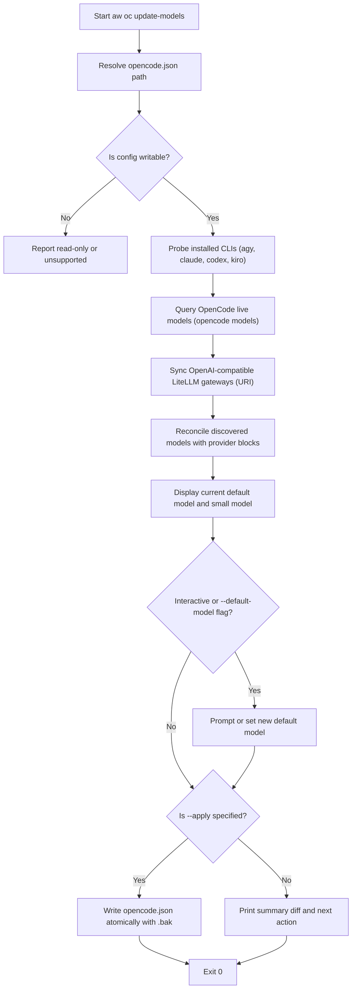
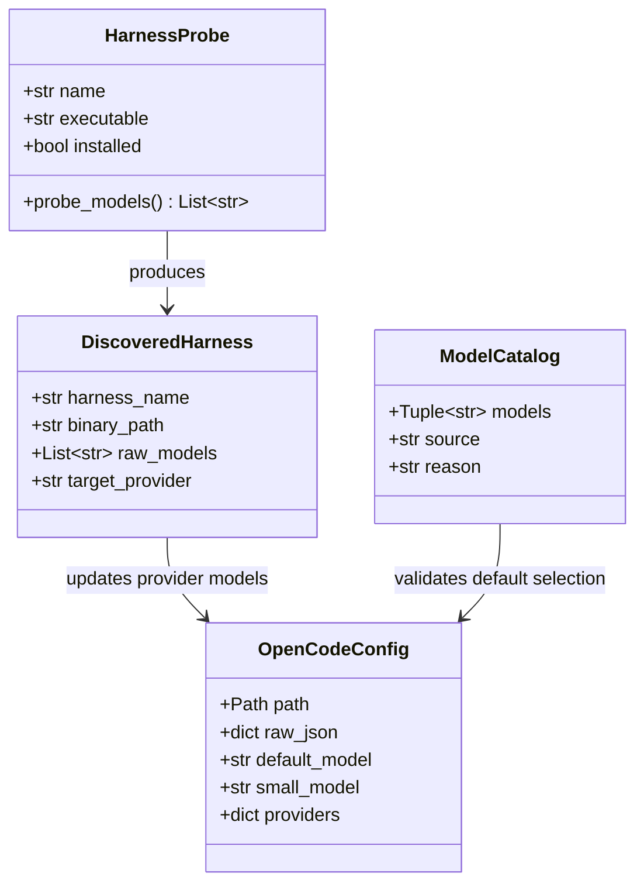

# Spec: Multi-harness model discovery and default selection for aw oc update-models

- Date: 2026-11-15
- Status: to-review
- Id: ayfyie
- Author: Antigravity
- Scope: Enhance aw oc update-models to discover models from installed harnesses (agy, claude, codex, kiro), populate opencode.json, and select the default model
- Work-Kind: feature
- Set: ocsync

## 0. Terms used in this spec

This section is informative. It defines each term once, and the rest of the spec uses the same term for the same concept.

| Term | Meaning |
|---|---|
| harness | An external AI agent CLI installed on the host system, specifically `agy`, `claude`, `codex`, or `kiro-cli`. |
| provider | A model service declaration inside OpenCode's configuration file under the `provider` dictionary. |
| OpenCode config | The JSON configuration file that OpenCode loads (`opencode.json`), located by OpenCode precedence rules. |
| default model | The top-level `model` key in `opencode.json` designating the active primary model for OpenCode turns. |
| small model | The top-level `small_model` key in `opencode.json` designating the secondary model for low-complexity turns. |
| live catalog | The set of models that OpenCode currently reports as accessible, queried via `opencode models`. |
| model sync | The process of updating provider `models` blocks and pricing in `opencode.json` from discovered sources. |

## 1. Problem and Objective

`aw oc update-models` previously supported only OpenAI-compatible gateways that expose LiteLLM proxy admin pricing endpoints (`/model/info`). When executed on machines where other AI agent harnesses are installed (`agy`, `claude`, `codex`, `kiro`), the command ignored them, omitted newly released models (such as Gemini 4 series and Claude 5.5 in Antigravity, and GPT-6 series in Codex), and provided no mechanism to view or update OpenCode's configured default model.

This specification defines an extensible discovery engine and interactive configuration workflow for `aw oc update-models` that:
1. Detects installed AI harnesses on the host system.
2. Identifies models accessible to OpenCode from each installed harness and active plugins.
3. Populates missing model entries in `opencode.json` under their respective provider blocks.
4. Displays the current default model and offers interactive and flagged options to select a new default.

## 2. Architecture and Data Flow

The following sequence details how `aw oc update-models` processes installed harnesses and reconciles configuration:

The relationship between discovered harnesses, live catalog entries, and `opencode.json` is modeled below:

## 3. Detailed Requirements

### 3.1 Harness Detection

1. **Discovery Boundary**:
   - The probe must check for the presence of CLI executables on the system `$PATH` using standard resolution (`shutil.which`):
     - `agy`: Google Antigravity CLI.
     - `claude`: Anthropic Claude Code CLI.
     - `codex`: OpenAI Codex CLI.
     - `kiro-cli` (falling back to `kiro`): Kiro CLI.
   - If an executable is absent, the probe records `installed: false` and skips execution without failing.

2. **Model Extraction per Harness**:
   - **Antigravity (`agy`)**: When `agy` is installed, the probe invokes `agy models` (or queries the local Antigravity settings/cache) to discover active models. Models exposed by `opencode-antigravity-auth` with the `antigravity-` prefix (e.g. `antigravity-claude-opus-5-5-high`, `antigravity-gemini-4-carbon-high`) are mapped to the `google` provider.
   - **Codex (`codex`)**: When `codex` is installed, the probe inspects `~/.codex/models_cache.json` and `~/.codex/config.toml` to extract active models (e.g. `gpt-6.1-terra`, `gpt-6.1-sol`, `gpt-6-astra`). These models are mapped to the `openai` provider.
   - **Claude Code (`claude`)**: When `claude` is installed, the probe inspects `~/.claude/settings.json` to identify configured endpoints and default models. Discovered models routed through gateways are validated against OpenCode providers.
   - **Kiro (`kiro`)**: When `kiro-cli` is installed, the probe executes `kiro-cli chat --list-models --format json` to extract available models. The tool reports Kiro availability and notes whether the `opencode-kiro` plugin is present in OpenCode.

### 3.2 Configuration Population in `opencode.json`

1. **Provider Model Blocks**:
   - Discovered models that are missing from the respective `provider.<name>.models` block must be populated with:
     - `name`: A human-readable display title derived from the model name or harness metadata.
     - Reasonable default limits or options if supplied by the harness discovery payload.
   - Existing model entries in `opencode.json` must be preserved without overwriting customized user settings.
2. **Gateway Pricing Sync**:
   - Providers declaring `@ai-sdk/openai-compatible` or `options.baseURL` with LiteLLM admin endpoints continue to have their `cost` blocks refreshed per the existing `ocsync-01` contract.

### 3.3 Default Model Display and Selection

1. **Current Default Display**:
   - `aw oc update-models` must output the current default model and small model:
     - `current default model: <provider>/<model>`
     - `current small model: <provider>/<model>`
2. **Interactive Selection**:
   - When running on an interactive terminal and neither `--agent` nor `--no-interactive` is passed:
     - The tool prompts whether to update the default model.
     - If confirmed, the tool displays valid options from the reachable model catalog and accepts selection by index or identifier.
3. **Non-Interactive Flags**:
   - The CLI must provide explicit flags:
     - `--default-model <id>`: Sets the top-level `model` property in `opencode.json`.
     - `--small-model <id>`: Sets the top-level `small_model` property in `opencode.json`.
   - The provided model identifier must be validated against known providers or reachable catalog entries before writing.

### 3.4 Command-Line Interface and Output

1. **Flag Compatibility**:
   - All existing flags must remain functional: `--config`, `--apply`, `--dry-run`, `--no-backup`, `--allow-insecure`, `--agent`, `--json`.
2. **Execution Modes**:
   - `--dry-run` (or default without `--apply` in non-interactive mode): Displays proposed additions and changes without writing to disk.
   - `--apply`: Executes changes, writing `opencode.json` atomically with a pre-write timestamped `.bak` backup file.

## 4. Verification and Acceptance Criteria

1. Running `aw oc update-models --dry-run` on a system with `agy` and `codex` installed lists new models for `google` and `openai`.
2. Running `aw oc update-models --apply` updates `opencode.json` and preserves valid JSON syntax and indentation.
3. Passing `--default-model <id>` sets `"model": "<id>"` in `opencode.json`.
4. Automated tests with mock harness runners verify that absent harnesses are handled gracefully and no subprocess calls fail the run.
5. All unit tests pass with zero network calls in the test suite.

## Workflow history
- 2026-11-15 to-review (aw set): complete spec draft for multi-harness update-models

- 2026-11-15 created (aw specs): Enhance aw oc update-models to discover models from installed harnesses (agy, claude, codex, kiro), populate opencode.json, and select the default model
