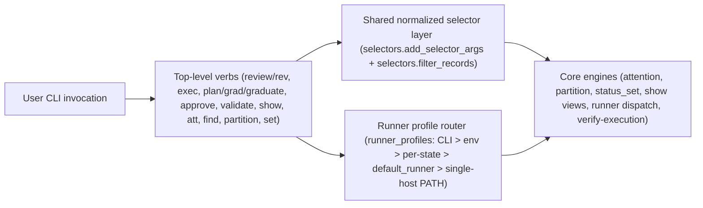

# Spec: Normalized Artifact Selectors, Unified aw show Views, and Verb-First CLI

- Id: ogd2nv
- Status: to-review
- Short-Description: Governing CLI contract for normalized artifact selectors (1iojci), unified aw show read-only views, retiring aw reviews, and verb-first top-level commands with per-state runner profile routing (i8dc07).
- Author: antigravity
- Priority: medium
- Work-Kind: feature

> Write and proofread this spec per the technical writing standard, `.aw/system/workflows/technical-writing/technical-writing.md` (`.agents/workflows/technical-writing/technical-writing.md` in a legacy-layout install), including requirement 12 (diagrams).

## Workflow history
- 2026-11-23 to-review (aw set): Authored from maintainer's 10 resolved OQs in 1iojci and i8dc07; ready for /spec-review
- 2026-11-23 created (aw specs): Governing CLI contract for normalized artifact selectors (1iojci), unified aw show read-only views, retiring aw reviews, and verb-first top-level commands with per-state runner profile routing (i8dc07).

## Scope

This specification governs two coupled CLI ergonomics initiatives graduated from backlog items `1iojci` (normalized artifact selector flags across all `aw` commands) and `i8dc07` (verb-first top-level CLI commands, per-state runner profile routing, unified read-only `aw show` views, and removing `aw reviews` in 2.0.0).

Non-goals:
- Changing non-artifact monitoring commands (`aw runs`, `aw runners`, `pwatch`) short flags (`-s`, `-S`, `-t`, `-r`, `-R`, `-d`).
- Removing existing host-qualified runner commands (`aw oc ...`, `aw agy ...`) or `aw set ...`; those remain supported lower-level interfaces.
- Implementing review-staleness clearing on human approval (`9ifwdx` owns that behavior; this spec integrates `aw show stale-reviews` and `aw approve` with it).

## Architecture overview

## Recorded maintainer decisions

All ten design questions from backlog items `1iojci` and `i8dc07` were resolved by the maintainer on 2026-11-22 via `/askme`:

1. **`1iojci` OQ-01 (Multi-word short aliases)**: Document double-dash short aliases (`--sid`, `--nsid`, `--mtime`, `--ctime`, `--desc`) as canonical in `--help`, and also accept single-dash forms (`-sid`, `-nsid`, `-mtime`, `-ctime`, `-desc`) as hidden aliases.
2. **`1iojci` OQ-02 (Filename-date flag & `-d`)**: Use `--date` / `-d` (and `-D` / `--not-date`) for filename-date selection across selector commands; move `aw att`'s `-d` (`--details`) to `--details` / `--desc` / `-desc`; rename `aw set`'s write-override `--date` to `--history-date` (keeping `--date` on authoring commands where no artifact selection occurs).
3. **`1iojci` OQ-03 (Date/time syntax & timestamp sources)**: Support unified expressions (exact `YYYYMMDD` / `YYYY-MM-DD`, prefixes like `202611`, closed/open `..` ranges like `20261101..20261115`, `20261101..`, `..20261115`, quoted comparators `>=`/`<=`/`>`/`<`, and relative windows `7d`/`24h`), backed by batched git/artifact history timestamps for `--modified-time` and `--created-time` with filesystem `stat()` fallback for uncommitted/untracked files, and align `aw att --order-by mtime|ctime` to the same source.
4. **`1iojci` OQ-04 (Short-flag collisions)**: Enforce normalized selector short flags strictly across all artifact-selecting commands (`att`, `find`, `search`, `partition`, `show`, `set`, `group`, `rename`, `archive`, `index`, `ipd`, `oc`, `agy`, and new verb-first commands); move conflicting flags on those commands to long forms (`--paths`, `--short`, `--prompt`); exempt non-artifact monitoring commands (`aw runs`, `aw runners`, `pwatch`).
5. **`1iojci` OQ-05 (Negated long-flag naming)**: Make `--not-<field>` canonical in `--help` (`--not-type`, `--not-status`, `--not-priority`, `--not-readiness`, `--not-set-id`, `--not-date`, `--not-mtime`, `--not-ctime`) and accept `--<field>-not` (`--status-not`, `--type-not`, etc.) as aliases.
6. **`i8dc07` OQ-01 (Host/profile routing & per-state defaults)**: Reuse `agent_workflows/runner_profiles.py` (`default_runner`, named profiles, `--host` / `--as` / `AW_HOST` overrides) with automatic single-host `PATH` fallback when `default_runner` is unset, plus per-verb / per-state default profile configuration and CLI control (e.g., separate defaults for backlog graduation, IPD review, IPD execution, and validation).
7. **`i8dc07` OQ-02 (`aw show` dispatch & views)**: Reserve built-in view names (`stale-reviews`, `decisions`, `graduation`, `board`, `history`, `runs`) dispatching first, fall back to artifact selectors (`id6`, Set ID, fragment, status), and provide `aw show artifact <selector>` as the collision escape hatch.
8. **`i8dc07` OQ-03 (`aw validate`)**: `aw validate <ids|set>` runs AI post-execution verification (`/verify-execution`) using the configured validation host/model profile; `aw check` and `aw doctor` remain the fast deterministic local checks.
9. **`i8dc07` OQ-04 (`aw approve` attestation)**: Interactive terminal calls (`aw approve <ids>`) attest automatically without requiring `--by-human`; non-interactive or `--agent` calls require `--by-human --message "<human instruction>"`.
10. **`i8dc07` OQ-05 (Retiring `aw reviews`)**: Remove `aw reviews` outright in 2.0.0 once `aw show decisions` ships, updating all 13 references across code, tests, and docs.

## Requirements

### Section 1: Normalized artifact selectors (`1iojci`, Set `selectors`)

- **R-01 (Single selector authority)**: `agent_workflows/selectors.py` must define one shared selector specification (`SelectorSpec`), one shared `argparse` flag builder (`add_selector_args`), and one shared filter evaluator (`filter_records`) used by every artifact-selecting CLI command.
- **R-02 (Uniform include/exclude flag matrix)**: Every artifact-selecting command must accept repeatable (and comma-separated) flags with identical semantics:
  - Type/tree: `-t` / `--type` / `--tree` and `-T` / `--not-type` (alias `--type-not`).
  - Status: `-s` / `--status` and `-S` / `--not-status` (alias `--status-not`).
  - Priority: `-p` / `--priority` and `-P` / `--not-priority` (alias `--priority-not`).
  - Readiness: `-r` / `--readiness` and `-R` / `--not-readiness` (alias `--readiness-not`).
  - Set ID: `--set-id` / `--sid` (hidden alias `-sid`, plus compatibility `--set` where non-authoring) and `--not-set-id` / `--nsid` (hidden alias `-nsid`, alias `--set-id-not`).
  - Filename date (`YYYYMMDD` prefix): `-d` / `--date` and `-D` / `--not-date` (alias `--date-not`).
  - Modified time: `--modified-time` / `--mtime` (hidden alias `-mtime`) and `--not-modified-time` / `--not-mtime` (aliases `--mtime-not`, `-nmtime`).
  - Created time: `--created-time` / `--ctime` (hidden alias `-ctime`) and `--not-created-time` / `--not-ctime` (aliases `--ctime-not`, `-nctime`).
- **R-03 (Date and timestamp expressions)**: Filename-date, modified-time, and created-time filters must accept exact dates (`YYYYMMDD`, `YYYY-MM-DD`), prefixes (`YYYY`, `YYYYMM`), closed ranges (`A..B`), open ranges (`A..`, `..B`), comparison operators (`>=`, `<=`, `>`, `<`), and relative windows (`Nd`, `Nh`, `Nm`, e.g. `7d`, `24h` for mtime/ctime). Invalid expressions must fail with exit code 2 naming the offending token.
- **R-04 (Durable git/history timestamps)**: `--created-time` and `--modified-time` must resolve artifact timestamps from a single batched git history pass (first commit touching the path for creation, latest commit for modification, falling back to filesystem `stat()` when uncommitted, untracked, or outside git). `aw att --order-by mtime` and `--order-by ctime` in `agent_workflows/attention.py` must call this same helper so sorting and filtering agree.
- **R-05 (Collision resolution on artifact-selecting commands)**:
  - On `aw att` / `aw next`: move `-d` (`--details`) to `--details` / `--desc` (hidden alias `-desc`), and fix the `--arcive-state` option typo in `agent_workflows/cli.py`.
  - On `aw set`: rename the history-date write-override `--date` to `--history-date` so `-d` / `--date` unambiguously selects by filename date.
  - On `aw find` and `aw search`: move `-p` (`--paths`) to `--paths` and `-S` (`--short`) to `--short`.
  - On `agent_workflows/agy_run.py`: move inline `-p` (`--prompt`) to `--prompt`.
  - Non-artifact operational commands (`aw runs`, `aw runners`, `pwatch`) are explicitly exempt and keep their existing short flags.
- **R-06 (Full CLI, runner, and completion coverage)**: `aw att`/`next`, `aw find`/`search`, `aw partition`, `aw show`, `aw set`, `aw group`, `aw rename`, `aw archive`, `aw index`, `aw ipd board`, `aw oc run`/`review`, `aw agy run`/`review`, and `agent_workflows/completion.py` must all attach and complete the normalized selector flags.

### Section 2: Per-state runner profile routing and `PATH` fallback (`i8dc07`, Set `cliverbs` Order 01)

- **R-07 (Host and profile precedence)**: Verb-first runner commands must resolve host, model, and variant through `agent_workflows/runner_profiles.py` and `agent_workflows/run_dispatch.py` with precedence: explicit `--host` / `--as <profile>` / `--model` / `--variant` > `AW_HOST` environment override > per-state default profile (keyed by workflow state/verb: `graduate`/`plan`, `review`, `execute`, `validate`) > `default_runner` > single-host `PATH` auto-detection (if exactly one of `agy` or `opencode` is found on `PATH`). When both or neither binaries are on `PATH` and no default is configured, the command must exit 2 with a clear remediation message.
- **R-08 (Per-state profile config and CLI control)**: Extend `agent_workflows/runner_profiles.py` and profile management CLI (exposing a host-neutral `aw profile` alias alongside `aw oc profile`) so users can set, inspect, and clear per-state default profiles (`graduate`/`plan`, `review`, `execute`, `validate`) and override them per invocation via `--as <profile>`, `--host`, `--model`, and `--variant`.

### Section 3: Unified read-only `aw show` views and retiring `aw reviews` (`i8dc07`, Set `cliverbs` Order 02)

- **R-09 (Reserved read-only views under `aw show`)**: `aw show` must dispatch reserved built-in view names before falling back to artifact selector resolution: `stale-reviews` (delegating to the unified stale-review renderer from `9ifwdx`), `decisions` (delegating to `agent_workflows/reviews.py`), `graduation`, `board`, `history`, and `runs`. Every artifact-scoped view must accept the normalized selector flags from Section 1.
- **R-10 (Collision escape hatch)**: `aw show artifact <selector>` must bypass reserved view names and resolve `<selector>` strictly as an artifact selector (`id6`, Set ID, filename fragment, or status). Existing `aw show <id6|setid|status>` lookups continue working for all non-reserved tokens.
- **R-11 (Remove `aw reviews` in 2.0.0)**: Remove the `aw reviews` top-level parser and command entry point from `agent_workflows/cli.py`, move its `decisions` CLI surface exclusively to `aw show decisions`, and update all 13 references across `agent_workflows/reviews.py`, `agent_workflows/cli.py`, `agent_workflows/check_engine.py`, `tests/test_review_decisions.py`, `docs/cli-output-contract.md`, and `docs/artifact-lifecycles.md`.

### Section 4: Verb-first top-level CLI commands (`i8dc07`, Set `cliverbs` Order 03)

- **R-12 (`aw rev` / `aw review`)**: Top-level verb dispatching AI review (`--action review`) on selected plans or specs via the Section 2 router and Section 1 selectors, preserving all re-review safety confirmations (`decide_rereview_admission`).
- **R-13 (`aw exec`)**: Top-level verb dispatching AI execution (`--action execute`) on selected approved plans (or prompts) via the Section 2 router and Section 1 selectors. Existing `aw run` subcommands (`as`, `ipd`, `init`, `start`, `record`, `verify`, `cancel`, `finalize`) remain intact and unbroken.
- **R-14 (`aw plan` / `aw grad` / `aw graduate`)**: Top-level verb dispatching graduation/planning (`--action plan`) on selected open backlog items or approved specs via the Section 2 router (using the `graduate`/`plan` per-state profile default) and Section 1 selectors.
- **R-15 (`aw validate`)**: Top-level verb dispatching AI post-execution verification (`/verify-execution`) on selected executed plans via the Section 2 router (using the `validate` per-state profile default) and Section 1 selectors. `aw check` and `aw doctor` remain the fast deterministic local check commands.
- **R-16 (`aw approve`)**: Top-level verb approving (or re-affirming, per `9ifwdx`) selected plans and specs via `agent_workflows/status_set.py` and Section 1 selectors. Interactive terminal calls (`term.stdin_is_interactive()`, not `--agent`/`--json`) attest automatically without requiring `--by-human`; non-interactive or `--agent` calls require `--by-human --message "<human instruction>"` and fail closed otherwise.

## Acceptance criteria

- **AC-01**: Calling `selectors.add_selector_args` + `selectors.filter_records` evaluates all positive/negative pairs (`-t/-T`, `-s/-S`, `-p/-P`, `-r/-R`, `--sid`/`--nsid`/`-sid`/`-nsid`, `-d/-D`, `--mtime`/`-mtime`, `--ctime`/`-ctime`, `--not-<field>` and `--<field>-not` aliases) identically across unit tests.
- **AC-02**: `--date`, `--mtime`, and `--ctime` correctly evaluate exact dates, prefixes, closed/open `..` ranges, comparators, and relative durations (`7d`/`24h`), and `--order-by mtime|ctime` matches `--mtime`/`--ctime` timestamps across git commits and uncommitted working-tree edits.
- **AC-03**: `aw att`, `aw find`, `aw search`, `aw partition`, `aw show`, `aw set` (`--history-date`), `aw group`, `aw rename`, `aw archive`, `aw index`, `aw ipd board`, `aw oc run`, and `aw agy run` all accept the normalized selector flags; `aw att --desc`/`-desc`, `aw find --paths`, `aw search --short`, and `agy_run --prompt` work cleanly; `aw runs -s/-S` and `aw runners -t` remain unchanged.
- **AC-04**: `runner_profiles.py` and `aw profile` store, show, and resolve per-state defaults (`graduate`, `review`, `execute`, `validate`), fall back to single-host `PATH` detection when `default_runner` is unset, and refuse cleanly when both or neither host binaries are present.
- **AC-05**: `aw show stale-reviews`, `aw show decisions`, `aw show graduation`, `aw show board`, `aw show history`, `aw show runs`, `aw show artifact <selector>`, and `aw show <id6>` all exit 0 with expected outputs; `aw reviews` is removed and zero stale `aw reviews` references remain in code, tests, or docs.
- **AC-06**: `aw rev`/`review`, `aw exec`, `aw plan`/`grad`/`graduate`, `aw validate`, and `aw approve` dispatch cleanly with normalized selectors, per-state profile routing, TTY-vs-non-TTY `--by-human` attestation on `aw approve`, updated shell completions, and full behavioral tests passing under `python3 -m pytest` and `mypy`.

## Open questions

None; all ten design questions from `1iojci` and `i8dc07` are resolved above.
