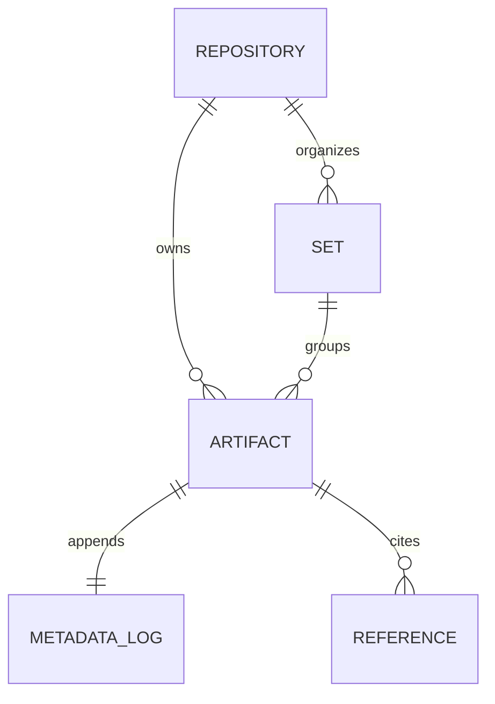
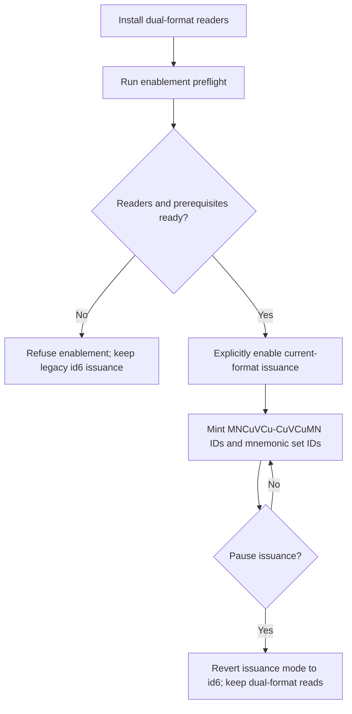

# Spec: Human-scannable artifact identifiers and mnemonic set IDs

- Id: 2aqq1c
- Status: to-review
- Short-Description: Define the MNCuVCu-CuVCuMN artifact ID format and mnemonic set ID contract while preserving legacy six-character IDs.
- Author: antigravity

> Write and proofread this spec per the technical writing standard, `.aw/system/workflows/technical-writing/technical-writing.md` (`.agents/workflows/technical-writing/technical-writing.md` in a legacy-layout install), including requirement 12 (diagrams).

## Workflow history

- 2026-11-28 to-review (aw specs): Ready for spec review
- 2026-11-28 created (aw specs): Define the MNCuVCu-CuVCuMN artifact ID format and mnemonic set ID contract while preserving legacy six-character IDs.

## Purpose

Agent Workflows uses stable artifact identifiers across filenames, metadata logs, citations, dependencies, reviews, and CLI selectors. Current six-character base36 identifiers (`[0-9a-z]{6}`) are hard to scan and hold in short-term memory, and standalone specs and graduated backlog plans frequently copy a random artifact ID into the `<setid>` slot.

This specification defines two reinforcing contracts for newly authored artifacts while preserving every previously issued artifact identifier and legacy filename:

1. A human-scannable artifact identifier format (`MNCuVCu-CuVCuMN`, for example `43bim-tox82`) that frames two pronounceable letter triplets between two-digit numbers and separates them with a literal hyphen.
2. A mnemonic `<setid>` contract that requires newly created sets, standalone specs, and graduated plans to use a short, letter-first human-readable topic slug (for example `metastore`, `artifact-ids`, or `installmore`) and never an artifact identifier or random token.

## Scope

This specification governs stable artifact identifiers and `<setid>` values across tracked `.aw/records/` trees (plans, specifications, backlog items, research reports, prompts, reviews, releases, walkthroughs, and roadmaps), CLI lookup and creation commands, filename parsing, metadata storage, validation checks, and repository rollout.

Run IDs, attempt IDs, session IDs, Git commit hashes, and artifact-local checklist/question IDs (`E-01`, `V-01`, `OQ-01`) retain their own contracts and are excluded. Bulk rekeying of existing artifacts is excluded.

## Entity model



## Requirements

### R1. Canonical artifact identifier forms

Agent Workflows must recognize two canonical artifact identifier forms:

| Form | Use | Pattern |
| --- | --- | --- |
| Current (`id10`) | Newly issued artifact identifiers when enabled | `MNCuVCu-CuVCuMN` |
| Legacy (`id6`) | Existing and imported six-character artifact identifiers | `[0-9a-z]{6}` |

In the current format:

- `M` must be an ASCII digit in `1-9` (preventing leading zeros `00` through `09`).
- `N` must be an ASCII digit in `0-9`.
- `Cu` must be a lowercase ASCII consonant excluding `l` (`bcdfghjkmnpqrstvwxyz`, 20 characters).
- `V` must be a lowercase ASCII vowel (`aeiou`, 5 characters).
- The separator must be one ASCII hyphen-minus (`-`, U+002D) between the two five-character halves.
- The resulting identifier has 10 alphanumeric characters, 11 display characters, and 32,400,000,000 possible values (`90 * 2000 * 2000 * 90`, about 14.88 times the base36 six-character keyspace).

Canonical validators must enforce exact ASCII, case-sensitive whole-string matching against these pattern bodies:

```regex
\A[1-9][0-9][b-df-hj-kmnp-tv-z][aeiou][b-df-hj-kmnp-tv-z]-[b-df-hj-kmnp-tv-z][aeiou][b-df-hj-kmnp-tv-z][1-9][0-9]\Z
\A[0-9a-z]{6}\Z
```

Agent Workflows must maintain one authoritative format definition in `agent_workflows/artifact_core.py` and import it everywhere instead of duplicating regex literals. Existing persisted and wire compatibility keys (such as `id6` or `target_id6`) must remain readable and may carry either canonical form once dual-format readers are in place.

### R2. Mnemonic set identifier contract

Every newly created `<setid>` (including standalone specs created by `aw specs new`, plans scaffolded by `aw ipd scaffold`, and plans graduated from backlog items) must satisfy all of the following rules:

1. **Letter-first mnemonic syntax**: a new `<setid>` must start with a lowercase ASCII letter and contain only lowercase ASCII letters, digits, and single internal hyphens (`\A[a-z](?:[a-z0-9]|-(?=[a-z0-9]))*\Z`).
2. **Length limits**: preferred length is 2 to 14 characters; lengths 15 to 24 warn (`check.setid-length-warn`); lengths over 24 are refused (`check.setid-length-error`).
3. **No artifact ID in `<setid>`**: producers and validators must refuse any new `<setid>` that equals the artifact's own identifier, matches the current `MNCuVCu-CuVCuMN` format, or matches a repository artifact's issued identifier.
4. **Standalone specs and single-item graduations**: `aw specs new` must accept an explicit `--set <mnemonic>` or derive a short readable mnemonic from `--slug` / `--title` rather than repeating the spec's minted artifact ID in the filename `<setid>` slot. Backlog graduation must likewise assign a readable mnemonic `<setid>` rather than copying the backlog item's random artifact ID.
5. **Syntactic disjointness**: because every current-format artifact ID begins with two digits (`10`-`99`) and every new `<setid>` begins with a letter (`a`-`z`), newly minted artifact IDs and newly created set IDs can never collide syntactically.
6. **Legacy grandfathering**: existing artifacts predating the repository's mnemonic-setid cutover whose `<setid>` is a legacy six-character ID remain valid on read, rename, and check.

### R3. Allocation, uniqueness, and concurrency

1. New current-format IDs must be drawn uniformly from the full `MNCuVCu-CuVCuMN` alphabet using `secrets.choice` (with an injectable RNG parameter for deterministic unit testing).
2. Allocation must check the candidate against the repository-wide occupied ID inventory, including live, terminal (`executed`, `done`, `implemented`, `shipped`), superseded, parked, and archived artifacts.
3. Allocation and record creation must run inside the repository's existing write/integration lock so concurrent writers in worktrees of the same repository cannot publish duplicate IDs.
4. On collision, the allocator must retry with a fresh candidate up to its retry budget; if exhausted, it must fail explicitly without modifying existing records or history.
5. An interrupted creation or retry must leave at most one committed artifact and must not orphan a claimed ID.

### R4. Lookup, normalization, and free-text extraction

1. **Explicit ID lookup** (CLI selectors, ID-specific flags, and direct lookup APIs): must accept both canonical forms, trim surrounding ASCII whitespace, fold ASCII uppercase to lowercase, and accept the compact 10-character spelling of the current form (`43bimtox82` -> `43bim-tox82`) by inserting a hyphen after character 5 and validating against the current pattern. Misplaced hyphens, extra hyphens, non-ASCII characters, internal whitespace, and trailing punctuation must be rejected.
2. **Canonical serialization**: all written records, filenames, typed references (`Item-Dependencies`, `From-Spec`, `From-Backlog`), metadata logs, JSON outputs, and copied IDs must use lowercase canonical form with the literal hyphen preserved for current-format IDs.
3. **Free-text extraction**: free-text reference extractors must require the literal hyphen for current-format IDs so unbroken 10-character hexadecimal strings never false-match. Boundary detection must use ASCII token boundaries that do not consume shared delimiters (such as commas in `43bim-tox82, 10pev-diw99`). Every extracted shape match must still be resolved against the repository inventory before acting on it.
4. **Filename parsing**: `agent_workflows/artifact_naming.py` (`parse_clustered` and related helpers) must capture the full `MNCuVCu-CuVCuMN` token (including its internal hyphen) as the single identity field alongside hyphenated `<setid>` values (for example `20261127-artifact-ids-01-43bim-tox82-sample-slug.ipd.md` yields `set_id="artifact-ids"`, `order="01"`, `id="43bim-tox82"`, `slug="sample-slug"`, `facet="ipd"`).

### R5. Storage, history, and backwards compatibility

1. Every artifact must carry its single canonical ID in its metadata (`- Id:` / YAML `id:` / prompt comment), filename identity slot, and metadata log path under the repository metadata store.
2. Existing six-character IDs, filenames, typed references, and append-only history bytes must remain unchanged across rollout, moves, status transitions, and index rebuilds.
3. Review filenames that embed a subject artifact's ID must accept and resolve both legacy six-character IDs and current `MNCuVCu-CuVCuMN` IDs.

### R6. Phased opt-in rollout and pause safety



1. Dual-format readers must ship before current-format issuance can be enabled.
2. Current-format issuance must be opt-in per repository via explicit configuration or an explicit migration apply step (never flipped silently by bare `aw migrate`).
3. Preflight must verify reader/writer readiness, report planned changes, and refuse stale previews or unsupported environments.
4. Pausing or disabling current-format issuance after one or more current-format IDs exist must keep all already-issued current-format artifacts readable, checkable, and resolvable.

## Acceptance criteria

| Criterion | Verifiable evidence |
| --- | --- |
| AC-1. Canonical validation | Validators accept `43bim-tox82`, `10pev-diw99`, `99mu2h`, `000000`, and `abcdef`, and reject `03bim-tox82`, `43lim-tox82`, `43bim-tox02`, `43BIM-TOX82`, `43bimtox82`, non-ASCII digits/hyphens, and trailing newlines. |
| AC-2. Lookup vs. free-text extraction | Direct lookup normalizes `43BIMTOX82` and `43bim-tox82` to the same artifact. Free-text extraction finds both IDs in `43bim-tox82, 10pev-diw99` and ignores unbroken 10-char hex `43badcab82`. |
| AC-3. Filename parsing | `parse_clustered` parses `20261127-artifact-ids-01-43bim-tox82-scan.ipd.md` into `set_id="artifact-ids"`, `order="01"`, `id="43bim-tox82"`, `slug="scan"`, `facet="ipd"` while preserving 100% of existing repository filenames. |
| AC-4. Mnemonic set IDs | `aw specs new` and `aw ipd scaffold` produce letter-first mnemonic set IDs and reject any new `<setid>` matching an artifact ID or repeating the artifact's own ID, while legacy pre-cutover ID-shaped set IDs still pass `aw check`. |
| AC-5. Allocation & concurrency | Forced collision against a terminal/archived ID retries cleanly; two concurrent worktree writers seeded with the same initial candidate cannot both publish it; retries after interruption leave at most one artifact. |
| AC-6. Opt-in enablement & pause | Mixed-format repository rehearsal demonstrates preflight refusal when prerequisites fail, explicit enablement, dual-format `aw find`/`aw check`/`aw attention`/index rebuild, and pausing issuance without breaking reads of issued current-format IDs. |
